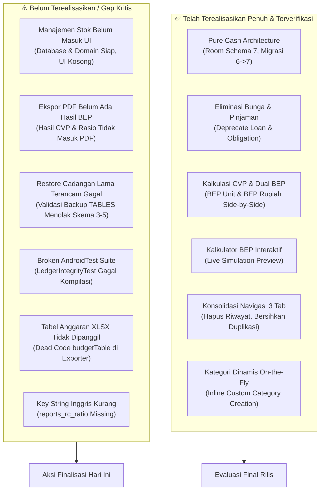

# Laporan Audit Menyeluruh & Status Kesiapan Rilis Final "Mankeu"

> **Dokumen riwayat.** Laporan audit 2026-10-20. Temuannya ditindaklanjuti lewat DEC-011 s.d. DEC-019; beberapa fitur yang dibahas di sini (kalkulator asumsi, pembalikan transaksi) sudah tidak ada. Keadaan sekarang (Room schema 11): `README.md`, `docs/DOMAIN_MODEL.md`, `docs/V1_IMPLEMENTATION_SPEC.md`, `docs/diagrams/`, dan keputusan di `logs/DECISION_LOG.md`.

> **Status Dokumen**: Evaluasi Menyeluruh Kesiapan Final (Whole-Codebase Audit)  
> **Tanggal Audit**: 20 Oktober 2026  
> **Target Release**: Finalisasi Aplikasi (Production Ready MVP UMKM)  
> **Klasifikasi Temuan**: *Verified* (Berdasarkan pembacaan kode riil dan eksekusi test suite)

---

## Ringkasan Eksekutif

Aplikasi **Mankeu** telah mengalami restrukturisasi besar dari aplikasi keuangan pertanian generik menjadi **aplikasi keuangan UMKM berbasis kas murni (*Pure Cash*) dengan kalkulator titik impas (*Cost-Volume-Profit / CVP*) standar akademik**.

Perubahan mendasar telah berhasil diterapkan pada data layer, domain layer, dan presentation layer. Namun, audit menyeluruh terhadap seluruh logika, alur transaksi, dan intuisi pengguna menemukan sejumlah **komponen penting yang belum terealisasikan secara tuntas (setengah jalan)**, **regresi kompatibilitas pemulihan cadangan lama**, serta **kerusakan kompilasi pada suite pengujian instrumentasi (`androidTest`)** yang wajib diselesaikan agar aplikasi benar-benar siap dinyatakan *final*.



---

## 1. Perubahan yang Telah Terjadi (Completed Realizations)

Setiap perubahan di bawah ini telah terverifikasi (*verified*) secara langsung pada kode sumber dan lolos uji unit otomatis:

### A. Transformasi Arsitektur Kas Murni (*Pure Cash Architecture*)
1. **Pembersihan Konsep Utang, Pinjaman, dan Bunga (`[DEC-006]`)**:
   - Kolom pinjaman dan bunga (`loanAmountRupiah`, `interestRateBasisPoints`, `loanDisbursementEpochDay`, `loanPaymentEpochDay`) dihapus dari model domain `AnalysisAssumptions` dan entitas Room `scenario_assumptions`.
   - Menghapus beban mental pencatatan utang-piutang (*AR/AP*) yang tidak relevan bagi UMKM mikro.
2. **Migrasi Database Non-Destruktif Versi 7 (`MIGRATION_6_7`)**:
   - Menghapus tabel Room `obligations` dan `settlements`.
   - Mengalihkan seluruh pencatatan transaksi harian ke 5 jenis transaksi kas murni: `CASH_INCOME`, `CASH_EXPENSE`, `OWNER_CAPITAL`, `OWNER_DRAWING`, dan `ASSET_PURCHASE_CASH`.
   - File skema database `6.json` dan `7.json` diekspor secara formal untuk verifikasi skema kompilasi Room.

### B. Kalkulasi Titik Impas (BEP) dan Rasio Kelayakan Bisnis (`[DEC-007]`, `[DEC-009]`)
1. **Implementasi Formula CVP Standar Akademik**:
   - Margin Kontribusi Satuan:
     $$CM = P - VC$$
   - Rasio Margin Kontribusi:
     $$CMR = \frac{CM}{P} = \frac{P - VC}{P}$$
   - Titik Impas Satuan (BEP Unit):
     $$BEP_{\text{unit}} = \frac{FC}{CM} = \frac{FC}{P - VC}$$
   - Titik Impas Omzet Rupiah (BEP Rupiah):
     $$BEP_{\text{rupiah}} = \frac{FC}{CMR} = BEP_{\text{unit}} \times P$$
   - Revenue-Cost Ratio ($R/C$ Ratio, ambang batas $\ge 1,00$) dan Benefit-Cost Ratio ($B/C$ Ratio, ambang batas $\ge 0,00$).
2. **Penyajian Metrik BEP Ganda Berdampingan**:
   - Di `FeasibilityCard.kt`, BEP disajikan dalam dua kartu berdampingan: **BEP Volume (Unit)** dan **BEP Nilai (Uang Rupiah)**.
   - BEP tidak lagi disembunyikan jika pengguna belum menentukan target penjualan volume; BEP langsung muncul seketika harga jual ($P$), biaya variabel ($VC$), dan biaya tetap ($FC$) diketahui.
   - Meteran progres interaktif `Target Penjualan vs BEP` otomatis muncul apabila target penjualan diisi.
3. **Kalkulator BEP Interaktif (*Live Calculation Preview*)**:
   - Tab 2 di `ReportsScreen.kt` dinamai **"Kelayakan & BEP"**.
   - Tombol pemicu diubah menjadi `[ 🧮 Kalkulator & Parameter BEP ]`.
   - Bottom sheet kalkulator dilengkapi kartu pratinjau langsung di bagian atas: nilai BEP Unit, BEP Rupiah, dan Margin Kontribusi Satuan (%) dihitung dan diperbarui secara instan saat pengguna mengetik angka di form input.
   - Input dikelompokkan logis: (1) Parameter Utama BEP, dan (2) Kas & Modal Usaha.
4. **Verifikasi Kasus Riil UMKM**:
   - Benchmark Kedai Kopi & Teh Susu Berkah ($P=\text{Rp10.000}$, $VC=\text{Rp5.000}$, $FC=\text{Rp2.000.000}$, $Q=700$ cup) terbukti menghasilkan $BEP = 400$ cup dan $BEP = \text{Rp4.000.000}$ secara akurat pada unit test `BusinessAnalysisTest.kt`.
   - Penanganan margin rugi ($P \le VC$) mengembalikan `null` dengan aman tanpa terjadi crash atau pembagian nol.

### C. Perampingan Navigasi & Eliminasi Redundansi UI/UX (`[DEC-008]`)
1. **Konsolidasi 3 Tab Utama**:
   - Menghapus tab `Riwayat` dan menghapus file `LedgerScreen.kt`.
   - Bottom navigation Material 3 kini murni 3 tab: `Beranda` (Home), `Catatan` (Entry), dan `Laporan` (Reports).
2. **Pembersihan Total Duplikasi Catatan di Beranda**:
   - Blok transaksi terakhir (`home_recent`, `EventCard`, `EmptyCard`, tombol lihat semua) dihapus dari `HomeScreen.kt`.
   - Beranda kini fokus penuh pada ringkasan saldo kas (*Hero Card* interaktif yang bisa diklik menuju Laporan), 4 metrik kas utama, diagram donat distribusi biaya, dan notifikasi impor.
3. **Pembersihan Duplikasi Kartu Metrik di Laporan**:
   - Grid 4 kartu metrik (`SimpleMetricGrid`) dihapus dari tab Laporan Keuangan di `ReportsScreen.kt`, sehingga Laporan langsung menyajikan Laporan Laba Rugi, Laporan Arus Kas, dan Grafik Arus Kas Bulanan tanpa mengulang tampilan Beranda.
4. **Optimalisasi Tab Catatan (`EntryScreen.kt`)**:
   - Menghapus tombol statis raksasa "Uang Masuk" dan "Uang Keluar" yang menyita layar.
   - Menghapus dropdown "Jenis lain".
   - Mengintegrasikan buku kas lengkap dengan pencarian real-time, chip filter (`Semua`, `Uang Masuk`, `Uang Keluar`), tombol balik (*undo*), dan hapus.
   - Form pencatatan transaksi kini dibuka melalui FAB (+) atau kartu kosong (*empty state*), dengan `SingleChoiceSegmentedButtonRow` di bagian paling atas sheet untuk mengganti arah uang masuk/keluar secara instan.
   - Mendukung penambahan kategori biaya baru secara langsung (*on-the-fly*) dari dropdown kategori.
5. **Infrastruktur Emulator Interaktif**:
   - Script `run_emulator.bat` dikonfigurasi menggunakan Windows Task Scheduler (`schtasks /it`) agar emulator Android selalu muncul interaktif di desktop pengguna (bukan headless di background).
6. **Kerapian Direktori Repositori**:
   - File simulasi verifikasi `simulasi_kelayakan_umkm_verifikasi.xlsx` yang sebelumnya berserak di root telah dipindahkan ke direktori semestinya (`docs/evidence/verification-workbook/`), dengan penyesuaian otomatis pada `VerificationWorkbookTest.kt` dan `scripts/generate_verification_workbook.py` sehingga seluruh unit test tetap lolos 100%.

---

## 2. Apa yang Belum Terealisasikan & Celah Kritis (Pending / Gaps)

Meskipun fondasi di atas sudah teruji, audit menyeluruh menemukan celah fungsional dan teknis yang belum terselesaikan:

### A. Fitur Manajemen Stok Masih Berstatus "Backend-Only" (Belum Ada UI)
- **Kondisi Riil**:
  - Di domain & data layer, entitas `StockItemEntity`, `StockMovementEntity`, DAO `StockDao`, `RecordStockMovementUseCase`, `GetStockSummaryUseCase`, dan formula alur stok telah ditulis lengkap dan lolos uji di `StockManagementTest.kt`.
- **Kesenjangan (Gap)**:
  - **Sama sekali belum terhubung ke antarmuka pengguna (UI)**. Tidak ada layar, tab, sheet, atau kartu di `HomeScreen`, `EntryScreen`, maupun `ReportsScreen` yang memanggil `stockDao` atau menampilkan data stok barang, barang masuk/keluar, nilai persediaan, maupun peringatan stok menipis (*low stock alert*).
  - Di dokumen `paket_audit_agentic_ai_mankeu.md`, manajemen stok minimal adalah **permintaan eksplisit dari dosen penilai**. Jika diserahkan tanpa UI, modul stok ini akan dinilai belum terwujud.

### B. Hasil Perhitungan BEP Belum Masuk ke Dokumen Ekspor PDF
- **Kondisi Riil**:
  - `FinancePdfExporter.kt` mengekspor Ringkasan Kas, Anggaran, Transaksi, dan Asumsi input (FC, VC, Output, Harga).
- **Kesenjangan (Gap)**:
  - **Hasil kalkulasi BEP (BEP Unit, BEP Rupiah, R/C Ratio, B/C Ratio, Status Kelayakan) TIDAK dicetak di PDF**.
  - Padahal pada `FinanceWorkbookExporter.kt` (Excel), sheet *"Asumsi dan Kelayakan"* menyertakan seluruh metrik CVP tersebut secara detail. Dokumen PDF laporan cetak saat ini tidak memuat kesimpulan titik impas.

### C. Dead Code di Ekspor Excel: `budgetTable` Tidak Dipanggil
- **Kondisi Riil**:
  - Di baris 77 `FinanceWorkbookExporter.kt`, terdapat fungsi privat `budgetTable` untuk menyusun sheet *"Anggaran Rencana / Realisasi"*.
- **Kesenjangan (Gap)**:
  - Fungsi ini **tidak pernah dimasukkan ke dalam daftar `tables`** pada fungsi `export()`:
    ```kotlin
    val tables = buildList {
        add(metadata(bundle))
        BookMode.entries.forEach { mode ->
            booksByMode[mode]?.let { book ->
                add(transactionTable(mode, book)) // Hanya transaksi!
            }
        }
        add(reportTable(bundle.books))
        add(comparisonTable(booksByMode))
        add(assumptionTable(bundle.books))
        add(importAuditTable(bundle))
    }
    ```
  - Akibatnya, file Excel hasil ekspor kehilangan sheet rincian anggaran (RAB) yang direncanakan.

### D. Bahaya Validasi Pemulihan Cadangan Lama (*Restore Compatibility Risk*)
- **Kondisi Riil**:
  - Pada `EncryptedBackupManager.kt`, konstanta `TABLES` kini berisi 14 tabel (termasuk `stock_items` dan `stock_movements`).
  - Baris 299 menyatakan:
    ```kotlin
    require(names.containsAll(TABLES) && (snapshot.schemaVersion < current || names.size == TABLES.size))
    ```
- **Kesenjangan (Gap)**:
  - Jika seorang pengguna memulihkan file backup terenkripsi (`.aabk`) dari aplikasi versi sebelumnya (v0.0.4, v0.0.5, atau v0.0.6 yang menggunakan skema 3, 4, atau 5), file cadangan tersebut **TIDAK memiliki tabel `stock_items` dan `stock_movements`**.
  - Pengecekan `names.containsAll(TABLES)` akan menghasilkan **FALSE** dan aplikasi melempar `IllegalArgumentException: "Daftar tabel cadangan tidak lengkap atau tidak dikenali"`.
  - Hal ini melanggar kontrak `OLDEST_RESTORABLE_SCHEMA = 3` dan menyebabkan pengguna lama gagal memulihkan data penting mereka ke versi final.

### E. Kerusakan Kompilasi Pengujian Instrumentasi (`androidTest`)
- **Kondisi Riil**:
  - Menjalankan `./gradlew compileDebugAndroidTestSources` menghasilkan error kompilasi fatal pada `LedgerIntegrityTest.kt`:
    ```text
    e: file:///.../LedgerIntegrityTest.kt:225:13 Unresolved reference 'getObligationBalances'.
    e: file:///.../LedgerIntegrityTest.kt:237:13 Unresolved reference 'getObligationBalances'.
    ```
- **Kesenjangan (Gap)**:
  - Tes integritas transaksi ini masih mencoba menguji alur pelunasan utang/piutang yang telah dihapus pada skema 7. Tes ini harus diperbarui agar suite pengujian instrumentasi Android bersih dan lolos verifikasi build CI/CD.

### F. Ketiadaan Terjemahan Kunci String Bahasa Inggris
- **Kondisi Riil**:
  - File `values/strings.xml` baris 175 memiliki:
    ```xml
    <string name="reports_rc_ratio">Rasio Penerimaan atas Biaya (R/C Ratio): %1$s</string>
    ```
- **Kesenjangan (Gap)**:
  - Kunci `reports_rc_ratio` **hilang dari `values-en/strings.xml`**. Jika pengguna menggunakan perangkat berbahasa Inggris, teks ini akan jatuh kembali (*fallback*) ke bahasa Indonesia.

### G. Sisa Kode Basi (*Dead Stubs*) yang Perlu Dibersihkan
- Di `FinanceRepository.kt`, fungsi `obligations(bookId)` dan `obligationBalances(bookId)` mengembalikan `flowOf(emptyList())`.
- Di `AppUiState.kt`, field `val obligations: List<ObligationView> = emptyList()` masih dipertahankan.
- Di `ReportsScreen.kt`, parameter `onSettle: ((String, Long, LocalDate, String) -> Unit)? = null` masih terpasang di tanda tangan fungsi namun tidak lagi digunakan.

---

## 3. Matriks Audit Teknis Menyeluruh

| Komponen / Modul | Status Implementasi | Status Verifikasi | Temuan / Catatan Khusus |
| :--- | :---: | :---: | :--- |
| **Room Database (v7)** | ✅ Selesai | Verified | `MIGRATION_6_7` berhasil menghapus `obligations` dan `settlements`. Schemas 6 & 7 tervalidasi. |
| **Domain CVP & BEP** | ✅ Selesai | Verified | Formula BEP Unit, BEP Rupiah, R/C, B/C akurat. 100% lolos unit test Kedai Kopi Berkah. |
| **Navigasi 3 Tab** | ✅ Selesai | Verified | `Riwayat` dihapus. `Beranda`, `Catatan`, `Laporan` tersusun rapi tanpa konflik bottom bar. |
| **Redundansi Beranda** | ✅ Selesai | Verified | Daftar transaksi duplikat di Beranda berhasil dihapus total. |
| **Redundansi Laporan** | ✅ Selesai | Verified | Duplikasi 4 kartu metrik Beranda berhasil dibersihkan dari Laporan. |
| **Input Catatan (Sheet)** | ✅ Selesai | Verified | Segmented switcher Masuk/Keluar, kategori dinamis, dan validasi seketika berjalan mulus. |
| **Kalkulator BEP Dialog** | ✅ Selesai | Verified | Live preview card menghitung BEP Unit & Rupiah secara real-time saat mengetik. |
| **Manajemen Stok (UI)** | ❌ **Belum Ada** | **Gap Kritis** | Database & UseCase siap di domain, tetapi belum ada tampilan UI sama sekali. |
| **Ekspor PDF Laporan** | ⚠️ Setengah Jadi | Gap Fungsional | Tidak menyertakan hasil BEP Unit, BEP Rupiah, dan Rasio Kelayakan di berkas PDF. |
| **Ekspor Excel (XLSX)** | ⚠️ Minor Defect | Gap Fungsional | `budgetTable` ada di kode tetapi lupa dimasukkan ke daftar tabel ekspor. |
| **Pemulihan Cadangan** | ⚠️ Rawan Crash | Gap Kompatibilitas | `require(names.containsAll(TABLES))` menolak berkas backup dari skema 3, 4, dan 5. |
| **Unit Test Suite** | ✅ Lolos 100% | Verified | 34 tasks lolos di `./gradlew testDebugUnitTest`. |
| **AndroidTest Suite** | ❌ **Gagal Build** | **Gap Kritis** | `LedgerIntegrityTest.kt` gagal kompilasi karena referensi method utang/piutang yang telah dihapus. |
| **Lokalisasi (Strings)** | ⚠️ Minor Defect | Verified | Kunci `reports_rc_ratio` belum ada di `values-en/strings.xml`. |
| **Kerapian Root Direktori** | ✅ Bersih | Verified | `simulasi_kelayakan_umkm_verifikasi.xlsx` dipindahkan ke `docs/evidence/verification-workbook/`. |
| **Dokumentasi `docs/`** | ⚠️ Belum Sinkron | Perlu Update | Dokumen di `docs/` masih mencatat Skema 5 (v0.0.6), belum mencatat Skema 7 & Pure Cash. |

---

## 4. Kesimpulan Kesiapan Rilis

Fondasi inti keuangan UMKM (Pencatatan kas murni, laporan laba rugi, arus kas, BEP ganda, dan kalkulator interaktif) telah berfungsi dengan sangat baik dan stabil.

Untuk menyelesaikan rilis final hari ini, silakan rujuk:
1. Checklist eksekusi teknis pada [`TODO_RELEASE_CHECKLIST.md`](./TODO_RELEASE_CHECKLIST.md)
2. Master prompt serah terima pekerjaan pada [`HANDOFF_PROMPT.md`](./HANDOFF_PROMPT.md)
