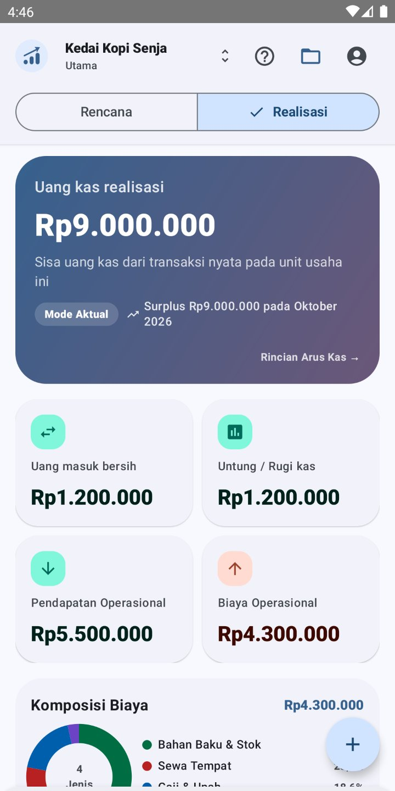
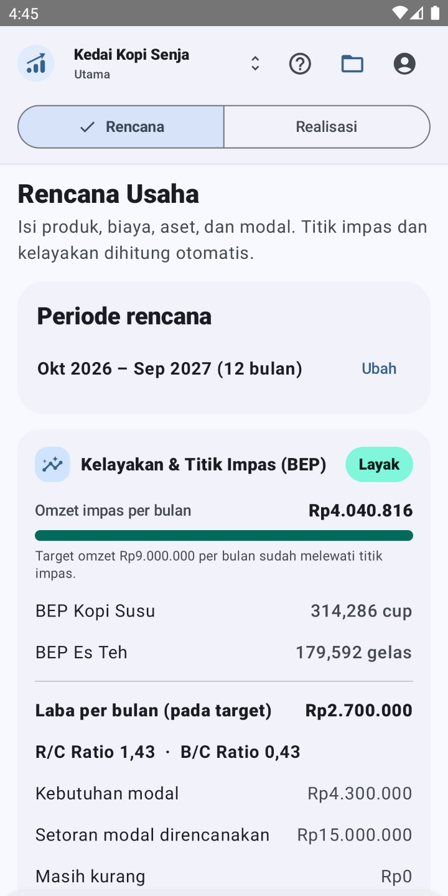
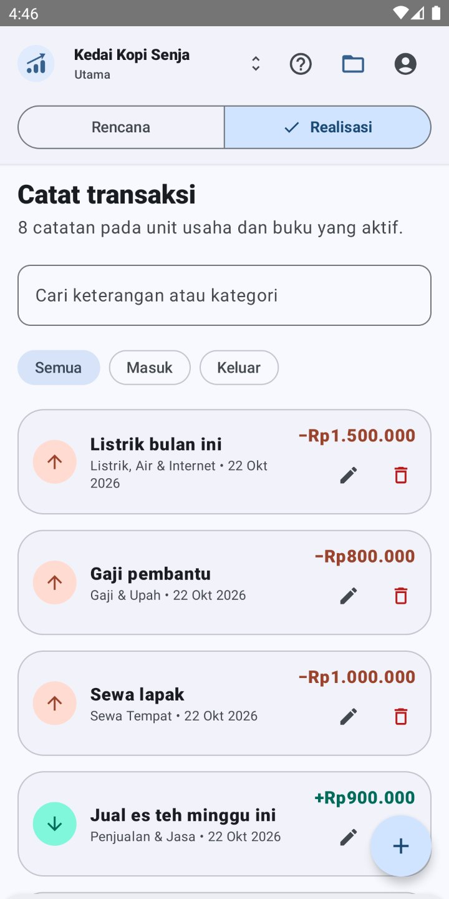
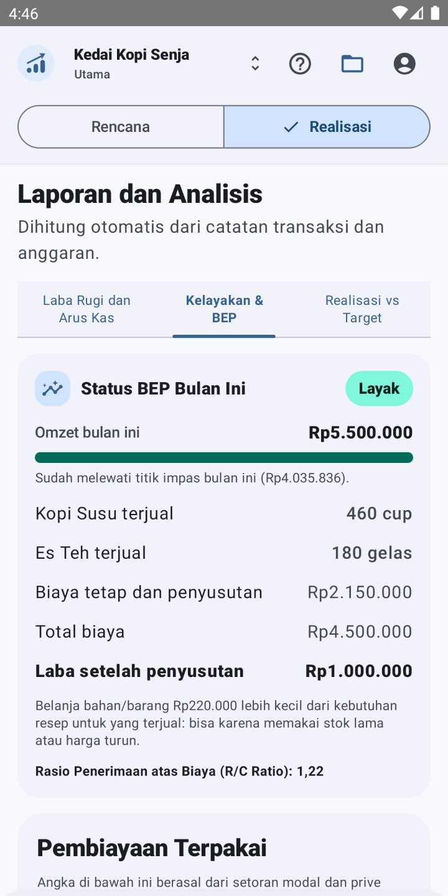
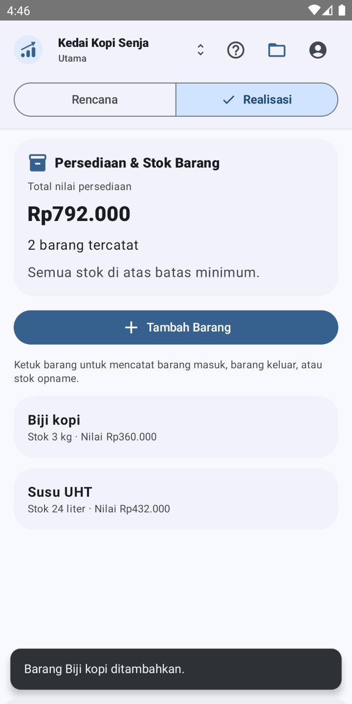
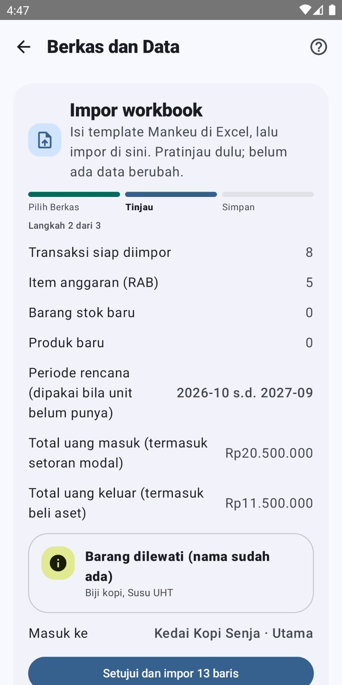
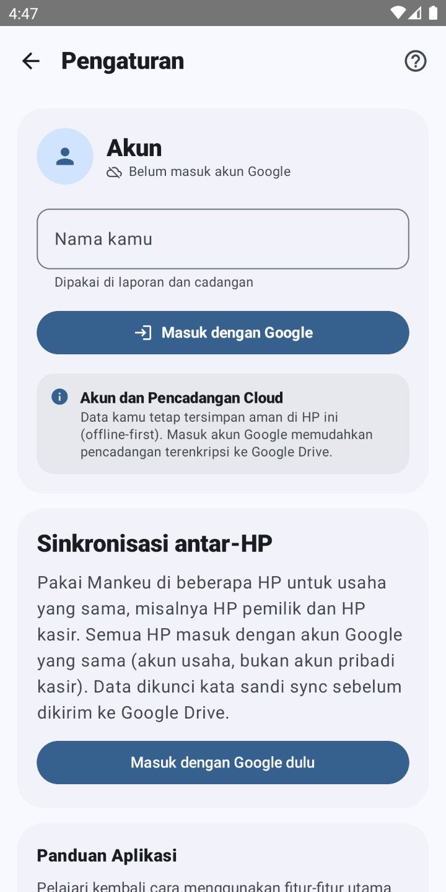
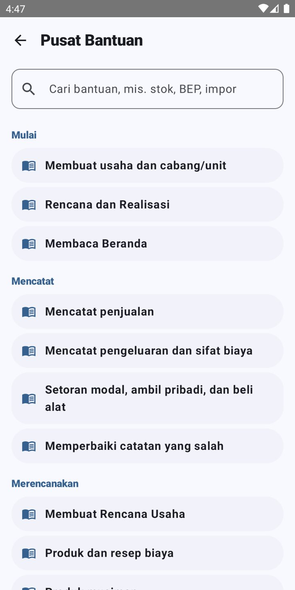

<p align="center">
  
</p>

<h1 align="center">Mankeu</h1>

<p align="center">
  <strong>Buku kas dan rencana usaha untuk UMKM. Offline, privat, dan dibuat untuk pemilik usaha, bukan akuntan.</strong>
</p>

<p align="center">
  <a href="https://github.com/adsurkasur/Mankeu/actions/workflows/android.yml"></a>
  <a href="https://github.com/adsurkasur/Mankeu/releases"></a>
  
  
  <a href="./LICENSE"></a>
</p>

---

## Tentang

Mankeu membantu pemilik usaha mikro, kecil, dan menengah menjawab tiga pertanyaan sehari-hari:
**berapa uang yang ada, apakah usaha ini untung, dan kapan balik modal.** Aplikasi mencatat uang
masuk dan keluar, menyusun rencana usaha lengkap dengan titik impas, dan membandingkan rencana itu
dengan kenyataan.

- **Offline dan privat.** Semua data tersimpan di HP. Tidak perlu login, tidak ada iklan, tidak ada
  pelacak, dan tidak ada server milik pengembang.
- **Dua buku per unit usaha.** *Rencana* berisi rencana usaha; *Realisasi* berisi uang yang benar-benar
  berpindah. Keduanya terpisah dan dibandingkan di Laporan.
- **Untuk pengguna awam.** Satu formulir untuk memulai, kategori terpilih otomatis, keterangan boleh
  kosong, dan penjelasan langsung di layar saat angka terlihat mengkhawatirkan.
- **Uang dihitung tepat.** Semua nominal disimpan sebagai rupiah bulat, tanpa pembulatan desimal.

## Tampilan

<table>
  <tr>
    <td align="center"><br /><sub><b>Beranda</b><br />Kas, untung/rugi, komposisi biaya</sub></td>
    <td align="center"><br /><sub><b>Rencana Usaha</b><br />Kelayakan, BEP, kebutuhan modal</sub></td>
    <td align="center"><br /><sub><b>Catatan</b><br />Ubah dan hapus langsung</sub></td>
    <td align="center"><br /><sub><b>Laporan</b><br />Status BEP bulan ini</sub></td>
  </tr>
  <tr>
    <td align="center"><br /><sub><b>Stok</b><br />Per unit atau dipakai bersama</sub></td>
    <td align="center"><br /><sub><b>Impor Excel</b><br />Pratinjau sebelum disimpan</sub></td>
    <td align="center"><br /><sub><b>Sinkronisasi</b><br />Beberapa HP, satu buku</sub></td>
    <td align="center"><br /><sub><b>Pusat Bantuan</b><br />Artikel, cari, tunjukkan di aplikasi</sub></td>
  </tr>
</table>

## Fitur

### Pencatatan kas
- **Uang masuk dan uang keluar.** Kategori menentukan jenisnya: penjualan, biaya, setoran modal,
  ambil pribadi (prive), atau beli peralatan.
- **Ubah dan hapus.** Catatan yang salah diperbaiki di tempat; laporan selalu ikut seimbang.
- **Produk dan jumlah (opsional).** Penjualan dapat menyebut produk; nominal mengikuti jumlah × harga.
- **Kas murni.** Hanya uang yang benar-benar berpindah yang dicatat: tanpa piutang, utang, cicilan,
  atau bunga.

### Rencana usaha dan kelayakan
- Periode rencana, produk dengan resep biaya per unit, produk musiman, biaya tetap bulanan, biaya dan
  pemasukan sekali, aset dengan umur pakai, serta setoran modal.
- Titik impas gabungan (bauran penjualan) dan per produk, laba per bulan, R/C dan B/C, serta
  kebutuhan modal dari defisit kas terdalam.
- Status BEP bulan berjalan di buku Realisasi.

### Laporan
- Laba rugi dan arus kas (operasi, investasi, pendanaan) dengan grafik bulanan.
- Rincian kelayakan per bulan dan perbandingan Realisasi vs Target.
- Ekspor PDF untuk dicetak atau diarsipkan.

### Stok
- Barang milik satu unit atau dipakai bersama seluruh unit usaha.
- Barang masuk, keluar, dan opname, dengan peringatan stok menipis dan nilai persediaan.

### Data dan keamanan
- **Templat Excel Mankeu.** Templat kosong dan hasil ekspor memakai format yang sama, sehingga
  ekspor dapat diimpor kembali tanpa kehilangan data. Impor menampilkan pratinjau, unit tujuan, dan
  peringatan duplikat, dan dapat dibatalkan.
- **Cadangan terenkripsi.** AES-256-GCM dengan kunci dari kata sandi (PBKDF2-HMAC-SHA256, 310.000
  iterasi), disimpan sebagai berkas atau di folder aplikasi Google Drive pribadi.
- **Sinkronisasi antar-HP (opsional).** HP pemilik dan HP kasir memakai buku yang sama lewat Google
  Drive, terenkripsi ujung ke ujung dengan kata sandi sync. Berjalan otomatis; nama yang sama dari dua
  HP digabung dan diberitahukan.

### Bantuan
- Sapaan singkat saat pertama dibuka, panduan tiap halaman lewat tombol **?**, dan Pusat Bantuan
  dengan pencarian, langkah bernomor, dan tombol **Tunjukkan di aplikasi**.
- [Panduan penggunaan](docs/panduan/PANDUAN_PENGGUNAAN_MANKEU.md) untuk pemilik usaha, lengkap dengan
  gambar.

## Teknologi

| Bagian | Pilihan |
| :--- | :--- |
| Bahasa | Kotlin, coroutines dan `StateFlow` |
| Antarmuka | Jetpack Compose, Material 3 (tema terang dan gelap) |
| Data lokal | Room (SQLite), skema 12, semua migrasi diuji |
| Uang | Rupiah bulat (`Long`) di seluruh perhitungan dan penyimpanan |
| Excel | Pembaca dan penulis OOXML sendiri, tanpa Apache POI |
| Kriptografi | `javax.crypto` bawaan platform: PBKDF2-HMAC-SHA256, AES-256-GCM, Android Keystore |
| Cloud (opsional) | Google Drive REST API v3 (`appDataFolder`), Firebase Authentication |
| Build | Gradle, R8 untuk rilis, GitHub Actions |
## Membangun dari kode sumber

**Prasyarat:** JDK 17, Android SDK Platform 36.

```bash
./gradlew testDebugUnitTest      # unit test JVM
./gradlew lintDebug              # lint
./gradlew connectedDebugAndroidTest   # instrumented test (emulator/perangkat menyala)
./gradlew assembleDebug          # APK debug: app/build/outputs/apk/debug/
./gradlew bundleRelease          # AAB rilis (penandatanganan lewat variabel KEYSTORE_*)
```

Penandatanganan dan alur rilis Play Console dijelaskan di
[`docs/PLAY_STORE_DEPLOYMENT.md`](docs/PLAY_STORE_DEPLOYMENT.md).

## Kualitas

- **Test unit dan instrumented** untuk keseimbangan jurnal, rencana usaha dan BEP, stok, migrasi
  skema, cadangan terenkripsi, round-trip templat Excel, sinkronisasi dua HP, dan alur di ViewModel.
- **Simulasi skala UMKM**: setahun data usaha mikro, kecil, dan menengah diimpor lewat jalur Excel
  yang asli, dan setiap angka dicocokkan dengan hitungan independen
  ([bukti](docs/evidence/2026-10-22_simulasi_skala_umkm/)).
- **Audit pra-rilis** beserta uji sebagai pengguna awam dan mahir:
  [`docs/audit/2026-10-22_AUDIT_PRA_RILIS.md`](docs/audit/2026-10-22_AUDIT_PRA_RILIS.md).

Standar lengkapnya ada di [`docs/QUALITY_GATES.md`](docs/QUALITY_GATES.md).

## Dokumentasi

| Dokumen | Isi |
| :--- | :--- |
| [Panduan penggunaan](docs/panduan/PANDUAN_PENGGUNAAN_MANKEU.md) | Cara memakai Mankeu, langkah demi langkah |
| [Peta dokumentasi](docs/README.md) | Semua dokumen produk dan teknis |
| [Log keputusan](logs/DECISION_LOG.md) | Keputusan produk dan teknis (DEC-xxx) |
| [Changelog](logs/CHANGELOG.md) | Perubahan per versi |
| [Kebijakan privasi](docs/privacy-policy/id.md) | Data apa yang ada dan di mana disimpan |

## Status

Versi **0.1.0** disiapkan untuk rilis produksi pertama di Google Play. Versi sebelumnya (0.0.4–0.0.6)
beredar di jalur pengujian internal.

## Lisensi

Dirilis di bawah [GNU General Public License v3.0](./LICENSE).
Hak cipta © 2026 adsurkasur &lt;adsurkasur.dev@gmail.com&gt;.
