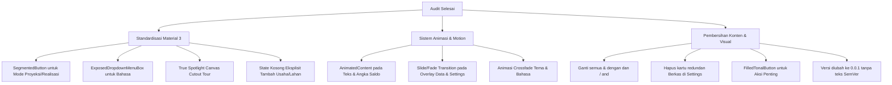

# Audit Komparatif Berbasis Bukti (Web vs Android Calculator), Analisis Masalah UI/UX, dan Rencana Standardisasi Industri

> **Dokumen riwayat.** Audit perbandingan dengan aplikasi web (2026-08). Mankeu sengaja tidak mengejar paritas fitur; piutang, pinjaman, dan importer referensi sudah dihapus. Keadaan sekarang (Room schema 11): `README.md`, `docs/DOMAIN_MODEL.md`, `docs/V1_IMPLEMENTATION_SPEC.md`, `docs/diagrams/`, dan keputusan di `logs/DECISION_LOG.md`.

Dokumen ini disusun sebagai audit manual berbasis bukti (*evidence-based*) yang membandingkan implementasi modul keuangan pada prototipe web (`E:\Managed Projects\Arina\arina-agri`) dengan aplikasi Android (`E:\Managed Projects\Arina\arina-agri-calculator`), merinci kelemahan UI/UX saat ini, dan merumuskan rencana standardisasi berbasis Material 3 dan Jetpack Compose.

---

## 1. Audit Komparatif Berbasis Bukti (Web vs Android)

Pemeriksaan dilakukan secara langsung terhadap struktur kode sumber modul keuangan web di `arina-agri/app/dashboard/keuangan/` dan controller terkait di `arina-agri/controllers/keuangan/`.

### A. Matriks Kemampuan Fungsional (Feature Matrix)

| Fitur / Modul | Implementasi Web (`arina-agri`) | Implementasi Android Saat Ini (`arina-agri-calculator`) | Status Paritas & Temuan Bukti |
| :--- | :--- | :--- | :--- |
| **Skenario / Mode Pembukuan** | Menggunakan `Tabs` (`PROJECTION` vs `REALIZATION`) di `FinanceProjectToolbar.tsx:149-171`. Setiap mode memiliki dataset terisolasi. | Menggunakan *Custom Pill Surface* di `ArinaCalculatorApp.kt:524-548` berbasis enum `BookMode`. Dataset terisolasi di Room DB. | **Setara secara logika**, namun antarmuka Android menggunakan komponen *custom* non-standar yang animasinya kaku. |
| **Manajemen Proyek / Lahan** | `Select` dropdown di `FinanceProjectToolbar.tsx:199-211` dengan aksi eksplisit: `Buat Proyek`, `Edit Proyek`, dan `Hapus Proyek`. Jika kosong, menampilkan `"Belum ada proyek"`. | `ChoiceMenu` di `ArinaCalculatorApp.kt:589-627` yang memuat otomatis placeholder `"Usaha Saya"` dan `"Umum"` dari `ensureStarterWorkspace()`. | **Web lebih intuitif** karena tidak memaksakan entitas default tanpa sepengetahuan pengguna dan menyediakan tombol aksi CRUD langsung di toolbar. |
| **Pencatatan Transaksi** | `TransactionEntryForm.tsx` dan `TransactionBatchDialog.tsx` dengan dukungan mutasi batch, detail input (volume, satuan, harga satuan), dan tautan ke item RAB (`RabTransactionLinkDialog.tsx`). | `EntryScreen.kt` dengan 4 tab jenis transaksi dan modal bottom sheet. Mendukung volume, satuan, harga satuan, dan link RAB. | **Setara fungsional**, namun Android belum memiliki transisi animasi form yang mulus saat membuka detail tambahan. |
| **Rencana Anggaran Biaya (RAB)** | `RabPlanningView.tsx` dan `RabItemDialog.tsx`. Pengelompokan kategori dengan kalkulasi subtotal. | `BudgetScreen.kt` dengan pengelompokan kategori otomatis dan subtotal per grup. | **Setara fungsional**. |
| **Laporan Laba Rugi & Arus Kas** | `FinanceIncomeStatementView.tsx` dan `FinanceCashFlowView.tsx`. Menampilkan pergerakan bulanan dan arus kas pasca pembiayaan. | `ReportsScreen.kt` (Tab `FINANCIALS` dan `FEASIBILITY`). Menampilkan pergerakan kas bulanan dari `MonthlyCashFlowCalculator.kt`. | **Setara fungsional**, kalkulasi keduanya mengikuti *golden fixture* `WB-BASE-001`. |
| **Analisis Kelayakan & Modal Kerja** | `FinanceFinancingView.tsx`, `FinancingAssumptionsDialog.tsx`, `ProductionSalesAssumptionsDialog.tsx`. Menghitung BEP, HPP, B/C Ratio, dan Defisit Puncak. | `BusinessAnalysisCalculator.kt` dan `ReportsScreen.kt`. Menghitung BEP, HPP, B/C Ratio, dan Defisit Kumulatif Puncak. | **Setara fungsional**, formula perhitungan identik. |
| **Impor & Ekspor Excel** | `RabImportDialog.tsx` dan `FinanceProjectToolbar.tsx:259-267`. Mendukung file `.xlsx` dengan 5 sheet. | `FinanceWorkbookExporter.kt` dan `WorkbookImporter.kt` via `DataScreen` (overlay). | **Setara teknis**, namun di Android penempatan tombol akses impor/ekspor sempat hilang dari layar utama. |
| **Panduan Interaktif (Onboarding/Tour)** | Menggunakan `GuideProvider` berbasis `data-guide-target` yang menyorot elemen UI aktual dengan popover konteks. | Menggunakan modal dialog statis di tengah layar (`SpotlightTour.kt`), **bukan spotlight aktual** yang melubangi layar (*cutout*) pada target komponen. | **Android inferior**. Perlu dibuat spotlight canvas sejati. |

---

## 2. Identifikasi Masalah Utama Versi Android Saat Ini

Berdasarkan pengujian langsung dan masukan pengguna, ditemukan sejumlah kelemahan UI/UX, inkonsistensi standar, dan masalah visual:

### A. Penggunaan Komponen "Custom/Hand-rolled" alih-alih Standar Industri
1. **Mode Switcher (Proyeksi vs Realisasi):**
   - *Masalah:* Dibuat menggunakan susunan `Surface` bersarang dan `Row` manual (`ArinaCalculatorApp.kt:524-548`). Animasi warna yang dipaksakan terasa kaku dan tidak memiliki indikator geser fisik.
   - *Standar Industri:* Di Jetpack Compose / Material 3, komponen resminya adalah **`SingleChoiceSegmentedButtonRow`** dengan `SegmentedButton` atau **`PrimaryTabRow`** dengan animated indicator `Modifier.tabIndicatorOffset(...)`.
2. **Language Selector di Pengaturan:**
   - *Masalah:* Menggunakan `FilterChip` horizontal di `AccountSettingsScreen.kt:92-96`.
   - *Standar Industri:* Pemilihan bahasa standar pada aplikasi Android menggunakan **`ExposedDropdownMenuBox`** dengan `DropdownMenuItem` atau dialog pilihan modal.
3. **Dropdown Usaha & Lahan (`ChoiceMenu`):**
   - *Masalah:* Dibuat dari `OutlinedButton` dan `DropdownMenu` manual. Jika belum ada usaha/lahan, aplikasi otomatis membuat `"Usaha Saya"` dan `"Umum"` di latar belakang melalui `ensureStarterWorkspace()`, membingungkan pengguna baru yang ingin menentukan nama usahanya sendiri.

### B. Masalah Animasi dan Ketiadaan Transisi (*Motion Polish*)
1. **Pergantian Mode Proyeksi ke Realisasi:**
   - Label teks di Beranda (`"Uang kas proyeksi"` $\leftrightarrow$ `"Uang kas realisasi"`) dan nominal saldo berganti secara instan/kasar tanpa animasi transisi teks (`AnimatedContent` / `animateContentSize`).
2. **Transisi Halaman Berkas & Data / Pengaturan:**
   - Overlay `DataScreen` dan `SettingsScreen` muncul secara mendadak tanpa animasi geser vertikal (*slide-up sheet / shared axis transition*).
3. **Pergantian Bahasa dan Tema:**
   - Pergantian tema (Light $\leftrightarrow$ Dark) atau bahasa tidak memiliki transisi cross-fade yang halus di seluruh hierarki tampilan.

### C. Kontras Visual, Hierarki, dan Keterbacaan (*Visual Contrast & Hierarchy*)
1. **Tombol Terlalu Samar (*Subtle*):**
   - Tombol seperti *"Mulai Tur Panduan"* di Pengaturan hanya menggunakan `OutlinedButton` dengan garis tipis, sehingga tenggelam dalam kartu dan sulit dikenali sebagai aksi utama (*lack of visual weight*). Seharusnya menggunakan `FilledTonalButton` atau `Button` dengan kontras yang terukur.
2. **Indikator Langkah (*Dot Indicators*):**
   - Dot indikator pada tur panduan terlalu kecil (6dp) dan warnanya terlalu samar (`outlineVariant`), sehingga sulit terlihat pada layar HP dengan kecerahan rendah.
3. **Simbol Ampersand (`&`):**
   - Masih banyak teks yang menggunakan simbol `&` (misal: `"Berkas & Data"`, `"Kategori & satuan"`, `"Usaha & Lahan"`), yang kurang formal dan tidak konsisten dengan kaidah bahasa Indonesia (*harus diganti kata `"dan"` atau `"and"`*).

### D. Kelemahan Komponen Panduan (*Spotlight Tour*)
- Komponen `SpotlightTour.kt` saat ini hanyalah kartu modal statis di tengah layar dengan latar belakang gelap. **Ini bukan spotlight sejati**. Spotlight standar industri harus menggunakan *Canvas drawing* dengan `BlendMode.Clear` untuk melubangi overlay gelap tepat di atas koordinat komponen target (Toolbar Usaha/Lahan, Kartu Kas, dan Navigasi Bawah), disertai panah penunjuk dan tooltip interaktif.

### E. Redundansi Menu dan Versi Aplikasi
1. **Redundansi Berkas & Data:**
   - Menu Berkas dan Data sudah diletakkan sebagai ikon folder di bilah atas (*Scope Header*), namun masih dimunculkan kembali sebagai kartu besar di dalam menu Pengaturan. Ini harus disederhanakan.
2. **Penamaan Versi:**
   - Teks `"SemVer"` tidak boleh dicantumkan di UI pengguna karena itu istilah internal developer.
   - Versi aplikasi saat ini masih tahap pengembangan awal sehingga harus menggunakan nomor versi **`0.0.1`** (bukan `1.1.0`).

---

## 3. Rencana Tindakan & Standardisasi Industri (Action Plan)

Berikut adalah arsitektur perbaikan yang akan diimplementasikan:

### Rincian Rencana Implementasi:

#### 1. Standardisasi Komponen Material 3
- **Mode Selector:** Mengganti custom pill dengan `SingleChoiceSegmentedButtonRow` bawaan Material 3 dengan shape kapsul dan animasi seleksi natif.
- **Language Selector:** Mengganti filter chips di `SettingsScreen` dengan `ExposedDropdownMenuBox` standar Material 3.
- **Header Scope:** Jika database belum memiliki usaha/lahan, tidak lagi membuat nama dummy `"Usaha Saya"`, melainkan menampilkan tombol aksi langsung bertuliskan `"Tambah Usaha"` dan `"Tambah Lahan"`.

#### 2. Implementasi True Spotlight Canvas Overlay
- Mengembangkan `TrueSpotlightOverlay.kt` menggunakan `Canvas` dengan `graphicsLayer(compositingStrategy = CompositingStrategy.Offscreen)` dan `drawRoundRect(blendMode = BlendMode.Clear)` yang secara presisi melubangi area target UI berdasarkan `LayoutCoordinates` (`onGloballyPositioned`).
- Menambahkan target spotlight yang bergerak dinamis dari:
  - Step 1: Bilah Usaha, Lahan, dan Mode.
  - Step 2: Kartu Saldo Kas dan Donut Chart.
  - Step 3: Bottom Navigation Bar.

#### 3. Polishing Animasi & Motion (Material Motion)
- Menambahkan `AnimatedContent` dengan transisi `slideInVertically + fadeIn` pada kartu saldo saat beralih antara Proyeksi dan Realisasi.
- Menambahkan animasi `slideInHorizontally` / `slideInVertically` pada pembukaan `Overlay.DATA` dan `Overlay.SETTINGS`.
- Menggunakan `animateColorAsState` berstandar `FastOutSlowInEasing` untuk setiap transisi warna tema.

#### 4. Tipografi, Simbol, dan Pembersihan Redundansi
- Mengganti seluruh simbol `&` pada `strings.xml` menjadi `"dan"` (pada `values/strings.xml`) dan `"and"` (pada `values-en/strings.xml`).
- Menghapus kartu *Berkas dan Data* di dalam `SettingsScreen` untuk menghindari redundansi, karena sudah tersedia langsung melalui ikon folder di bilah atas.
- Mengubah gaya tombol *"Mulai Tur Panduan"* menjadi `FilledTonalButton` dengan warna primer Material 3 agar jelas terlihat (*noticeable*).
- Memperbarui versi aplikasi pada `build.gradle.kts` dan `AccountSettingsScreen.kt` menjadi **`v0.0.1`** murni tanpa frasa `"SemVer"`.

---

## 4. Round 4 — Pelaksanaan, Bukti Verifikasi, dan Temuan Baru

Bagian 1–3 di atas adalah audit; bagian ini adalah catatan pelaksanaannya. Setiap baris berstatus
**Selesai** telah dijalankan pada emulator Android 11 (SDK 30, 1080x2400, densitas 420) memakai APK
debug hasil `gradlew.bat testDebugUnitTest assembleDebug`, bukan disimpulkan dari kode saja.

### A. Status penyelesaian temuan

| Temuan | Status | Bukti |
| --- | --- | --- |
| Mode switcher custom pill | **Selesai** | `SingleChoiceSegmentedButtonRow` + `SegmentedButton` dengan `SegmentedButtonDefaults.itemShape`. Dipindah ke barisnya sendiri di bawah pemilih scope, mengikuti tata letak `Tabs` di `FinanceProjectToolbar.tsx:145–171`. Terlihat pada tangkapan layar beranda. |
| Language selector filter chips | **Selesai** | `ExposedDropdownMenuBox` + `OutlinedTextField` read-only pada kartu Bahasa. Tampilan/Gerakan juga dipindah dari `FilterChip` ke `SingleChoiceSegmentedButtonRow` — chip adalah afordans *filter* (multi-pilih), keliru untuk pengaturan yang selalu bernilai satu. |
| Tombol "Mulai Tur Panduan" terlalu samar | **Selesai** | `FilledTonalButton`. Terverifikasi terbaca jelas pada kartu Panduan Aplikasi. |
| `ChoiceMenu` custom | **Selesai** | Diganti `ExposedDropdownMenuBox`. Efek samping penting: kedua dropdown di bilah scope kini punya label mengambang (`Usaha`, `Lahan / musim tanam`) — sebelumnya keduanya tanpa label dan hanya bisa dibedakan dari isinya. |
| Animasi teks/angka saldo saat ganti mode | **Selesai** | `AnimatedContent` pada `HeroCard` dengan arah geser mengikuti arah perpindahan buku, plus `animateContentSize`. |
| Transisi overlay Data/Settings | **Selesai** | `AnimatedContent` shared-axis Z: overlay naik + fade in, shell fade + `scaleOut(0.97f)`. |
| Cross-fade tema dan bahasa | **Selesai, dengan perubahan pendekatan** | Lihat D-017. Bahasa memakai `Crossfade` sungguhan; tema memakai interpolasi seluruh `ColorScheme` di `ArinaTheme` karena `Crossfade` pada tema akan membuang seluruh state di dalamnya (posisi scroll, form separuh terisi, dialog terbuka). |
| Spotlight tour palsu | **Selesai** | `SpotlightTour.kt` ditulis ulang: `Canvas` + `CompositingStrategy.Offscreen` + `drawRoundRect(blendMode = BlendMode.Clear)`, koordinat dari `Modifier.tourTarget()` (`onGloballyPositioned` → `boundsInRoot`). Lubang beranimasi antar target, ada cincin `primary` berdenyut, kartu otomatis ditempatkan di bawah lubang bila target di paruh atas layar dan di atasnya bila sebaliknya. Terverifikasi melubangi bilah scope (langkah 1) dan navigasi bawah (langkah 2). |
| Dot indikator terlalu kecil | **Selesai** | Pill 28x10dp `primary` untuk langkah aktif, titik 10dp `onSurfaceVariant` 45% untuk sisanya. |
| Entitas dummy otomatis | **Selesai** | Lihat D-015. Terverifikasi dari `clear_app_data`: instalasi baru menampilkan `Tambah Usaha` (aktif) dan `Tambah Lahan` (nonaktif hingga ada usaha), kartu beranda "Mulai dengan menambah usaha", dan `0 usaha • 0 lahan` — tidak ada `Usaha Saya`/`Umum`. |
| Kartu Berkas dan Data di Pengaturan | **Selesai** | Kartu dan tiga string-nya dihapus. |
| Ampersand | **Selesai** | Nol kemunculan `&` tersisa pada `strings.xml` (id/en) maupun literal UI di Kotlin, termasuk nama kategori bawaan (`Benih dan Bibit`, `Obat dan Pestisida`, `Alat dan Mesin`). |
| Versi `0.0.1` tanpa "SemVer" | **Selesai** | Lihat D-016. Terverifikasi tampil `Versi 0.0.1` / `Version 0.0.1`. |

### B. Hasil audit mandiri (di luar daftar awal)

| # | Temuan | Tingkat | Status |
| --- | --- | --- | --- |
| 1 | **Tombol kembali tidak menutup overlay.** Tidak ada `BackHandler` sama sekali: menekan kembali di layar Berkas dan Data atau Pengaturan keluar dari aplikasi, dan dari tab mana pun kembali juga langsung keluar. | Tinggi | **Diperbaiki.** Satu `BackHandler` dengan urutan eksplisit: tur → overlay → kembali ke Beranda → perilaku sistem. `android:enableOnBackInvokedCallback="true"` ditambahkan pada manifest untuk predictive back di Android 13+. |
| 2 | **Kontras warna gagal WCAG AA.** Tujuh token palet terang gagal, terburuk `outline` di 1.20:1 dan `semantic.success` sebagai teks di 2.47:1. | Tinggi | **Diperbaiki.** Lihat D-018 dan tabel terukur di `docs/UX_AND_ACCESSIBILITY.md`. |
| 3 | **Tanggal transaksi diketik bebas `YYYY-MM-DD`.** Tidak ada kalender, format ISO dipaksakan, dan salah ketik baru ketahuan setelah seluruh form diisi. | Sedang | **Diperbaiki.** `DatePicker` Material 3; nilai tersimpan tetap ISO. |
| 4 | **Validasi angka.** Kolom Volume menerima teks bebas — `"2,5,3"` atau `"dua"` lolos ke `FinanceRepository.calculateFormulaTotal`, yang melempar dan muncul sebagai snackbar setelah simpan. Kolom nominal membiarkan angka nol di depan (`0500000`) dan panjang tak terbatas hingga melampaui `Long`. | Sedang | **Diperbaiki.** Volume dibatasi di tingkat ketikan dan menerima `,` maupun `.`; nominal membuang nol di depan dan dibatasi 15 digit. Pemisah desimal rupiah tidak pernah menjadi masalah karena uang disimpan sebagai `Long` rupiah bulat — tidak ada pecahan yang bisa diperdebatkan. |
| 5 | **Ekspor `.xlsx` tidak dapat diimpor kembali sepenuhnya.** `FinanceWorkbookExporter` menulis `Anggaran Proyeksi`, `Anggaran Realisasi`, `Transaksi Proyeksi`, dan `Transaksi Realisasi`; jalur ekspor kanonik pada `FinanceWorkbookImporter.parseCanonicalExport` hanya membaca lembar `Transaksi Realisasi`. Buku Proyeksi dan seluruh RAB hilang pada perjalanan pulang-pergi. Ini bertabrakan dengan aturan AGENTS.md: "Never force a user to manually recreate information already recoverable from the supplied workbook." | Tinggi | **Diperbaiki (D-020).** `ImportCandidate` membawa `bookMode`, pratinjau membawa `budgetCandidates`, `commitImport` menempatkan tiap baris pada bukunya sendiri, dan `reverseImportBatch` mengarsipkan item anggaran batch agar pembatalan tetap utuh. Dua tes baru: `CanonicalRoundTripTest` (menjalankan exporter asli lalu importer asli) dan `ImportCommitTest` (instrumented, Room in-memory, memverifikasi penempatan per-buku, pembuatan kategori dari workbook, dan pembalikan). |
| 6 | **Lokalisasi bahasa Inggris tidak lengkap.** `values-en/strings.xml` tidak memuat sama sekali string tur, tentang aplikasi, dan panduan (jatuh diam-diam ke bahasa Indonesia), dan layar Anggaran/Laporan/Berkas masih memuat ±200 literal Indonesia yang di-hardcode, ditambah 52 pesan snackbar di ViewModel yang tidak punya akses ke resource sama sekali. | Sedang | **Diperbaiki (D-021).** Seluruh layar Laporan, Anggaran, Berkas dan Data, komponen bersama, dan pesan ViewModel kini melalui resource; `UiText` memberi ViewModel jalan ke string tanpa `Context`. O-010 ditutup. |
| 7 | **Pergantian bahasa me-restart Activity.** `recreate()` mengedipkan layar hitam dan membuang tab serta overlay yang sedang terbuka. | Sedang | **Dicoba lalu dibatalkan — lihat D-017.** Pendekatan in-composition memang menghilangkan restart, tetapi tidak menjangkau dialog, dropdown, bottom sheet, dan date picker; terbukti di perangkat layar berbahasa Inggris dengan tombol Simpan/Batal berbahasa Indonesia. Dikembalikan ke `recreate()`. Animasi tema tetap. |
| 8 | **Versi ditulis dua kali.** `build.gradle.kts` dan `AccountSettingsScreen.kt` sama-sama memuat literal `"1.1.0"`. | Rendah | **Diperbaiki.** UI membaca `BuildConfig.VERSION_NAME`. |

### C. Batasan yang diketahui pada hasil round 4

- Tur panduan hanya menampilkan langkah yang targetnya benar-benar terukur di layar. Pada instalasi
  baru — belum ada usaha, sehingga kartu saldo belum dirender — tur berjalan dua langkah, bukan tiga.
  Ini disengaja: spotlight tidak boleh menunjuk komponen yang tidak ada.
- Mengganti bahasa mereset posisi scroll layar yang sedang terbuka, konsekuensi wajar dari
  `Crossfade`. Mengganti tema tidak, karena tema tidak memakai `Crossfade`.
- Verifikasi dilakukan pada satu emulator SDK 30. Predictive back Android 13+ dan perilaku font
  scaling besar belum diuji pada perangkat nyata.

## 5. Kesimpulan & Status Kesiapan

Seluruh temuan di bagian 1–2 telah diverifikasi silang langsung dengan kode sumber `arina-agri` dan
`arina-agri-calculator`, dikerjakan, lalu diuji pada emulator dengan APK debug. Gerbang mutu
`gradlew.bat testDebugUnitTest assembleDebug lintDebug connectedDebugAndroidTest` lolos dengan 28 unit
test hijau, satu tes instrumented hijau, lint tanpa error, dan tanpa peringatan kompilator.

O-009 (keterbacaan ulang berkas ekspor) dan O-010 (kelengkapan lokalisasi) keduanya ditutup pada
putaran lanjutan; lihat D-020 dan D-021.

### Putaran lanjutan: standardisasi input dan gerbang lint

- `DateField` dan `MoneyField` dipindah ke `components/FormFields.kt`. Dialog pelunasan, asumsi, dan
  item anggaran sebelumnya masih mengetik tanggal ISO bebas dan menerima `0001200000` sebagai
  nominal; sekarang ketiganya memakai kontrol yang sama dengan form Catat.
- `gradlew lintDebug` dijadikan bagian dari gerbang mutu dan sekarang lolos tanpa error. Tiga error
  yang ditemukan pertama kali semuanya berasal dari pekerjaan putaran ini: dua `NonObservableLocale`
  (membaca `Locale.getDefault()` di dalam composable) dan satu `LocalContextConfigurationRead`.
  Enam belas string yang sudah tidak terpakai dihapus.
- Kategori bawaan pada dialog item anggaran tidak lagi menunjuk "Alat dan Mesin" (sebuah aset);
  RAB hampir seluruhnya biaya, dan kategori terpilih yang salah adalah kesalahan yang tersimpan
  diam-diam lalu baru terlihat di laporan.

### Putaran 5: satu bentuk modal, kelola scope dari tempat memilihnya, dan skema mati dihapus

- Sembilan `AlertDialog` — item anggaran, kategori dan satuan, cadangan, pratinjau pemulihan,
  pelunasan, asumsi, ganti nama, pembatalan batch impor, pembatalan transaksi — kini memakai satu
  `ArinaSheet` (D-023). Tidak ada lagi `AlertDialog` di seluruh `app/src/main`. Kotak di tengah layar
  dengan tombol di ujung jangkauan ibu jari sudah tidak konsisten dengan form Catat yang sejak awal
  berupa bottom sheet.
- `SheetState` dibuat di dalam `ArinaSheet`, bukan sebagai parameter default. Sebagai default,
  `rememberModalBottomSheetState` dievaluasi di setiap pemanggil, sehingga lima pemanggil pertama
  gagal kompilasi dengan "This material API is experimental". Ini bukan detail gaya: parameter
  default yang eksperimental menular ke seluruh call site.
- Kelola Usaha dan Lahan pindah dari rute layar penuh (`Overlay.SCOPE`) ke `ManageScopeSheet`
  (D-024), dibuka dari header pemilih itu sendiri dan dari Berkas dan Data. Diverifikasi di
  emulator: tambah usaha → tambah lahan → keduanya langsung muncul di dropdown header, dan sheet
  tumbuh mulus saat bagian "Lahan pada …" muncul.
- Bagian Lahan disembunyikan sepenuhnya ketika belum ada usaha. Sebelumnya judulnya terbaca
  "Lahan pada " dengan nama kosong, di atas kartu yang mengulang teks "Belum ada usaha".
- `ReportRow` sekarang memberi label bobot dan melarang nominal membungkus. "Kebutuhan Modal Kerja
  (Defisit Puncak)" memakan seluruh baris dan memecah "Rp1.150.000" menjadi tiga baris.
- `ComparisonRow` menerima `higherIsBetter`. Belanja Rp1.150.000 di atas rencana ditampilkan hijau
  karena selisihnya positif; biaya, utang, piutang, dan total RAB kini memakai `false`.
- `saved_mappings` (tabel + entity + dua metode DAO tanpa pemanggil) dan tiga kolom `projects` yang
  hanya pernah ditulis (`status`, `templateKind`, `templateMetadata`) dihapus; versi basis data 3
  (D-026). Tiga tombol masuk akun yang dinonaktifkan dihapus (D-027).

### Putaran 6: sistem warna Material 3 dari satu benih

- Seluruh palet kini dihasilkan dari satu warna benih — hijau merek `#2D6A4F` — oleh algoritma
  Material 3 (Material Color Utilities, `SchemeTonalSpot`, spesifikasi 2021), bukan disalin tangan
  dari tema MUI web lalu ditambal token per token (D-028). Skrip pembangkit sekaligus pengaudit
  kontras ada di `docs/evidence/theme/generate_palette.py`; 96 pasangan yang benar-benar digambar
  aplikasi diukur, seluruhnya lolos.
- Peran lengkap kedua tema dihasilkan: primary/secondary/tertiary/error beserta pasangan `on`,
  container dan `on…Container`; background dan surface; `surfaceVariant`, `surfaceDim`,
  `surfaceBright`, kelima tingkat surface container; `outline` dan `outlineVariant`; peran inverse,
  `surfaceTint`, `scrim`; serta peran fixed.
- Uang punya makna yang tidak punya slot di Material 3, jadi pemasukan, pengeluaran dan mode
  rencana memakai peran sendiri yang diharmoniskan ke benih (D-029). `error` kembali menjadi merah
  Material dan hanya dipakai untuk kesalahan sungguhan dan tindakan merusak.
- Enam warna diagram rincian biaya sebelumnya adalah hue Material 2 mentah yang mengabaikan palet
  dan tetap sama di mode gelap; sekarang diharmoniskan ke benih dan diberi tone berbeda per tema.
- Kartu memakai `surfaceContainerLow`, bottom sheet `surfaceContainerLow` tanpa tonal elevation,
  bilah navigasi `surfaceContainer`. Bayangan hanya dipakai di mode terang (D-030).
- Kartu hero Beranda dulu menulis teks putih di atas gradien `primary`→`tertiary`. Di mode gelap
  kedua peran itu adalah hijau dan biru *muda*, sehingga teks putih hanya sekitar 2:1. Mode gelap
  kini mengisi dengan tone container dan menulis dengan `onPrimaryContainer` (7,2:1 di kedua ujung
  gradien).
- Bottom sheet mendapat titik henti setengah-terbuka, tombol aksi yang tidak ikut ter-scroll, dan
  `imePadding()` sehingga papan ketik mendorong sheet alih-alih menutupi kolom yang sedang diisi
  (D-031).

### Putaran 7: studi kasus Padi 1 Ha diuji ujung ke ujung di perangkat

Seluruh alur dijalankan dari nol pada emulator (data aplikasi dihapus, tur dijalankan, usaha dan
lahan dibuat manual dengan papan ketik sungguhan), lalu workbook rujukan diimpor lewat pemilih
berkas Android yang sebenarnya.

| Angka | Workbook rujukan | Aplikasi | |
| --- | --- | --- | --- |
| Total pendapatan | 45.500.000 | 45.500.000 | cocok |
| Total pengeluaran | 22.159.000 | 22.159.000 | cocok |
| Laba bersih | 23.341.000 | 23.341.000 | cocok |
| Kas operasi | 23.341.000 | 23.341.000 | cocok |
| Baris transaksi | 36 + 1 penjualan | 38 (termasuk sewa lahan yang dipulihkan) | cocok |

Rincian biaya per kategori juga cocok dengan lembar laba rugi workbook: Jasa Alsintan 36,8%
(8.150.000), Sewa Lahan 31,6% (7.000.000), Tenaga Kerja 15,2% (3.360.000), Pengairan 4,5%
(1.000.000), dan seterusnya — sembilan kategori, total 22.159.000.

- **Papan ketik stabil.** Gboard tidak lagi mogok setelah PC dimulai ulang; masalah sebelumnya
  adalah kondisi emulator, bukan aplikasi. Ini sekaligus membuktikan perbaikan `imePadding()`
  putaran 6 dengan papan ketik sungguhan: kolom isian beserta tombol Batal dan Simpan tetap terlihat
  di atas papan ketik.
- **Pemilih berkas akhirnya teruji.** Baris pada DocumentsUI memang tidak merespons ketukan
  sintetis, tetapi merespons navigasi papan ketik (`DPAD_DOWN` + `ENTER`). Jalur impor karena itu
  kini terverifikasi manual, bukan hanya oleh tes otomatis — menutup catatan verifikasi putaran 4.
- **Ekspor Excel diperiksa isinya**, bukan hanya keberadaannya: 10 lembar, penanda
  `ARINA_AGRI_FINANCE_XLSX`, 38 baris transaksi dengan kategori yang benar, lembar Perbandingan
  berisi 45.500.000 / 22.159.000 / 23.341.000, dan Jejak Impor memuat SHA-256 workbook sumber.
- **Ekspor PDF diperiksa isinya**: 4 halaman, kedua buku, seluruh 38 transaksi dengan tanggal dan
  nominal berformat Indonesia.
- **Ekspor kanonik dapat diimpor kembali** melalui UI: lembar Metadata, Transaksi/Anggaran Proyeksi,
  dan Transaksi/Anggaran Realisasi semuanya dikenali (D-020).
- **Pembalikan batch bekerja** dan memunculkan satu cacat nyata: kartu ringkasan kembali ke Rp0
  sementara grafik komposisi biaya masih menampilkan Rp22.159.000. Diperbaiki (D-035).

### Dua cacat yang ditemukan karena melihat aplikasi berjalan, bukan karena tes

1. Kategorisasi impor pertama kali menempatkan Rp600.000 upah ke dalam kategori bahan, karena baris
   upah menyebut pekerjaannya ("upah penyiangan herbisida"). Total tetap cocok, hanya rinciannya
   yang berbohong — jenis kesalahan yang baru ketahuan berbulan-bulan kemudian.
2. Tes yang seharusnya menangkap hal itu ternyata **dilewati diam-diam**: jalur berkas fixture salah
   satu tingkat, sehingga `assumeTrue` melewatkan seluruh tes dan build tetap hijau. Sekarang ada
   tes `the fixture path resolves` yang gagal keras bila fixture tidak ditemukan, dan seluruh 35 tes
   dijalankan tanpa satu pun dilewati.

### Batasan yang diketahui pada hasil putaran 5

- Nama kategori bawaan tetap bahasa Indonesia ketika aplikasi berbahasa Inggris. Kategori adalah
  baris data milik pengguna yang dibuat saat usaha dibuat, bukan string UI; menerjemahkan data
  tersimpan akan mengubah catatan pengguna. Peran di bawahnya ("Money out") sudah mengikuti bahasa.
- Tombol BACK melalui alat uji emulator kadang tertelan oleh jendela IME; `adb shell input keyevent 4`
  langsung ke aplikasi bekerja normal (diverifikasi kembali pada putaran ini). Bukan cacat aplikasi.

### Catatan verifikasi yang jujur

Impor melalui pemilih berkas Android **belum** dapat diuji langsung pada emulator ini: baris berkas
pada DocumentsUI tidak merespons ketukan sintetis (uiautomator maupun `adb shell input tap`), dan
`get_clickable_elements` menunjukkan hanya `preview_icon` yang dapat diklik. MIME tersimpan sudah
benar (`application/vnd.openxmlformats-officedocument.spreadsheetml.sheet`, diperiksa melalui
`content query`), jadi ini keterbatasan alat uji, bukan cacat aplikasi. Jalur ekspor→impor karena
itu diverifikasi oleh dua tes otomatis di atas, bukan oleh klik manual; alur pemilih berkas masih
perlu satu kali uji manual pada perangkat nyata sebelum rilis.

## 7. Putaran 9 — pemangkasan bloat, penguatan logika, dan grafik standar industri

Putaran ini tidak menambah fitur. Tiga sasarannya adalah membuang antarmuka dan entitas yang tidak
membayar dirinya sendiri, menutup tiga kerapuhan logika yang justru berbahaya ketika data membesar,
dan mengganti dua grafik buatan tangan dengan pustaka standar.

### A. Yang dihapus, dan alasannya

| Dihapus | Bukti bahwa ini bloat | Keputusan |
| --- | --- | --- |
| `BusinessSector` dan empat `BusinessTemplate` | Pemilihnya baru tersambung pada putaran 8 — sebelum itu **setiap** usaha dibuat sebagai `GENERAL_MSME` apa pun isinya. Empat daftar dirawat, diuji, dan dilokalkan; satu yang pernah terpakai. Pilihannya juga tidak bisa diubah setelah usaha dibuat | D-063. Satu daftar kategori umum yang namanya berupa peran, bukan jenis dagang, sehingga cocok untuk warung, bengkel, dapur, maupun tani |
| `UnitEntity` + tabel `units` + kolom `categories.defaultUnitId` | `defaultUnitId` tidak pernah dibaca satu baris kode pun. Registri satuan hanya mengisi dropdown yang formulir Catat tidak pakai | D-064. Satuan kembali menjadi teks bebas di formulir |
| `BudgetScreen.kt`, `ExpandingNav.kt` | Nol referensi dari mana pun | Dihapus |
| `DEFAULT_UNITS` dan `DEFAULT_CATEGORIES` di `FinanceRepository` | Nol referensi; tertinggal saat template sektor masuk | Dihapus |
| 31 string yatim | Termasuk seluruh string `budget_*` milik layar yang dihapus | Dihapus dari `values` dan `values-en` |
| Donat Pendapatan vs Biaya | Dua irisan bukan komposisi, melainkan satu perbandingan — dan tiga baris tepat di bawahnya sudah menyatakannya persis | Dihapus bersama grafik kustom |
| Judul ganda di Berkas dan Data serta Pengaturan | Keduanya sudah dibungkus `TopAppBar` dengan judul yang sama | `SectionTitle` dihapus |

### B. Header yang dipangkas

Sebelum: baris judul aplikasi dan subjudul, lalu dua `ExposedDropdownMenuBox` setinggi 56dp, lalu
pengalih mode — sekitar seperlima layar ponsel. Sesudah: satu baris logo, ringkasan lingkup, dan
tiga ikon aksi, lalu pengalih mode.

Kedua dropdown itu hanya bisa *memilih*; untuk menambah, mengubah nama, atau mengarsipkan, pengguna
tetap harus membuka `ManageScopeSheet`. Ringkasan barunya membuka sheet yang sama, jadi satu baris
menggantikan dua kontrol tanpa kehilangan kemampuan apa pun (D-065). Terverifikasi di emulator:
kartu hero kini mulai pada y sekitar 360px, sebelumnya sekitar 510px, dan seluruh kisi empat metrik
masuk layar tanpa menggulir.

### C. Warna mode

Putaran 8 memberi Realisasi warna `successContainer` (teal) supaya kedua buku bisa dibedakan. Itu
berhasil, tetapi ongkosnya terlalu besar: teal adalah warna *uang* di aplikasi ini — Uang Masuk,
surplus, piutang tertagih — dan blok teal permanen di header bersaing dengan angka di bawahnya yang
justru seharusnya berwarna. Buku adalah lingkup, bukan nominal.

Sekarang keduanya dari palet Material 3 yang sama: Realisasi `primaryContainer`, Proyeksi
`secondaryContainer`. Keterbacaan dijaga oleh bentuk dan status — hanya satu yang terisi, dan yang
terpilih membawa ikon centang serta bobot tebal — bukan dengan meminjam warna yang sudah bermakna
lain.

### D. Tiga kerapuhan logika yang ditutup

| # | Kerapuhan | Perbaikan | Bukti |
| --- | --- | --- | --- |
| 1 | `JournalEntry.requireBalanced()` ada, tetapi bergantung pada setiap jalur konstruksi *mengingat* memanggilnya. Pasangan tak seimbang yang lolos akan senyap, permanen, dan baru terlihat berbulan-bulan kemudian sebagai laporan yang tidak cocok | `require` atas jumlah posting, positivitas, dan debit sama dengan kredit di `insertEventAndJournal` — satu-satunya corong yang dilewati semua event. Berada di dalam `database.withTransaction`, jadi kegagalan ikut membatalkan event-nya | D-069 |
| 2 | Membalik penjualan atau pembelian tempo membatalkan kewajibannya, tetapi pelunasannya tetap POSTED: pergerakan kas nyata yang menunjuk piutang yang sudah tidak ada, tetap dihitung di saldo kas, dan tidak bertuan | Diblokir, bukan di-cascade — cascade akan membalik uang yang benar-benar diterima pemilik. Pesannya menyebut berapa pembayaran yang harus dibatalkan lebih dulu | D-067. **Terverifikasi di perangkat** terhadap piutang Warung Bu Ani yang sudah dilunasi sebagian: pembalikan ditolak, ledger tidak berubah |
| 3 | Setiap layar menarik **seluruh** riwayat buku ke memori — lengkap dengan uraian, kategori, pihak, referensi — hanya untuk menampilkan beberapa baris terbaru dan menjumlahkan belasan angka | Lihat bagian E | D-068 |

### E. Kenapa `LIMIT` saja akan merusak angka

Permintaan awalnya membatasi pengambilan ke 100 baris terbaru. Itu **tidak aman** apa adanya:
`state.events` bukan hanya sumber daftar, tetapi juga sumber grafik arus kas bulanan dan grafik
komposisi biaya. Membatasinya begitu saja akan membuat kedua grafik itu diam-diam salah pada buku
yang lebih panjang dari batasnya — persis jenis kesalahan yang dilarang AGENTS.md.

Pemisahan tiga arah:

| Kebutuhan | Sumber baru | Sifat |
| --- | --- | --- |
| Daftar ledger dan catatan terbaru | `observeEventsForBook(bookId, limit)`, batas 200 | Hanya tampilan; tidak pernah menjadi dasar total mana pun |
| Penghitung "(56)" pada tab dan Beranda | `observeEventCount(bookId)` — `SELECT COUNT(*)` | Daftar yang dipotong tidak pernah mengecilkan angkanya |
| Komposisi biaya | `observeCategoryTotals(bookId)` — `GROUP BY` di SQL, dengan filter POSTED dan belum-dibalik yang sama seperti `ReportCalculator` | Benar pada buku berukuran apa pun tanpa memuatnya |
| Arus kas bulanan | `observeCashFlowRows(bookId)` ke `CashFlowRecord` (lima primitif per baris) lalu `MonthlyCashFlowCalculator.calculateFromRecords` | Logika domain tetap di Kotlin, tetapi tanpa string |

`VerificationWorkbookTest` menegaskan jalur sempit itu menghasilkan angka yang **persis sama**
dengan jalur `MoneyEvent`, termasuk penanganan pembalikan.

### F. Grafik: Vico 3.2.3, bukan 3.3.1

Versi terbaru (3.3.1) menuntut `compileSdk 37` dan AGP 9.1 — artinya menyeret peningkatan toolchain
masuk di belakang sebuah pustaka grafik. **3.2.3** menuntut `compileSdk 36`, persis yang dipakai
proyek ini, dan membawa Compose Multiplatform 1.11.0 yang rukun dengan BOM yang ada.

`MonthlyCashFlowChart` memakai `CartesianChartHost` dengan column layer, gulir horizontal bawaan,
dan marker tekan-untuk-lihat. Warna tetap milik aplikasi: kolom surplus bertona success, defisit
bertona danger. Format angka Indonesia di kedua sumbu dan di marker.

Terverifikasi di emulator: sumbu terbaca `Rp14,0 jt`, `Rp7,0 jt`, `Rp0`; label `Feb 26`, `Mar 26`,
`Apr 26`; dan menekan kolom Maret memunculkan **`Mar 26: Rp11.640.000`** — tepat sama dengan arus
kas bersih Maret pada workbook rujukan.

### G. Migrasi basis data, dan satu invarian yang akhirnya ditegakkan

Menghapus `units` menaikkan skema 3 ke 4. `AppDatabase` masih memakai
`fallbackToDestructiveMigration(dropAllTables = true)`, padahal **v0.0.4 sudah ada di Play Store**.
Dibiarkan begitu, putaran ini akan menghapus seluruh pembukuan setiap pengguna yang sudah memasang
aplikasi.

`Migration(3, 4)` ditulis sungguhan — `units` di-`DROP`, `categories` dibangun ulang tanpa kolom
`defaultUnitId` (SQLite sebelum 3.35 tidak punya `DROP COLUMN`, dan minSdk 26 memuat versi yang
lebih tua), setiap nilai disalin per nama, kedua indeks dibangun ulang — dan fallback destruktif
dihapus. Ini menutup pengecualian yang ditandai `docs/DOMAIN_MODEL.md` sebagai "harus dihapus
sebelum build dipakai untuk data pengguna sungguhan".

**Bukti:** APK baru dipasang **menimpa** instalasi lama tanpa uninstall. Seluruh 56 transaksi, 45
baris RAB, dan setiap angka bertahan: Rp27.050.000 kas, Rp12.250.000 arus kas operasi,
Rp15.650.000 laba, Rp3.400.000 piutang, Rp133.200.000 komposisi biaya.

### H. Gerbang mutu

`gradlew.bat testDebugUnitTest lintDebug assembleDebug` — 61 test hijau, 0 gagal, 0 error lint, APK
debug terbangun. Jumlah test turun dari 68 karena `BusinessTemplateTest` (7 test) ikut terhapus
bersama template sektornya.

## 8. Putaran 10 — audit ponytail: performa, arsitektur informasi, dan YAGNI

### A. Dua kerapuhan yang hanya muncul saat aplikasi dipakai sungguhan

| # | Masalah | Perbaikan | Bukti di perangkat |
| --- | --- | --- | --- |
| 1 | Sembilan belas kueri SQLite hidup terus sejak ViewModel dibuat sampai proses mati. Buku yang dibiarkan terbuka di latar belakang menjalankan ulang kueri-kueri itu pada setiap penulisan | `WhileSubscribed(5000)` pada empat belas alur kueri per-buku (D-071) | Lihat bagian B — perubahan ini sempat merusak sesuatu, dan itu tertangkap |
| 2 | Tombol Simpan tetap hidup selama penulisan berjalan. Pada ponsel lambat, tiga ketukan berarti tiga transaksi kembar | `isSaving` plus peluncur `mutating { }` yang `compareAndSet`-nya menolak panggilan bersamaan (D-072) | Tiga ketukan dalam satu frame menghasilkan **tepat satu** baris ledger, tanpa pesan galat |

### B. Kenapa `WhileSubscribed` tidak dipasang ke semua alur

Permintaannya: ubah **semua** `SharingStarted.Eagerly`. Dipasang ke semuanya, lalu diuji, dan
hasilnya salah: **start dingin menampilkan Rp0 pada buku berisi Rp27.050.000**, dan angka
sebenarnya baru muncul pada peluncuran kedua.

Sebabnya bukan pada `WhileSubscribed` itu sendiri melainkan pada apa yang membaca alurnya. Empat
alur — `businesses`, `projects`, `books`, `selectedBookId` — menentukan buku *mana* yang dibaca
semua alur lain, dan `init` mengoleksi dua di antaranya secara permanen untuk merekonsiliasi
pilihan. Artinya keduanya memang tidak pernah bisa menjadi dingin, jadi tidak ada penghematan yang
bisa didapat di sana. Yang ada justru ongkos: setiap `stateIn` membawa nilai awal penampung, dan
perekonsiliasi tidak bisa membedakan penampung kosong dari basis data yang memang kosong. Dibuat
malas, penampung itu dikonsumsi saat berlangganan — di tengah proses start — lalu menihilkan
pilihan yang sudah diselesaikan `currentWorkspace()`.

Buku yang tampak kosong adalah hal paling menakutkan yang bisa ditampilkan aplikasi pembukuan, jadi
rantai pemilihan tetap `Eagerly` dan empat belas sisanya menjadi malas. Diverifikasi ulang: 2,5
detik setelah start dingin, seluruh angka sudah benar.

### C. Split-brain di tab Catat

`EntryScreen` menggabungkan dua model mental lewat satu `SegmentedButton`: formulir "Catat" (aksi)
dan "Riwayat" (daftar). Akibatnya pencarian dan saringan Masuk/Keluar/Belum Lunas tidak terlihat
oleh siapa pun yang tidak terpikir menekan segmen kanan sebuah kontrol di atas formulir.

Dipisah (D-070). Riwayat menjadi destinasi tersendiri, dan bilah bawah kini terbaca sebagai apa
yang benar-benar dilakukan aplikasi:

| | Beranda | Catat | Riwayat | Laporan |
| --- | --- | --- | --- | --- |
| Pertanyaan | Bagaimana usaha saya? | Tambah satu catatan | Cari catatan lama | Apakah ini masuk akal? |
| Ikon | rumah | tambah | struk | grafik |

Langkah tur yang menjelaskan tab lama ikut dihapus. `TransactionManagementTest` menangkapnya pada
jalannya yang pertama — tes itu memang ada untuk ini.

### D. Pemangkasan YAGNI

| Dihapus | Bukti | Keputusan |
| --- | --- | --- |
| Animasi token tema | 40 peran `ColorScheme` dan 11 peran semantik dibungkus `animateColorAsState` masing-masing: sekitar 51 objek state animasi dibuat dan dibaca pada komposisi pertama, dibaca ulang pada tiap rekomposisi pohon — demi transisi yang ditekan sekali seumur pemakaian | D-073. Token diteruskan langsung |
| `interface AuthService`, `interface CloudBackupClient` | Masing-masing satu implementasi, nol test double, hanya dirujuk oleh perakitan aplikasi | D-074. Kelas implementasinya dipakai langsung |
| `computeSha256Hex` dan `ByteArray.sha256()` | Dua rutinitas identik byte per byte | D-075. Disatukan menjadi `ByteArray.sha256Hex()` di domain — keduanya hash konten yang menjadi kunci catatan lain, jadi harus selalu sepakat |

### E. Gerbang mutu

`gradlew.bat testDebugUnitTest lintDebug assembleDebug` — 61 test hijau, 0 gagal, 0 error lint, APK
debug terbangun dan terpasang di emulator.
