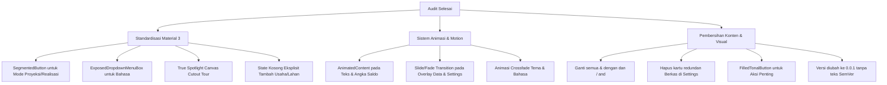

# Audit Komparatif Berbasis Bukti (Web vs Android Calculator), Analisis Masalah UI/UX, dan Rencana Standardisasi Industri

Dokumen ini disusun sebagai audit manual berbasis bukti (*evidence-based*) yang membandingkan implementasi modul keuangan pada prototipe web (`E:\Managed Projects\Arina\arina-agri`) dengan aplikasi Android (`E:\Managed Projects\Arina\arina-agri-calculator`), merinci kelemahan UI/UX saat ini, dan merumuskan rencana standardisasi berbasis Material 3 dan Jetpack Compose.

---

## 1. Audit Komparatif Berbasis Bukti (Web vs Android)

Pemeriksaan dilakukan secara langsung terhadap struktur kode sumber modul keuangan web di `arina-agri/app/dashboard/keuangan/` dan controller terkait di `arina-agri/controllers/keuangan/`.

### A. Matriks Kemampuan Fungsional (Feature Matrix)

| Fitur / Modul | Implementasi Web (`arina-agri`) | Implementasi Android Saat Ini (`arina-agri-calculator`) | Status Paritas & Temuan Bukti |
| :--- | :--- | :--- | :--- |
| **Skenario / Mode Pembukuan** | Menggunakan `Tabs` (`PROJECTION` vs `REALIZATION`) di `FinanceProjectToolbar.tsx:149-171`. Setiap mode memiliki dataset terisolasi. | Menggunakan *Custom Pill Surface* di `ArinaCalculatorApp.kt:524-548` berbasis enum `BookMode`. Dataset terisolasi di Room DB. | **Setara secara logika**, namun antarmuka Android menggunakan komponen *custom* non-standar yang animasinya kaku. |
| **Manajemen Proyek / Lahan** | `Select` dropdown di `FinanceProjectToolbar.tsx:199-211` dengan aksi eksplisit: `Buat Proyek`, `Edit Proyek`, dan `Hapus Proyek`. Jika kosong, menampilkan `"Belum ada proyek"`. | `ChoiceMenu` di `ArinaCalculatorApp.kt:589-627` yang memuat otomatis placeholder `"Usaha Saya"` dan `"Umum"` dari `ensureStarterWorkspace()`. | **Web lebih intuitif** karena tidak memaksakan entitas default tanpa sepengetahuan pengguna dan menyediakan tombol aksi CRUD langsung di toolbar. |
| **Pencatatan Transaksi** | `TransactionEntryForm.tsx` dan `TransactionBatchDialog.tsx` dengan dukungan mutasi batch, detail input (volume, satuan, harga satuan), dan tautan ke item RAB (`RabTransactionLinkDialog.tsx`). | `EntryScreen.kt` dengan 4 tab jenis transaksi dan modal bottom sheet. Mendukung volume, satuan, harga satuan, dan link RAB. | **Setara fungsional**, namun Android belum memiliki transisi animasi form yang mulus saat membuka detail tambahan. |
| **Rencana Anggaran Biaya (RAB)** | `RabPlanningView.tsx` dan `RabItemDialog.tsx`. Pengelompokan kategori dengan kalkulasi subtotal. | `BudgetScreen.kt` dengan pengelompokan kategori otomatis dan subtotal per grup. | **Setara fungsional**. |
| **Laporan Laba Rugi & Arus Kas** | `FinanceIncomeStatementView.tsx` dan `FinanceCashFlowView.tsx`. Menampilkan pergerakan bulanan dan arus kas pasca pembiayaan. | `ReportsScreen.kt` (Tab `FINANCIALS` dan `FEASIBILITY`). Menampilkan pergerakan kas bulanan dari `MonthlyCashFlowCalculator.kt`. | **Setara fungsional**, kalkulasi keduanya mengikuti *golden fixture* `WB-BASE-001`. |
| **Analisis Kelayakan & Modal Kerja** | `FinanceFinancingView.tsx`, `FinancingAssumptionsDialog.tsx`, `ProductionSalesAssumptionsDialog.tsx`. Menghitung BEP, HPP, B/C Ratio, dan Defisit Puncak. | `BusinessAnalysisCalculator.kt` dan `ReportsScreen.kt`. Menghitung BEP, HPP, B/C Ratio, dan Defisit Kumulatif Puncak. | **Setara fungsional**, formula perhitungan identik. |
| **Impor & Ekspor Excel** | `RabImportDialog.tsx` dan `FinanceProjectToolbar.tsx:259-267`. Mendukung file `.xlsx` dengan 5 sheet. | `FinanceWorkbookExporter.kt` dan `WorkbookImporter.kt` via `DataScreen` (overlay). | **Setara teknis**, namun di Android penempatan tombol akses impor/ekspor sempat hilang dari layar utama. |
| **Panduan Interaktif (Onboarding/Tour)** | Menggunakan `GuideProvider` berbasis `data-guide-target` yang menyorot elemen UI aktual dengan popover konteks. | Menggunakan modal dialog statis di tengah layar (`SpotlightTour.kt`), **bukan spotlight aktual** yang melubangi layar (*cutout*) pada target komponen. | **Android inferior**. Perlu dibuat spotlight canvas sejati. |

---

## 2. Identifikasi Masalah Utama Versi Android Saat Ini

Berdasarkan pengujian langsung dan masukan pengguna, ditemukan sejumlah kelemahan UI/UX, inkonsistensi standar, dan masalah visual:

### A. Penggunaan Komponen "Custom/Hand-rolled" alih-alih Standar Industri
1. **Mode Switcher (Proyeksi vs Realisasi):**
   - *Masalah:* Dibuat menggunakan susunan `Surface` bersarang dan `Row` manual (`ArinaCalculatorApp.kt:524-548`). Animasi warna yang dipaksakan terasa kaku dan tidak memiliki indikator geser fisik.
   - *Standar Industri:* Di Jetpack Compose / Material 3, komponen resminya adalah **`SingleChoiceSegmentedButtonRow`** dengan `SegmentedButton` atau **`PrimaryTabRow`** dengan animated indicator `Modifier.tabIndicatorOffset(...)`.
2. **Language Selector di Pengaturan:**
   - *Masalah:* Menggunakan `FilterChip` horizontal di `AccountSettingsScreen.kt:92-96`.
   - *Standar Industri:* Pemilihan bahasa standar pada aplikasi Android menggunakan **`ExposedDropdownMenuBox`** dengan `DropdownMenuItem` atau dialog pilihan modal.
3. **Dropdown Usaha & Lahan (`ChoiceMenu`):**
   - *Masalah:* Dibuat dari `OutlinedButton` dan `DropdownMenu` manual. Jika belum ada usaha/lahan, aplikasi otomatis membuat `"Usaha Saya"` dan `"Umum"` di latar belakang melalui `ensureStarterWorkspace()`, membingungkan pengguna baru yang ingin menentukan nama usahanya sendiri.

### B. Masalah Animasi dan Ketiadaan Transisi (*Motion Polish*)
1. **Pergantian Mode Proyeksi ke Realisasi:**
   - Label teks di Beranda (`"Uang kas proyeksi"` $\leftrightarrow$ `"Uang kas realisasi"`) dan nominal saldo berganti secara instan/kasar tanpa animasi transisi teks (`AnimatedContent` / `animateContentSize`).
2. **Transisi Halaman Berkas & Data / Pengaturan:**
   - Overlay `DataScreen` dan `SettingsScreen` muncul secara mendadak tanpa animasi geser vertikal (*slide-up sheet / shared axis transition*).
3. **Pergantian Bahasa dan Tema:**
   - Pergantian tema (Light $\leftrightarrow$ Dark) atau bahasa tidak memiliki transisi cross-fade yang halus di seluruh hierarki tampilan.

### C. Kontras Visual, Hierarki, dan Keterbacaan (*Visual Contrast & Hierarchy*)
1. **Tombol Terlalu Samar (*Subtle*):**
   - Tombol seperti *"Mulai Tur Panduan"* di Pengaturan hanya menggunakan `OutlinedButton` dengan garis tipis, sehingga tenggelam dalam kartu dan sulit dikenali sebagai aksi utama (*lack of visual weight*). Seharusnya menggunakan `FilledTonalButton` atau `Button` dengan kontras yang terukur.
2. **Indikator Langkah (*Dot Indicators*):**
   - Dot indikator pada tur panduan terlalu kecil (6dp) dan warnanya terlalu samar (`outlineVariant`), sehingga sulit terlihat pada layar HP dengan kecerahan rendah.
3. **Simbol Ampersand (`&`):**
   - Masih banyak teks yang menggunakan simbol `&` (misal: `"Berkas & Data"`, `"Kategori & satuan"`, `"Usaha & Lahan"`), yang kurang formal dan tidak konsisten dengan kaidah bahasa Indonesia (*harus diganti kata `"dan"` atau `"and"`*).

### D. Kelemahan Komponen Panduan (*Spotlight Tour*)
- Komponen `SpotlightTour.kt` saat ini hanyalah kartu modal statis di tengah layar dengan latar belakang gelap. **Ini bukan spotlight sejati**. Spotlight standar industri harus menggunakan *Canvas drawing* dengan `BlendMode.Clear` untuk melubangi overlay gelap tepat di atas koordinat komponen target (Toolbar Usaha/Lahan, Kartu Kas, dan Navigasi Bawah), disertai panah penunjuk dan tooltip interaktif.

### E. Redundansi Menu dan Versi Aplikasi
1. **Redundansi Berkas & Data:**
   - Menu Berkas dan Data sudah diletakkan sebagai ikon folder di bilah atas (*Scope Header*), namun masih dimunculkan kembali sebagai kartu besar di dalam menu Pengaturan. Ini harus disederhanakan.
2. **Penamaan Versi:**
   - Teks `"SemVer"` tidak boleh dicantumkan di UI pengguna karena itu istilah internal developer.
   - Versi aplikasi saat ini masih tahap pengembangan awal sehingga harus menggunakan nomor versi **`0.0.1`** (bukan `1.1.0`).

---

## 3. Rencana Tindakan & Standardisasi Industri (Action Plan)

Berikut adalah arsitektur perbaikan yang akan diimplementasikan:

### Rincian Rencana Implementasi:

#### 1. Standardisasi Komponen Material 3
- **Mode Selector:** Mengganti custom pill dengan `SingleChoiceSegmentedButtonRow` bawaan Material 3 dengan shape kapsul dan animasi seleksi natif.
- **Language Selector:** Mengganti filter chips di `SettingsScreen` dengan `ExposedDropdownMenuBox` standar Material 3.
- **Header Scope:** Jika database belum memiliki usaha/lahan, tidak lagi membuat nama dummy `"Usaha Saya"`, melainkan menampilkan tombol aksi langsung bertuliskan `"Tambah Usaha"` dan `"Tambah Lahan"`.

#### 2. Implementasi True Spotlight Canvas Overlay
- Mengembangkan `TrueSpotlightOverlay.kt` menggunakan `Canvas` dengan `graphicsLayer(compositingStrategy = CompositingStrategy.Offscreen)` dan `drawRoundRect(blendMode = BlendMode.Clear)` yang secara presisi melubangi area target UI berdasarkan `LayoutCoordinates` (`onGloballyPositioned`).
- Menambahkan target spotlight yang bergerak dinamis dari:
  - Step 1: Bilah Usaha, Lahan, dan Mode.
  - Step 2: Kartu Saldo Kas dan Donut Chart.
  - Step 3: Bottom Navigation Bar.

#### 3. Polishing Animasi & Motion (Material Motion)
- Menambahkan `AnimatedContent` dengan transisi `slideInVertically + fadeIn` pada kartu saldo saat beralih antara Proyeksi dan Realisasi.
- Menambahkan animasi `slideInHorizontally` / `slideInVertically` pada pembukaan `Overlay.DATA` dan `Overlay.SETTINGS`.
- Menggunakan `animateColorAsState` berstandar `FastOutSlowInEasing` untuk setiap transisi warna tema.

#### 4. Tipografi, Simbol, dan Pembersihan Redundansi
- Mengganti seluruh simbol `&` pada `strings.xml` menjadi `"dan"` (pada `values/strings.xml`) dan `"and"` (pada `values-en/strings.xml`).
- Menghapus kartu *Berkas dan Data* di dalam `SettingsScreen` untuk menghindari redundansi, karena sudah tersedia langsung melalui ikon folder di bilah atas.
- Mengubah gaya tombol *"Mulai Tur Panduan"* menjadi `FilledTonalButton` dengan warna primer Material 3 agar jelas terlihat (*noticeable*).
- Memperbarui versi aplikasi pada `build.gradle.kts` dan `AccountSettingsScreen.kt` menjadi **`v0.0.1`** murni tanpa frasa `"SemVer"`.

---

## 4. Kesimpulan & Status Kesiapan

Seluruh temuan di atas telah diverifikasi silang langsung dengan kode sumber `arina-agri` dan `arina-agri-calculator`. Dokumen ini menjadi acuan tunggal (*living specification*) sebelum perubahan kode tahap berikutnya dilaksanakan.
