# Audit UI/UX Mankeu (2026-10-30)

Status: selesai (2026-10-30). 32 layar/keadaan (L01–L32), 71 screenshot. Tidak ada kode yang diubah.
Build: debug `fase2-nota-piutang` @ `648fba4`, emulator `emulator-5554` (1080×2400), data dikosongkan lalu diisi
seperti pemilik usaha: "Keripik Bu Sri".
Pemicu (user-confirmed, 2026-10-30): "ada form form form form form berjejer row jelek sekali, apa maksudnya",
"sekilas memang aku lihat kaya ga banyak berubah", "pokoknya APP INI HARUS USEFUL, intinya itu".

Klasifikasi: semua temuan per layar `verified` (dilihat di emulator, screenshot di `docs/audit/img/ui-20261030-*`),
usulan berstatus `proposed`. Kolom "Kapan": **sekarang** (bisa dikerjakan sebelum F3), **F3** (navigasi, form halaman
penuh, Rencana, Beranda), **F4** (laporan).

Tingkat: **Berat** = membuat pemilik bingung, salah baca angka, atau gagal menyelesaikan tugas harian;
**Sedang** = lambat/jelek tapi tugas tetap selesai; **Ringan** = kosmetik.

## Ringkasan: 10 masalah terbesar

Diurutkan menurut seberapa besar masalah itu menghalangi pemilik memakai app untuk usahanya.

1. **Untung punya tiga angka berbeda untuk bulan yang sama.** Beranda "Untung semua bulan Rp120.000" di samping "Uang masuk bersih −Rp60.000"; tab "Realisasi vs Target" berkata laba −Rp60.000; selisih belanja-vs-HPP Rp220.000 di satu layar dan Rp224.000 di layar lain. Pemilik tidak bisa menjawab "bulan ini untung berapa". ([L19](#l19-beranda-setelah-ada-transaksi), [L27](#l27-laporan--tab-kelayakan--bep), [L28](#l28-laporan--tab-realisasi-vs-target); [screenshot](img/ui-20261030-40-beranda-isi.png))
2. **Layar pertama sama dengan versi demo yang dinilai membingungkan.** Saklar Rencana/Realisasi, "Uang kas realisasi", "Mode Aktual", "unit usaha", empat kartu "Operasional"; mode Rencana mengubah isi semua tab. Inilah sumber "sekilas ga banyak berubah". ([L03](#l03-beranda-kosong-baru-membuat-usaha), [L29](#l29-mode-rencana-saklar--beranda-dan-laporan); [screenshot](img/ui-20261030-03-setelah-usaha.png))
3. **Form berjejer.** Setiap baris resep, satuan jual, dan baris nota adalah kartu berisi 2–4 kotak bergaris tepi yang identik; editor produk Keripik berisi 19 kotak, nota 8, belanja 9. ([L08](#l08-editor-produk-produk-baru-halaman-penuh), [L12](#l12-nota-penjualan-baru), [P1](#p1-form-berjejer-penyebab-utama-kesan-jelek); [screenshot](img/ui-20261030-13-produk-editor-resep.png))
4. **Beli bahan tidak menambah stok, tambah stok tidak mencatat uang.** Belanja 10 liter minyak: stok Minyak tetap 0 dan tetap "Menipis"; "Masuk 50 kg" singkong menaikkan nilai stok Rp1,5 juta tanpa uang keluar. ([L07](#l07-lembar-catat-stok-singkong-masukkeluaropname-bahan), [L19](#l19-beranda-setelah-ada-transaksi), [P6](#p6-satu-kejadian--satu-catatan); [screenshot](img/ui-20261030-41-beranda-isi-bawah.png))
5. **"Siapa yang belum bayar?" tidak terjawab di Beranda.** Kartu Tagihan hanya total tanpa nama; Kontak tersembunyi di ikon folder "Berkas dan Data"; mengetuk kontak hanya membuka form ubah, tanpa daftar nota atau tombol tagih. ([L19](#l19-beranda-setelah-ada-transaksi), [L20](#l20-berkas-dan-data-ikon-folder-di-header), [L21](#l21-kontak-daftar-dan-ubah); [screenshot](img/ui-20261030-42-beranda-tagihan.png))
6. **Nota dan catatan adalah dua dunia.** Setelah nota Rp600.000 disimpan, layar tetap "0 catatan · Belum ada catatan"; form Uang masuk masih berjudul "Penjualan … yang langsung dibayar"; artikel bantuan "Mencatat penjualan" mengajarkan cara lama (Pemasukan, tanpa HPP). ([L14](#l14-tab-catatan-setelah-nota-pertama), [L16](#l16-form-uang-masuk-lembar-dari-bawah), [L25](#l25-bantuan-lembar--dan-pusat-bantuan); [screenshot](img/ui-20261030-27-setelah-nota.png))
7. **Bahasa akuntan di layar sehari-hari.** "Sifat biaya: Tetap/Variabel" di form belanja, "Prive", "Aset dan Penyusutan", "Arus Kas Operasi/Investasi/Pembiayaan", "R/C Ratio", "BEP", "persediaan", "opname", "Nominal" (melanggar #19). ([L17](#l17-form-uang-keluar-belanja), [L22](#l22-kategori-pembukuan), [L26](#l26-laporan--tab-laba-rugi-dan-arus-kas), [P4](#p4-bahasa-19-daftar-ganti-kata); [screenshot](img/ui-20261030-36-pengeluaran-bawah.png))
8. **Piutang tanpa jatuh tempo dan tanpa cara menagih.** "Belum dibayar" tidak meminta jatuh tempo (filter "Lewat jatuh tempo" selalu kosong); tidak ada Kirim nota/tagihan ke WhatsApp. ([L12](#l12-nota-penjualan-baru), [L15](#l15-detail-nota-dan-lembar-bayar); [screenshot](img/ui-20261030-28-nota-detail.png))
9. **Rencana menghakimi sebelum selesai diisi dan tersembunyi.** Rencana ada di tab Catatan lewat saklar, dengan periode tanggal; "Tidak Layak" muncul karena target belum diisi, "Layak" muncul dengan biaya tetap Rp0; "BEP 769,231 bungkus", "R/C 0 · B/C −1"; target harus diisi di editor produk 19 kotak. ([L27](#l27-laporan--tab-kelayakan--bep), [L30](#l30-rencana-usaha-tab-catatan-dalam-mode-rencana-dan-lembar-lembarnya); [screenshot](img/ui-20261030-64-rencana-kelayakan-isi.png))
10. **Navigasi dasar goyah.** Tombol Back sistem diabaikan di Riwayat stok dan lembar Usaha; form uang masuk/keluar masih lembar dari bawah setinggi layar (#13); "Cabang / Unit" muncul saat membuat usaha pertama; tiga ikon header tanpa label. ([L02](#l02-tambah-usaha-lembar-bertumpuk), [L04](#l04-lembar-usaha-dan-cabang--unit-dari-panah-di-header), [L10](#l10-lembar-produksi-hitung-stok-dan-riwayat-stok), [L16](#l16-form-uang-masuk-lembar-dari-bawah); [screenshot](img/ui-20261030-05-usaha-unit-sheet.png))

## Per layar

### L01. Layar pertama (belum ada usaha)

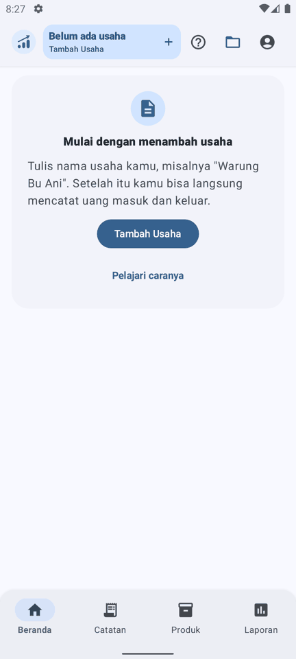

Untuk apa: mengarahkan pengguna baru ke langkah pertama.

| Masalah | Tingkat | Usulan | Kapan |
|---|---|---|---|
| Header berisi 5 benda sekaligus (logo, kotak "Belum ada usaha / Tambah Usaha" dengan +, ikon ?, ikon folder, ikon orang) padahal belum ada apa pun. Tiga ikon tanpa label. Ada dua tombol "Tambah Usaha" (header dan kartu) yang berlomba. | Sedang | Saat belum ada usaha: sembunyikan header usaha dan ikon folder/orang; sisakan satu tombol besar. Ikon yang tersisa diberi label teks atau dipindah ke menu "Lainnya". | sekarang |
| Kartu kosong hanya menyebut "uang masuk dan keluar", padahal kekuatan app (produk, HPP, nota, tagihan) tidak disebut. Pengusaha keripik tidak melihat alasan memakai app ini dibanding buku tulis. | Sedang | Kartu sambutan 3 baris manfaat dengan ikon: "Tahu untung per bungkus/dus", "Catat nota & siapa yang belum bayar", "Data hanya di HP kamu". | F3 |
| Tab bawah (Catatan, Produk, Laporan) aktif dan bisa ditekan walau belum ada usaha; isinya pasti kosong. | Ringan | Sembunyikan tab bawah sampai usaha pertama dibuat. | F3 |

### L02. Tambah usaha (lembar bertumpuk)

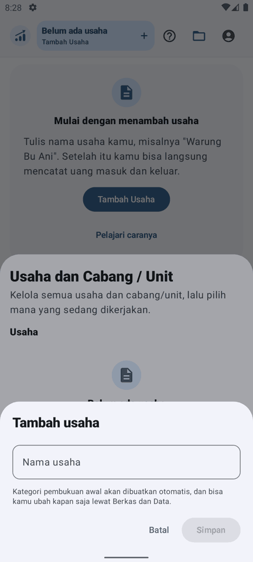

Untuk apa: memberi nama usaha pertama.

| Masalah | Tingkat | Usulan | Kapan |
|---|---|---|---|
| Masih dua lembar bertumpuk: "Usaha dan Cabang / Unit" (dengan kalimat "Kelola semua usaha dan cabang/unit") lalu "Tambah usaha" di atasnya. Temuan yang sama persis dengan uji 2026-10-29 CP1–2; pengguna baru langsung bertemu kata "Cabang / Unit" (bertentangan dengan #15). | Berat | Tombol "Tambah Usaha" dari layar kosong membuka satu layar/lembar saja: kolom "Nama usaha" + pilihan jenis usaha (chip: Produksi/olahan, Warung/dagang, Jasa, Pertanian). Lembar daftar usaha baru muncul bila sudah ada ≥1 usaha. | sekarang |
| Teks bantu "Kategori pembukuan awal ... lewat Berkas dan Data" berisi istilah pembukuan dan menunjuk menu yang belum pernah dilihat. | Ringan | Hapus. Ganti dengan contoh: "Misalnya: Keripik Bu Sri". | sekarang |
| Tidak ada pertanyaan jenis usaha, padahal app bisa langsung menyiapkan produk/kategori yang cocok (keripik vs jasa traktor). | Sedang | Chip jenis usaha (opsional) yang menentukan kategori bawaan dan apakah tab Produk ditonjolkan. | F3 |

### L03. Beranda (kosong, baru membuat usaha)

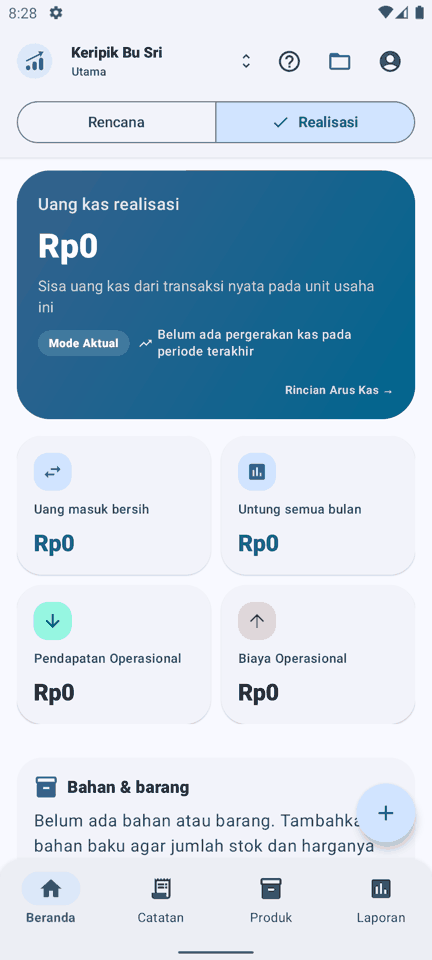 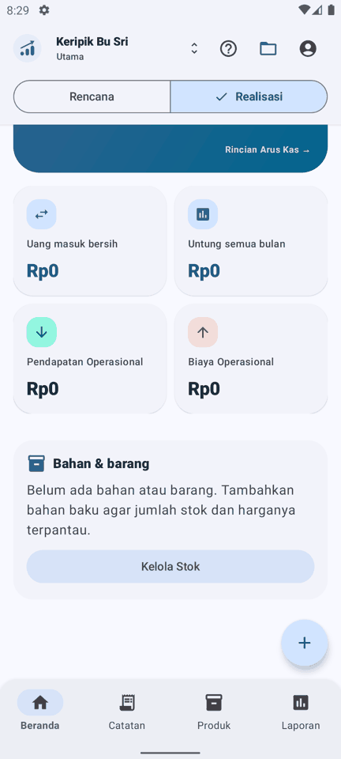

Untuk apa: seharusnya menjawab "usahaku hari ini bagaimana, dan apa yang harus kulakukan sekarang".

Inilah alasan utama pemilik merasa "ga banyak berubah": layar pertama setelah membuat usaha **sama dengan versi
2026-10-28** yang dinilai membingungkan.

| Masalah | Tingkat | Usulan | Kapan |
|---|---|---|---|
| Saklar besar **Rencana / Realisasi** masih tampil paling atas, di semua tab. Keputusan #4 menghapusnya, tetapi di build ini masih ada. Kata "Realisasi" bukan bahasa pedagang. | Berat | Hapus saklar dari semua layar. Rencana Usaha jadi satu kartu/tautan di Beranda. Ini inti F3, tetapi karena paling terlihat, dahulukan di awal F3. | F3 (prioritas 1) |
| Kartu utama "**Uang kas realisasi** Rp0 – Sisa uang kas dari transaksi nyata pada **unit usaha** ini", chip "**Mode Aktual**", tautan "Rincian **Arus Kas**". Empat istilah akuntansi/proyek dalam satu kartu (melanggar #19 dan #15). | Berat | Ganti jadi "Uang di tangan" (atau "Saldo kas") + satu baris "Hari ini: masuk RpX · keluar RpY". Hapus chip "Mode Aktual" dan kata "unit". | sekarang |
| Empat kartu angka Rp0: "Uang masuk bersih", "Untung semua bulan", "Pendapatan Operasional", "Biaya Operasional". Namanya tumpang tindih (uang masuk bersih vs pendapatan vs untung), "semua bulan" tidak berguna (pengusaha bertanya **bulan ini**), "Operasional" istilah laporan formal. Empat kartu dengan ikon dan bayangan berat = dinding angka nol. | Berat | Satu kartu "Bulan ini": Penjualan · Untung (setelah HPP) · Belanja, dengan pembanding bulan lalu (panah naik/turun). Hapus "semua bulan". Angka yang sama tidak boleh muncul dengan dua nama. | sekarang (isi), F3 (tata letak) |
| Tidak ada **langkah awal** untuk pengguna baru (persis temuan 10-29). Beranda kosong tidak menyebut produk, nota, atau kontak, padahal itu fitur F1–F2. Hanya kartu "Bahan & barang – Kelola Stok" (yang justru paling opsional menurut #9). | Berat | Saat data kosong, ganti kartu angka dengan daftar langkah bercentang: 1) Tambah produk & resep (lihat HPP), 2) Catat produksi, 3) Buat nota penjualan pertama, 4) Catat belanja. Hilang setelah semua selesai. | sekarang |
| Tombol + mengambang tanpa label, menutupi isi kartu (teks "Tambahkan ... bahan baku" terpotong di screenshot 03). Tidak jelas + menambah apa. | Sedang | FAB lebar berlabel "Catat" (atau dua: "Jual" dan "Belanja"), dan beri ruang kosong di bawah isi agar tidak menutupi. | sekarang |
| Kartu "Bahan & barang" dengan tombol "Kelola Stok" di Beranda; istilah "stok" untuk bahan, padahal Produk juga punya stok. | Sedang | Pindahkan ke tab Produk. Beranda cukup peringatan "Stok Keripik tinggal 20 bungkus" bila perlu. | F3 |
| Header: nama usaha + "Utama" (nama unit) + ikon panah ganda + 3 ikon tanpa label (?, folder, orang). Kata "Utama" adalah unit yang seharusnya tersembunyi (#15). | Sedang | Tampilkan nama usaha saja. Gabungkan folder (Data), orang (Akun/sinkron), dan pengaturan ke satu menu "Lainnya" berlabel; tanda ? masuk ke menu itu juga. | sekarang (hapus "Utama"), F3 |
| Gradien biru tua + kartu tinted + bayangan; tiga gaya kartu berbeda di satu layar. | Ringan | Lihat aturan warna di "Pola lintas layar". | F3 |

### L04. Lembar "Usaha dan Cabang / Unit" (dari panah di header)

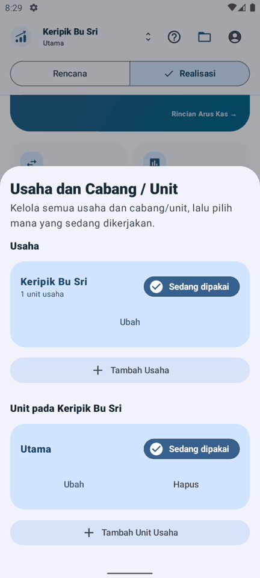 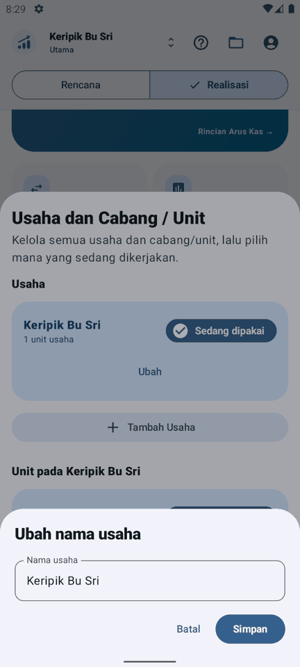

Untuk apa: berganti usaha, mengubah nama usaha.

| Masalah | Tingkat | Usulan | Kapan |
|---|---|---|---|
| Separuh lembar membahas **Unit** ("Unit pada Keripik Bu Sri", "Utama", "Tambah Unit Usaha", "Hapus") untuk pengguna yang hanya punya satu usaha dan satu tempat. Melanggar #15. | Berat | Lembar berjudul "Usaha": daftar usaha (baris biasa, centang di yang aktif), "+ Tambah usaha". "Cabang" hanya sebagai satu baris "Punya cabang? Tambah cabang" di bawah; bagian unit muncul setelah cabang kedua ada. | F3 |
| Setiap usaha dan unit adalah kartu biru besar (≈140 dp) dengan pil "Sedang dipakai" dan tombol teks "Ubah"/"Hapus" mengambang di tengah kartu. Untuk dua pilihan, ini lebih mirip formulir daripada pemilih. Tombol "Hapus" unit sejajar dengan "Ubah" tanpa pembeda warna. | Sedang | Baris daftar 56 dp: nama + radio/centang; "Ubah" dan "Hapus" di menu titik tiga per baris; Hapus berwarna merah dan selalu dengan konfirmasi. | F3 |
| Tombol Back sistem **tidak menutup** lembar ini (dua kali ditekan, lembar tetap; baru tertutup saat menyentuh area gelap). Tidak ada tombol Tutup. | Sedang | Back harus selalu menutup lembar paling atas. Tambah tombol Tutup/× di kanan atas. Hal yang sama terjadi di halaman "Riwayat stok" (L10): tombol Back sistem diabaikan, hanya panah ← di layar yang bekerja. Back sistem hanya menutup keyboard. | sekarang |
| "Ubah nama usaha" membuka lembar ketiga di atas lembar kedua. | Ringan | Ubah nama langsung di baris (sunting di tempat) atau halaman Pengaturan usaha. | F3 |

### L05. Tab Produk (kosong, lalu dengan bahan)

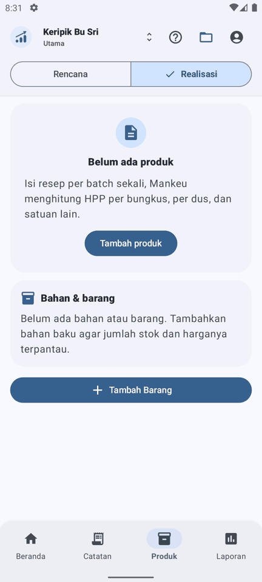 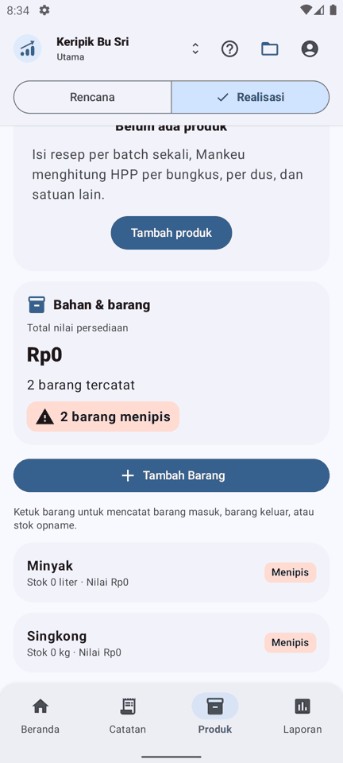

Untuk apa: daftar produk (HPP, stok jadi) dan bahan.

| Masalah | Tingkat | Usulan | Kapan |
|---|---|---|---|
| Kalimat kosong "Isi resep per batch sekali, Mankeu menghitung HPP per bungkus, per dus..." **bagus** dan berbahasa pengusaha. Pertahankan. | – | – | – |
| Dua tombol utama bersaing: "Tambah produk" (di kartu) dan "+ Tambah Barang" (lebar penuh, warna sama, lebih menonjol). Padahal bahan opsional (#9). Urutan logisnya juga terbalik: resep butuh bahan, tetapi tidak ada petunjuk "tambah bahan dulu". | Sedang | Satu tombol utama "Tambah produk". Bahan bisa ditambah langsung dari dalam editor resep ("+ bahan baru" di pemilih bahan). Bagian bahan jadi tautan sekunder "Bahan baku (2)". | sekarang |
| Kartu "Bahan & barang" memakai istilah "**Total nilai persediaan**", "barang tercatat", dan teks bantu "stok **opname**". | Sedang | "Nilai bahan di gudang: Rp1.500.000". "Opname" → "Hitung ulang stok". | sekarang |
| Bahan baru dengan stok 0 langsung diberi tanda merah "**Menipis**" dan kartu "2 barang menipis" ⚠ — bahkan Minyak yang batas minimumnya tidak diisi. Pengguna baru disambut peringatan palsu. | Sedang | Peringatan hanya bila batas minimum diisi **dan** stok pernah > 0. Stok 0 tanpa batas = teks abu "Stok kosong". | sekarang |
| Baris bahan hanya "Stok 0 liter · Nilai Rp0". **Harga per satuan** (yang dipakai HPP, #20) tidak terlihat; untuk melihatnya harus membuka sesuatu. | Sedang | Baris: "Minyak — Rp25.000/liter" (judul) dan "Stok 0 liter" (sub). Nilai total cukup di kartu ringkas. | sekarang |
| Saklar Rencana/Realisasi tampil di tab Produk, padahal produk tidak punya versi rencana (temuan 10-29 CP5, belum berubah). | Berat | (lihat L03) | F3 |
| Kartu kosong produk tetap tampil paling atas setinggi ±280 dp setelah bahan ada; bahan terdorong ke bawah. | Ringan | Kartu kosong ringkas (1 baris + tombol) begitu ada bahan. | sekarang |

### L06. Form "Tambah Barang" (bahan)

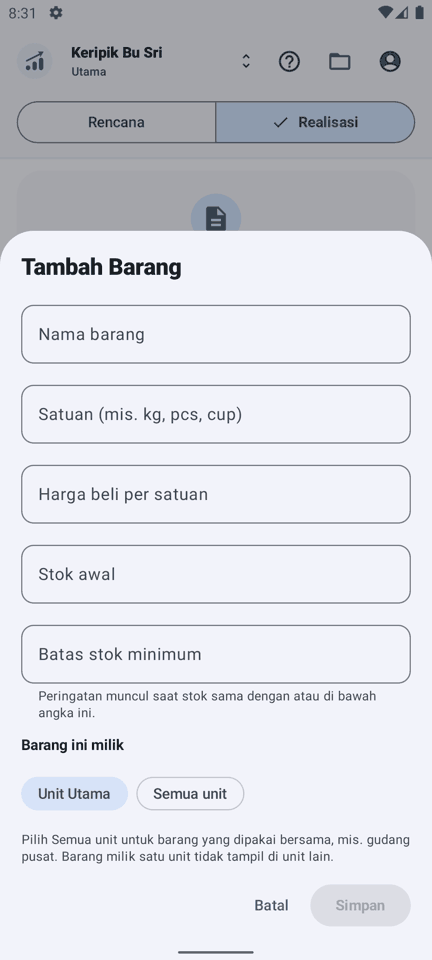 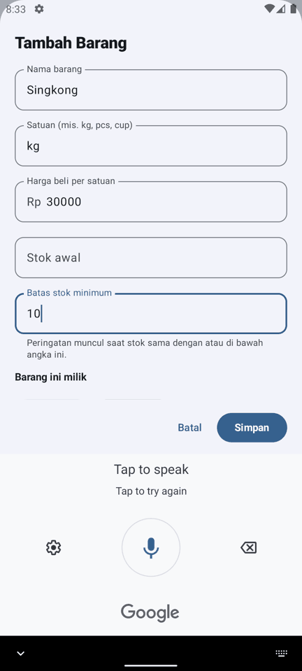

Untuk apa: mendaftar bahan baku dan harganya.

Ini contoh nyata keluhan "**form berjejer row**": **5 kotak isian bergaris tepi identik bertumpuk** (Nama barang, Satuan,
Harga beli per satuan, Stok awal, Batas stok minimum) + teks bantu + pilihan "Barang ini milik: Unit Utama / Semua unit"
+ teks bantu kedua. Semua kotak sama tinggi, sama warna, tanpa pengelompokan, sehingga mata tidak tahu mana yang wajib.

| Masalah | Tingkat | Usulan | Kapan |
|---|---|---|---|
| 5 kotak isian sejajar; hanya 3 yang diperlukan untuk HPP (nama, satuan, harga). "Stok awal" dan "Batas stok minimum" jarang diisi saat mendaftar. | Berat | Tampilkan 2 baris saja: **Nama** dan baris gabungan "**Harga** Rp[____] per [kg ▾]" (satuan sebagai chip/dropdown dengan pilihan umum: kg, liter, gram, pcs, bungkus, ikat + "lainnya"). Stok awal & batas minimum di bawah tautan "Atur stok (opsional)". | sekarang |
| Pilihan "Barang ini milik: **Unit Utama / Semua unit**" + penjelasan gudang pusat, untuk pengguna dengan satu tempat usaha. | Berat | Sembunyikan seluruhnya selama hanya ada satu unit (#15). | sekarang |
| Uang diketik tanpa pemisah ribuan ("Rp 30000"); rawan salah nol (temuan 10-29, belum berubah). | Sedang | Format ribuan saat mengetik (`30.000`) di semua kolom uang, dengan keyboard angka. | sekarang |
| Placeholder "Satuan (mis. kg, pcs, cup)" — "pcs" dan "cup" bukan contoh untuk usaha ini; pengguna harus mengetik bebas sehingga "Kg", "kg", "kilo" bisa jadi tiga satuan. | Sedang | Chip satuan umum + isian bebas. | sekarang |
| Saat keyboard muncul, Batal/Simpan naik di tengah layar dan pilihan unit terpotong di bawahnya; lembar terlihat sesak. | Sedang | Form ini pendek setelah dirampingkan, jadi lembar boleh tetap; kalau tidak dirampingkan, pindah ke halaman penuh (#13). | sekarang |
| Setelah Simpan tidak ada pesan konfirmasi; daftar langsung berubah (masih bisa diterima). | Ringan | Snackbar "Singkong ditambahkan". | sekarang |

### L07. Lembar "Catat Stok: Singkong" (masuk/keluar/opname bahan)

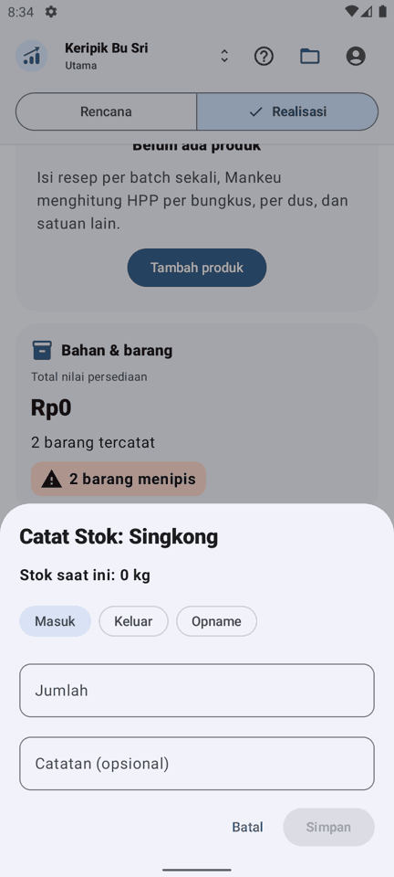

Untuk apa: menambah/mengurangi stok bahan.

| Masalah | Tingkat | Usulan | Kapan |
|---|---|---|---|
| "Masuk 50 kg" menaikkan nilai bahan Rp1.500.000 **tanpa mencatat uang keluar** dan tanpa bertanya apakah ini dibeli. Pengusaha yang membeli singkong lewat sini akan melihat stok bertambah tetapi uangnya tidak berkurang; belanja yang sama dicatat lewat Catatan → stok tidak ikut (atau ganda). Dua jalan untuk satu kejadian. | Berat | Pilihan pertama di lembar ini: "**Beli** (catat juga uang keluar)" yang membuka form belanja dengan bahan & jumlah sudah terisi; "Tambah tanpa beli" (hasil panen sendiri, koreksi) sebagai pilihan kedua. | sekarang |
| Chip "Masuk / Keluar / **Opname**" — "Opname" istilah gudang. | Sedang | "Tambah / Pakai / Hitung ulang". | sekarang |
| Lembar tidak menampilkan harga per satuan atau tombol "Ubah barang" (ganti harga/nama) dan riwayat; tidak jelas di mana mengubah atau menghapus bahan. | Sedang | Ketuk baris bahan → halaman detail bahan (harga terakhir, riwayat harga, stok, riwayat gerak, Ubah/Hapus). Lembar cepat ini dipanggil dari tombol di halaman itu. | F3 |

### L08. Editor produk ("Produk baru", halaman penuh)

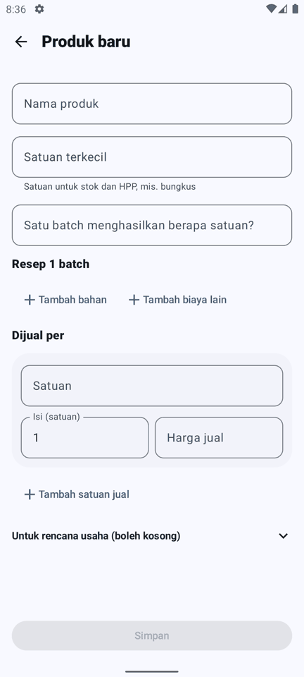 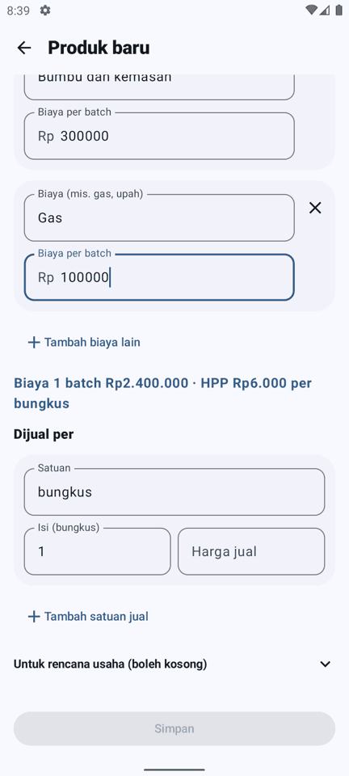 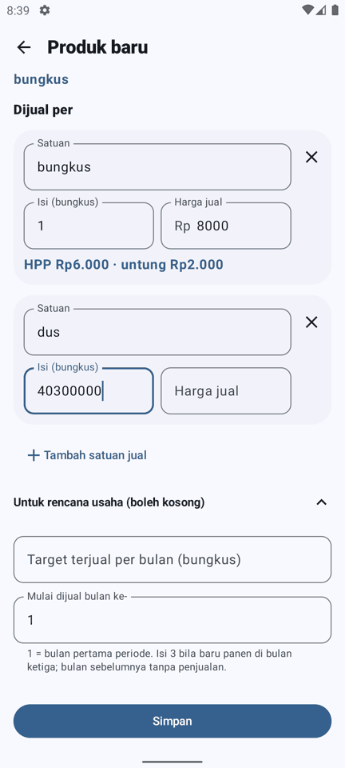

Untuk apa: mendaftar produk, resep 1 batch, HPP, dan harga per satuan jual. Ini layar yang paling menunjukkan
nilai app ("HPP Rp240.000/dus · untung Rp60.000" tanpa hitung manual) — dan sekaligus layar dengan kotak isian
terbanyak.

Hitungan untuk produk Keripik (2 bahan, 2 biaya lain, 2 satuan jual, bagian rencana dibuka): **19 kotak isian
bergaris tepi** yang bentuknya identik: Nama, Satuan terkecil, Hasil per batch; per bahan 2 kotak (Bahan ▾, Jumlah);
per biaya lain 2 kotak (Nama biaya, Biaya per batch); per satuan jual 3 kotak (Satuan, Isi, Harga jual); Target per
bulan, Mulai dijual bulan ke-. Halaman harus digulir ±3 layar.

Yang sudah baik (pertahankan): halaman penuh dengan Simpan tetap di bawah (#13); HPP dihitung langsung saat mengetik
("Biaya 1 batch Rp2.400.000 · HPP Rp6.000 per bungkus", per satuan jual "HPP Rp240.000 · untung Rp60.000"); label
"Jumlah (liter)" mengikuti satuan bahan; bagian rencana dilipat.

| Masalah | Tingkat | Usulan | Kapan |
|---|---|---|---|
| **Setiap baris resep = kartu berisi 2 kotak bertumpuk** (Bahan di atas, Jumlah di bawah) + tombol ×. 4 baris resep = 8 kotak + 4 kartu. Ini sumber utama kesan "form berjejer". Padahal satu baris resep cukup satu baris teks. | Berat | Resep sebagai **daftar baris ringkas**: "Singkong · 50 kg · Rp1.500.000" (satu baris 56 dp, ketuk untuk ubah di lembar kecil, geser/× untuk hapus). Tambah baris lewat lembar pendek: pilih bahan (daftar + "bahan baru") → jumlah (keyboard angka) → selesai. Biaya lain sama: "Gas · Rp100.000". Total di bawah daftar. | sekarang |
| Satuan jual juga kartu dengan 3 kotak (Satuan, Isi, Harga). Baris pertama "bungkus, Isi 1" sudah pasti isi 1 tetapi tetap minta diisi. | Sedang | Baris satuan dasar otomatis ("per bungkus: Rp[____]"), satuan tambahan sebagai baris ringkas "dus isi 40 · Rp300.000 · untung Rp60.000" dengan lembar kecil untuk mengubah. | sekarang |
| Urutan: halaman dibuka dengan 3 kotak abstrak ("Satuan terkecil", "Satu batch menghasilkan berapa satuan?") sebelum pengguna melihat resep. Pengusaha berpikir "1 adonan: singkong 50 kg, minyak 20 liter → jadi 400 bungkus". | Sedang | Urutan: Nama → Resep 1 adonan (daftar) → "Jadi berapa?" [400] [bungkus ▾] → Dijual per → (lipat) Rencana. Istilah "batch" dijelaskan sekali: "1 kali masak / 1 adonan (batch)". | sekarang |
| "Satuan terkecil" dan "Satuan" diketik bebas; tidak ada pilihan cepat (bungkus, pcs, kg, dus, bal, karung, ikat). | Sedang | Chip pilihan umum + "lainnya". | sekarang |
| Ringkasan HPP berupa teks biru kecil yang bergeser posisinya setiap kali baris ditambah; hasil terpenting tidak menempel saat menggulir. | Sedang | Bilah ringkasan menempel di atas tombol Simpan: "HPP Rp6.000/bungkus · Rp240.000/dus". | sekarang |
| Bahan pertama otomatis terisi "Minyak" (bahan teratas menurut abjad) tanpa ditanya — mudah tersimpan keliru. | Sedang | Baris baru dimulai dari pemilih bahan, bukan dari nilai bawaan. | sekarang |
| Bagian rencana: "Mulai dijual bulan ke- [1]" + teks bantu panen bulan ketiga selalu tampil begitu dibuka (temuan 10-29). Berhubungan dengan Rencana tanpa periode (#14). | Ringan | Hapus dari editor produk; target penjualan diisi di Rencana Usaha (F3). | F3 |
| Kolom uang tanpa pemisah ribuan; isian "Isi" dan "Harga jual" berdampingan sempit, mudah salah ketuk (saat uji, angka harga masuk ke kolom Isi → "40300000" tanpa peringatan). | Sedang | Format ribuan; validasi "isi dus 40.300.000 bungkus?" (isi > 10.000 diberi peringatan). | sekarang |
| Tombol × hapus baris tanpa konfirmasi/urungkan. | Ringan | Snackbar "Baris dihapus · Urungkan". | sekarang |

### L09. Tab Produk dengan produk

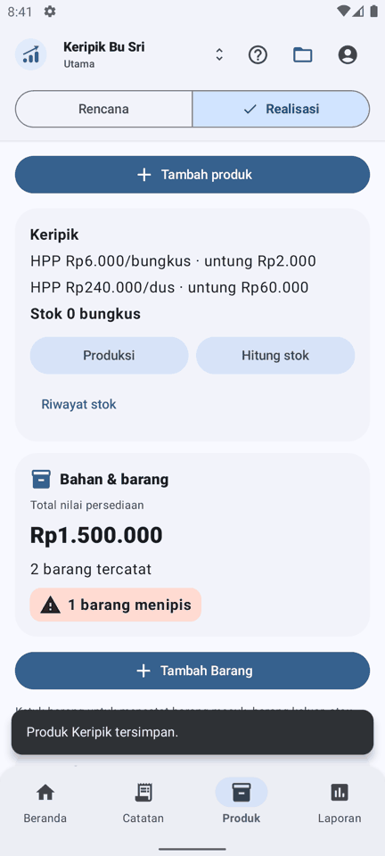

| Masalah | Tingkat | Usulan | Kapan |
|---|---|---|---|
| Kartu produk informatif (HPP & untung per bungkus dan per dus, stok) — ini bagian terbaik app. Tetapi **harga jual tidak tertulis**; "untung Rp2.000" tanpa harga membuat pembaca menebak. | Sedang | "per bungkus: jual Rp8.000 · HPP Rp6.000 · untung Rp2.000". Untuk banyak satuan jual, tabel kecil 3 kolom. | sekarang |
| Dua tombol tonal "Produksi" dan "Hitung stok" + tautan "Riwayat stok" di setiap kartu. Dengan 10 produk, layar menjadi deretan tombol. "Hitung stok" sejajar dengan Produksi padahal jarang dipakai. | Sedang | Kartu bisa diketuk → halaman detail produk (resep, satuan jual, stok, riwayat). Di kartu cukup satu aksi cepat "+ Produksi". "Hitung stok" dan "Riwayat" pindah ke detail. | sekarang/F3 |
| Dua tombol biru penuh "+ Tambah produk" (atas) dan "+ Tambah Barang" (tengah) dengan bobot sama; huruf kapital tidak konsisten ("Tambah produk" vs "Tambah Barang"). | Ringan | Satu FAB "Produk baru"; bahan di sub-bagian dengan tombol teks. Pakai huruf kecil seragam ("Tambah bahan"). | sekarang |
| Kata "barang" (bahan) dan "produk" dipakai berdampingan tanpa pembeda yang jelas. | Sedang | Konsisten: "Produk" (yang dijual) dan "Bahan" (yang dibeli untuk dibuat). "Barang" hanya untuk usaha dagang (barang beli-jual) bila nanti ada. | sekarang |

### L10. Lembar Produksi, Hitung stok, dan Riwayat stok

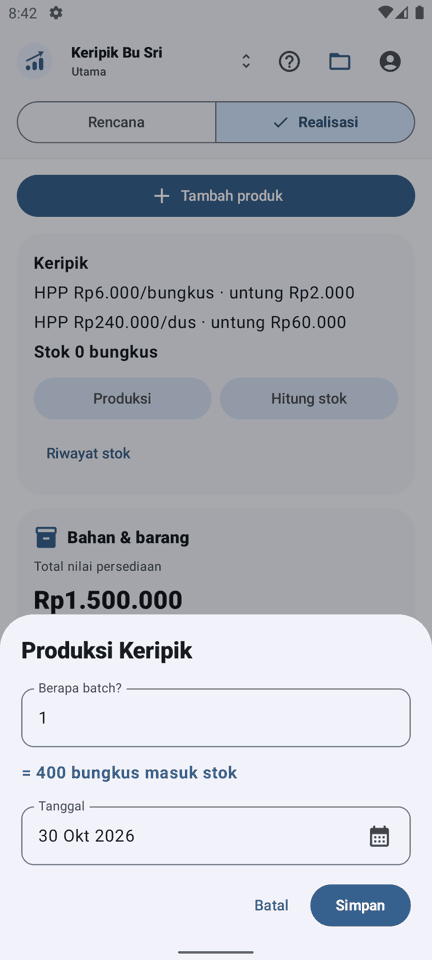 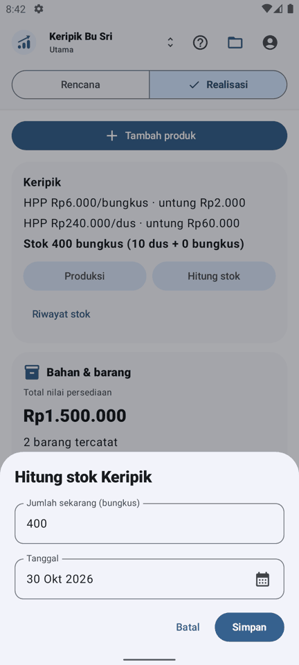 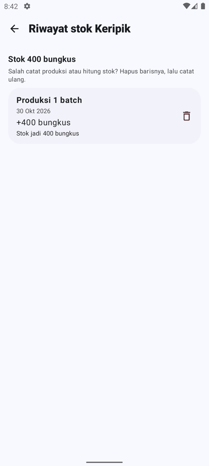

Yang sudah baik: lembar pendek (2 kotak), hasil langsung terbaca ("= 400 bungkus masuk stok"), stok ditampilkan
"400 bungkus (10 dus + 0 bungkus)". Riwayat jelas dan bisa dihapus. Ini contoh pola yang benar.

| Masalah | Tingkat | Usulan | Kapan |
|---|---|---|---|
| "Berapa batch?" berupa kotak ketik; nilai hampir selalu 1–3. | Ringan | Stepper − 1 + (tetap bisa diketik). | sekarang |
| Produksi tidak menyebut biaya ("1 batch = modal Rp2.400.000") dan tidak mengatakan bahwa bahan **tidak** dikurangi otomatis (#9). Pemilik yang melihat stok singkong tetap 50 kg setelah produksi akan mengira app salah. | Sedang | Baris kecil di lembar: "Modal 1 batch Rp2.400.000. Stok bahan tidak dikurangi otomatis — [Kurangi bahan juga]" (pilihan centang opsional di masa depan). | sekarang (teks), nanti (opsi) |
| Hitung stok: tidak menampilkan selisih ("400 → 380 = hilang/rusak 20 bungkus") sebelum disimpan. | Sedang | Tampilkan selisih dan alasan cepat (chip: rusak, dimakan/dibagi, salah hitung). | sekarang |
| **Tombol Back sistem tidak berfungsi** di halaman Riwayat stok (ditekan dua kali, halaman tetap; panah ← bekerja). Pengguna Android terbiasa dengan gerakan/tombol kembali; app terasa "macet". | Berat | Pasang `BackHandler` / navigasi yang benar untuk setiap halaman dan lembar; tambahkan tes instrumented "Back menutup layar" untuk tiap tujuan navigasi. | sekarang |
| Riwayat: ikon tempat sampah merah besar di setiap baris; menghapus produksi seharusnya jarang. Penjualan (nota) tidak terlihat di riwayat stok? (dicek setelah nota dibuat, lihat L-nota). | Ringan | Hapus lewat ketuk-tahan / menu; tanda sumber setiap baris (Produksi, Nota #, Hitung). | sekarang |

### L11. Tab Catatan (kosong) dan tombol +

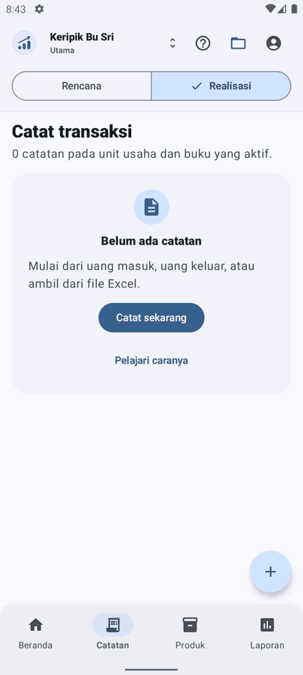 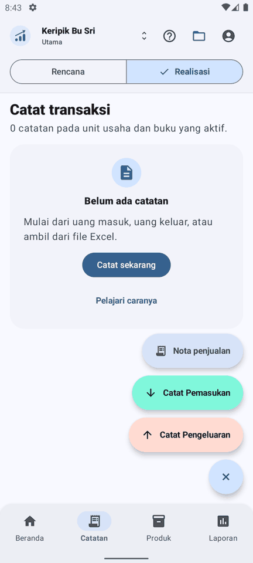

Untuk apa: mencatat dan melihat semua uang masuk/keluar dan nota.

| Masalah | Tingkat | Usulan | Kapan |
|---|---|---|---|
| Judul "Catat transaksi" + "0 catatan pada **unit usaha dan buku** yang aktif". Dua konsep tersembunyi (unit, buku) di kalimat pertama. | Sedang | Judul "Catatan", subjudul dihapus atau "Oktober 2026 · 0 catatan". | sekarang |
| Kartu kosong "Mulai dari uang masuk, uang keluar, atau ambil dari file Excel" tidak menyebut **nota penjualan**, padahal untuk usaha produk penjualan harus lewat nota (F2-4). | Sedang | "Catat penjualan pertama (nota), belanja, atau uang masuk lain." Tombol utama "Buat nota". | sekarang |
| Tombol + membuka tiga pilihan: "Nota penjualan" (biru, lebih kecil), "Catat **Pemasukan**" (hijau), "Catat **Pengeluaran**" (merah). Untuk penjual keripik, "Pemasukan" dan "Nota penjualan" terdengar sama; tidak ada petunjuk kapan memakai yang mana. Huruf kapital dan bentuk tidak seragam; nota tampil paling lemah padahal paling sering dipakai. | Berat | Tiga pilihan dengan bobot sama dan penjelas satu baris: **Jual** ("nota ke pelanggan, potong stok"), **Belanja / bayar** ("bahan, gas, gaji"), **Uang masuk lain** ("modal, pinjaman keluarga, lain-lain"). Untuk usaha tanpa produk, "Jual" membuka form uang masuk sederhana. | sekarang |
| FAB di pojok kanan bawah tanpa label (ikon + saja), berbeda posisi dari tombol "Catat sekarang" di kartu. | Ringan | FAB lebar berlabel "Catat". | sekarang |

### L12. Nota penjualan baru

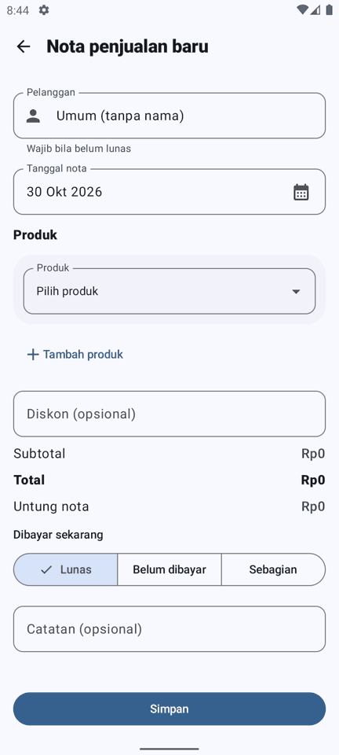 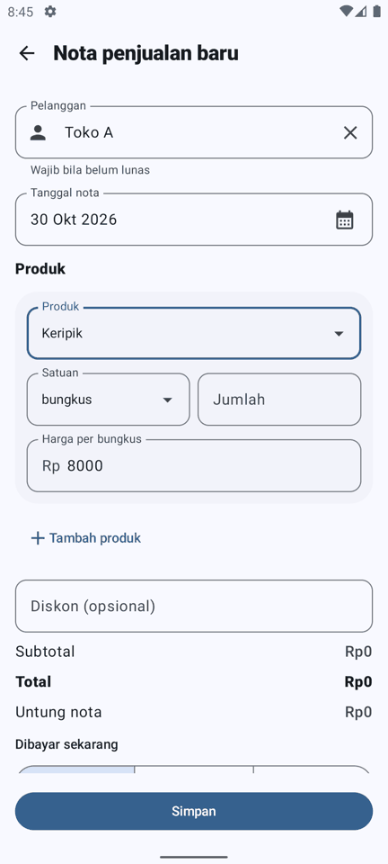 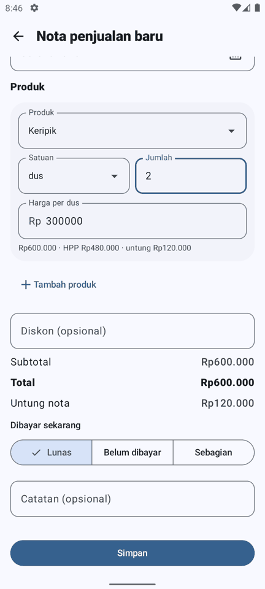 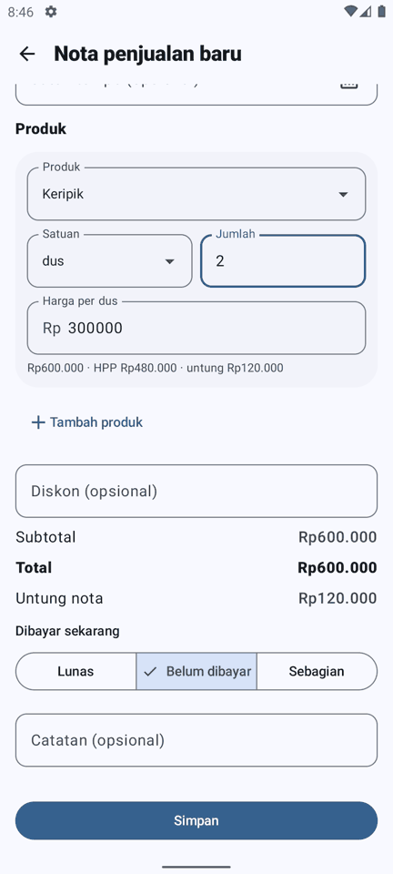

Untuk apa: tugas harian nomor satu — "jual 2 dus ke Toko A, belum bayar".

Yang sudah baik: halaman penuh, Simpan tetap di bawah; memilih produk mengisi harga; untung per baris dan per nota
langsung tampil ("Rp600.000 · HPP Rp480.000 · untung Rp120.000"); status bayar sebagai tombol segmen; pelanggan
"Umum" boleh untuk nota lunas (F2-3). Ini perbaikan nyata dibanding versi 10-28.

Hitungan isian untuk satu nota satu produk: Pelanggan, Tanggal, Produk ▾, Satuan ▾, Jumlah, Harga, Diskon, status,
Catatan = **8 kotak bergaris tepi + 1 segmen**. Ketukan untuk "2 dus ke Toko A belum bayar" (pelanggan sudah ada):
+ → Nota → Pelanggan → pilih → Produk ▾ → Keripik → Satuan ▾ → dus → Jumlah → ketik 2 → tutup keyboard → gulir →
Belum dibayar → Simpan = **±14 ketukan**.

| Masalah | Tingkat | Usulan | Kapan |
|---|---|---|---|
| Baris produk = kartu dengan **4 kotak** (Produk ▾, Satuan ▾, Jumlah, Harga). Untuk nota 3 produk = 12 kotak. Ini pola "form berjejer" yang sama dengan editor produk. | Berat | Pemilih produk sebagai **daftar ketuk**: setiap produk satu baris dengan stepper per satuan jual ("Keripik — dus Rp300.000 [− 2 +] · bungkus Rp8.000 [− 0 +]"). Harga bisa diubah dengan ketuk harga (lembar kecil). Nota menampilkan ringkasan baris "2 dus Keripik · Rp600.000". | sekarang |
| Satuan bawaan "bungkus" walaupun pengusaha grosir hampir selalu menjual "dus". | Sedang | Ingat satuan terakhir per produk/pelanggan; untuk pelanggan toko, bawaan satuan terbesar. | sekarang |
| Tidak menampilkan **stok tersedia** saat memilih jumlah (stok 10 dus); tidak ada peringatan bila jual melebihi stok. | Sedang | "Stok: 10 dus (400 bungkus)" di bawah baris; peringatan kuning bila kurang. | sekarang |
| Status "Belum dibayar" tidak meminta **jatuh tempo**, padahal daftar nota punya filter "Lewat jatuh tempo" dan #18 menjanjikan pengingat. Filter itu tidak akan pernah berisi apa-apa dari form ini. | Berat | Saat Belum dibayar/Sebagian dipilih, muncul chip "Jatuh tempo: 7 hari · 14 hari · 30 hari · pilih tanggal". | sekarang |
| Pilihan "**Titip**" (konsinyasi, #7, F2-6) tidak ada di segmen status. Bisa jadi belum dikerjakan (F2 masih berjalan) — tetap dicatat sebagai celah kegunaan. | Sedang | Tambah segmen keempat "Titip" sesuai rencana F2. | sekarang (F2) |
| "Untung nota Rp120.000" tampil polos di antara Subtotal dan Total, tanpa penekanan; ini angka yang paling ingin dilihat pengusaha. | Ringan | Bilah ringkasan menempel di atas Simpan: "Total Rp600.000 · untung Rp120.000". | sekarang |
| Diskon dan Catatan selalu tampil sebagai kotak penuh, padahal jarang dipakai. | Sedang | Satu baris tautan "+ Diskon" "+ Catatan" yang membuka kotaknya bila diketuk. | sekarang |
| Ruang ketuk "Pelanggan" bermasalah: menyentuh bagian bawah kotak (teks "Umum (tanpa nama)") hanya memfokuskan kolom teks tanpa membuka pemilih; harus menyentuh bagian atas kotak. | Sedang | Seluruh kotak satu target ketuk (read-only field + `clickable` di luar). | sekarang |

### L13. Pilih pelanggan dan Kontak baru

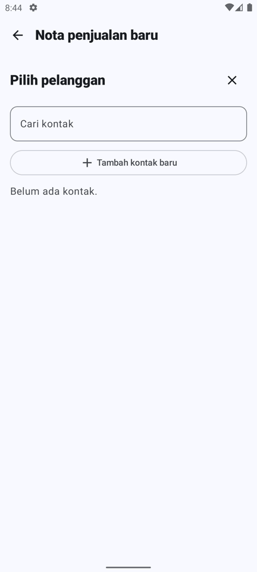 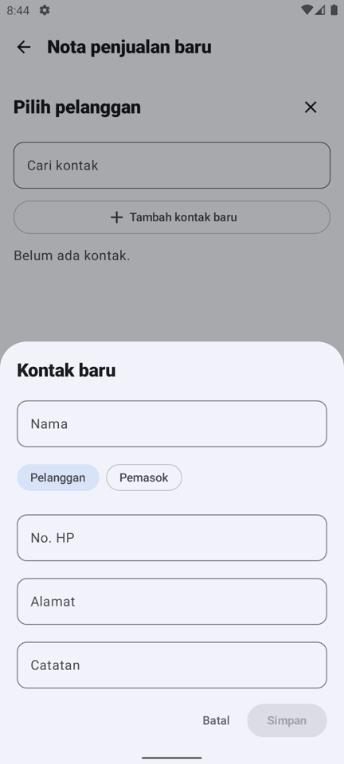

| Masalah | Tingkat | Usulan | Kapan |
|---|---|---|---|
| Halaman pemilih punya dua tombol tutup sekaligus: ← (di bilah atas, milik halaman nota) dan × (milik pemilih). Tidak jelas apakah ← membatalkan nota. | Sedang | Pemilih sebagai halaman/lembar sendiri dengan satu tombol tutup. | sekarang |
| Mengetik nama di "Cari kontak" yang belum ada tidak menawarkan "+ Tambah 'Toko A'"; pengguna harus menekan tombol lalu mengetik nama lagi. | Sedang | Baris "Tambah 'Toko A' sebagai pelanggan" di atas hasil pencarian (1 ketuk). | sekarang |
| Kontak baru: 4 kotak (Nama, No. HP, Alamat, Catatan) + chip Pelanggan/Pemasok. Untuk membuat nota hanya nama yang perlu. | Sedang | Hanya Nama (+ No. HP opsional, dengan tombol ambil dari kontak HP). Alamat & catatan di "Lainnya" / diisi nanti dari halaman kontak. | sekarang |
| Setelah simpan, kontak langsung terpilih dan snackbar "Kontak Toko A disimpan" — **bagus**. | – | – | – |

### L14. Tab Catatan setelah nota pertama

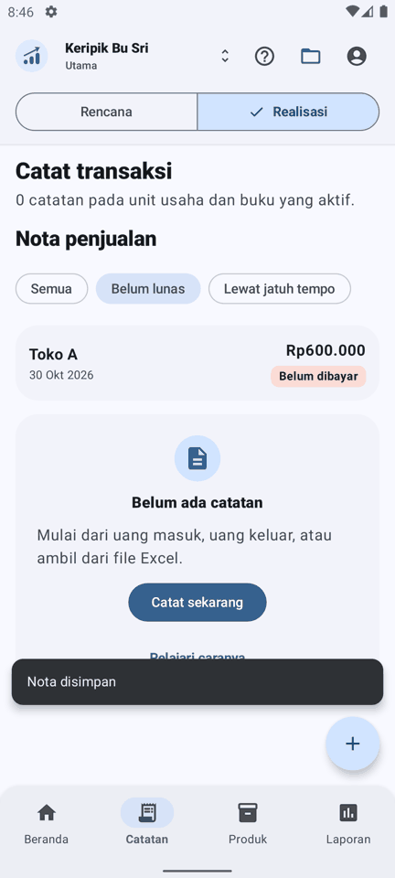

| Masalah | Tingkat | Usulan | Kapan |
|---|---|---|---|
| Setelah menyimpan nota Rp600.000, layar tetap berkata "**0 catatan**" dan menampilkan kartu besar "**Belum ada catatan**" tepat di bawah nota. Pengguna akan mengira nota tidak tersimpan atau bukan "catatan". Dua dunia (nota vs catatan) yang tidak saling kenal. | Berat | Satu daftar kronologis per hari: nota, belanja, uang masuk lain, dengan filter chip (Semua · Nota · Belum lunas · Belanja). Hitungan "N catatan" mencakup nota. Kartu kosong hanya bila semua jenis kosong. | sekarang |
| Bagian "Nota penjualan" dengan 3 chip filter selalu tampil di atas, sehingga catatan uang biasa terdorong ke bawah. Chip "Belum lunas" sudah terpilih bawaan → pengguna tidak melihat nota lunas tanpa mengganti chip. | Sedang | Lihat usulan satu daftar. Bawaan "Semua". "Belum lunas" sebagai kartu ringkas di Beranda ("Tagihan: Rp600.000 dari 1 pelanggan"). | sekarang |
| Baris nota: "Toko A · 30 Okt 2026 · Rp600.000 · Belum dibayar". Tidak menyebut **apa** yang dijual ("2 dus Keripik"). | Sedang | Baris kedua: "2 dus Keripik". | sekarang |

### L15. Detail nota dan lembar Bayar

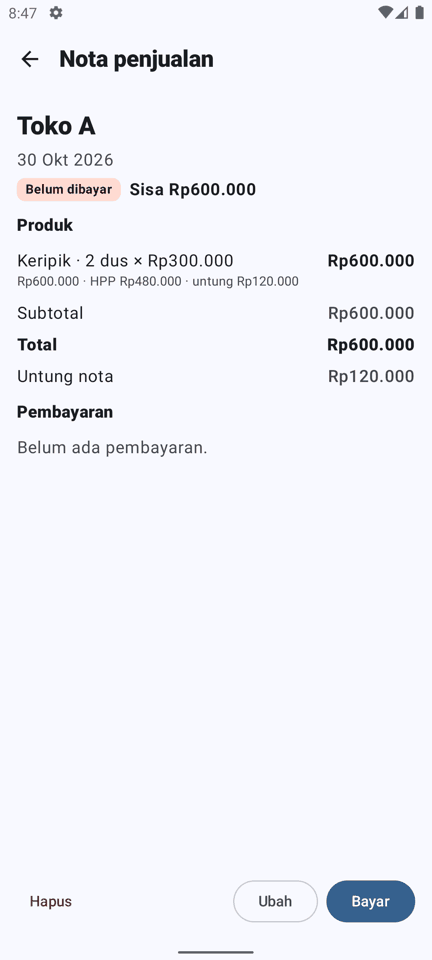 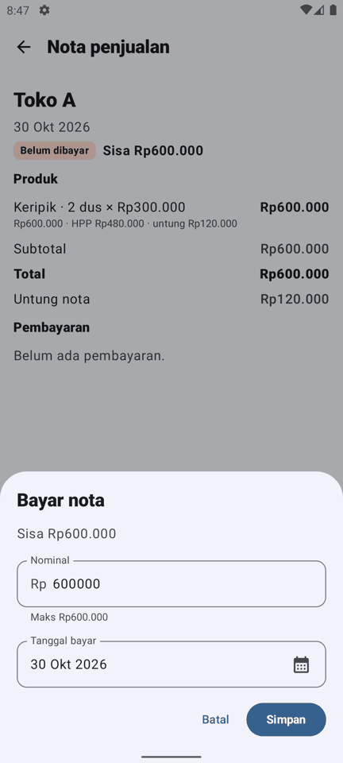 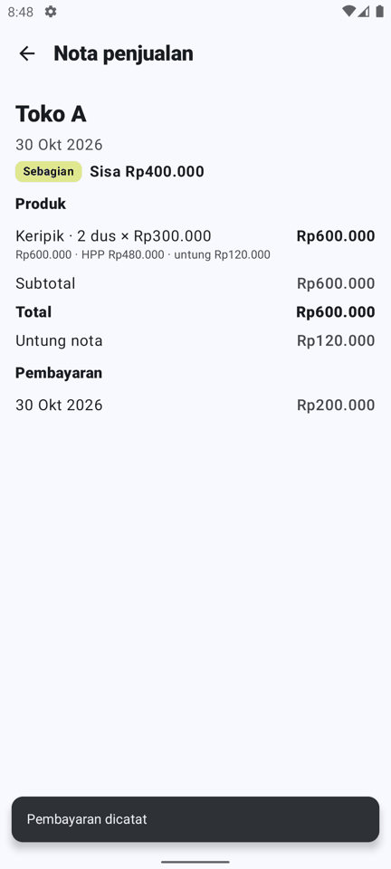

Yang sudah baik: bersih, mudah dibaca, status + sisa di atas, riwayat pembayaran, lembar Bayar pendek dengan nominal
terisi sisa dan batas "Maks". Contoh pola yang benar.

| Masalah | Tingkat | Usulan | Kapan |
|---|---|---|---|
| Tidak ada **Kirim nota** (gambar/teks ke WhatsApp) atau **tagih** ("Halo Toko A, sisa tagihan Rp400.000"). Bagi pengusaha yang menagih toko, ini fitur paling berguna dari nota. | Berat | Tombol "Kirim" (bagikan teks/gambar nota lewat share sheet Android, tanpa izin baru). Di nota belum lunas: "Kirim tagihan". | sekarang |
| Bayar: tidak ada tombol cepat "Lunasi semua" / "Setengah"; nominal penuh terisi bawaan sudah membantu, tetapi untuk bayar sebagian harus menghapus 6 digit. | Ringan | Chip "Lunas Rp400.000 · Rp100.000 · Rp200.000". | sekarang |
| Label "**Nominal**" (bahasa bank). | Ringan | "Jumlah dibayar". | sekarang |
| Tombol "Hapus" teks merah di kiri bawah sejajar dengan Ubah/Bayar; mudah tersentuh. | Ringan | Hapus di menu ⋮ di bilah atas, dengan konfirmasi. | sekarang |
| Tidak ada tautan ke halaman pelanggan (semua nota & sisa Toko A). | Sedang | Nama pelanggan dapat diketuk → halaman kontak. | sekarang |

### L16. Form "Uang masuk" (lembar dari bawah)

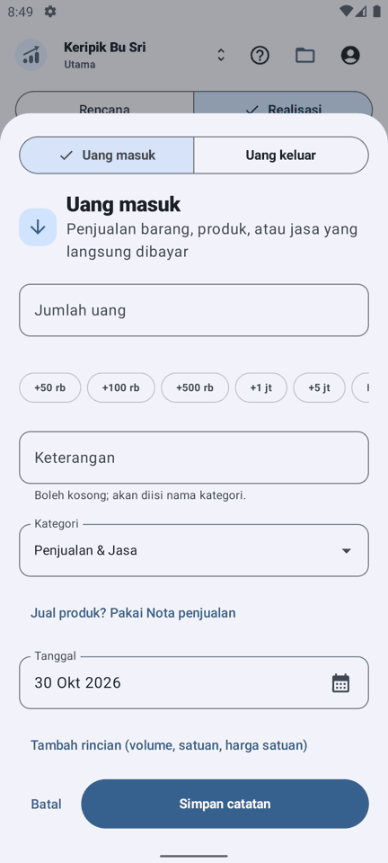 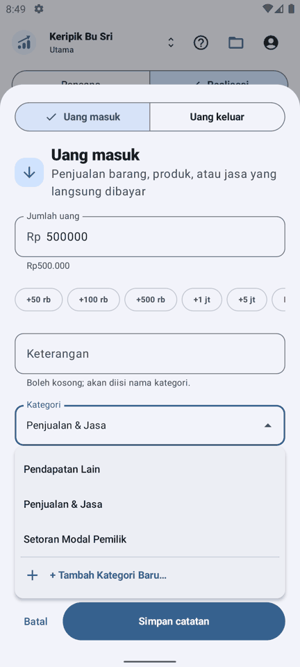 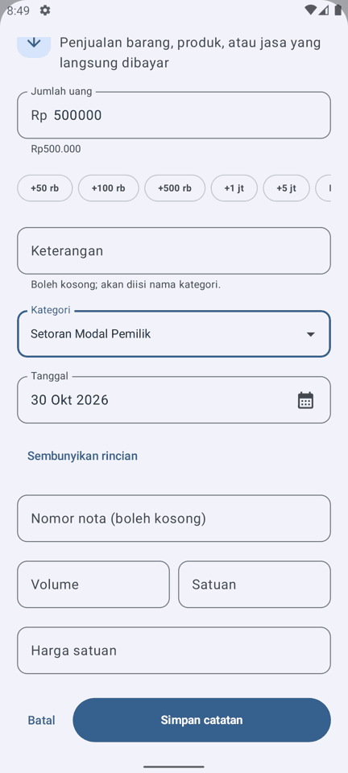

Untuk apa: uang masuk selain nota (modal, lain-lain).

Isian: Jumlah uang, deret tombol +50rb…+5jt, Keterangan, Kategori ▾, Tanggal; dengan "Tambah rincian": Nomor nota,
Volume, Satuan, Harga satuan = **8 kotak bergaris tepi + 1 deret chip + saklar masuk/keluar**, dalam lembar dari
bawah setinggi layar.

| Masalah | Tingkat | Usulan | Kapan |
|---|---|---|---|
| Masih **lembar dari bawah** setinggi layar penuh, padahal #13 memutuskan form panjang = halaman penuh. Nota dan produk sudah halaman penuh; form uang masuk/keluar tidak. Dua pola berbeda untuk tugas yang sejenis = kesan "tidak banyak berubah". | Berat | Halaman penuh yang sama polanya dengan nota (bilah atas ←, Simpan menempel di bawah). | F3 (#13) |
| Subjudul "Penjualan barang, produk, atau jasa yang langsung dibayar" + kategori bawaan "**Penjualan & Jasa**" — bertentangan dengan F2-4 (penjualan produk lewat nota). Tautan "Jual produk? Pakai Nota penjualan" kecil di tengah form. Pengguna masih akan mencatat penjualan keripik di sini (tanpa HPP, tanpa potong stok). | Berat | Untuk usaha yang punya produk: judul "Uang masuk lain", kategori bawaan "Lain-lain"; penjualan diarahkan ke nota di menu +. Untuk usaha jasa tanpa produk: tetap "Penjualan & Jasa". | sekarang |
| Kategori: "**Setoran Modal Pemilik**", "**Pendapatan Lain**", "Penjualan & Jasa" (istilah akuntansi). | Sedang | Chip bahasa sehari-hari: "Modal dari saya", "Penjualan/jasa", "Lain-lain". | sekarang |
| Jumlah uang diketik tanpa titik ribuan; formatnya muncul terpisah di bawah kotak ("Rp500.000"). Dua tampilan angka yang sama. | Sedang | Format di dalam kotak; hapus teks bantu. | sekarang |
| "Tambah rincian (volume, satuan, harga satuan)" menambah 4 kotak, termasuk "Nomor nota" — sisa model lama sebelum ada nota. | Sedang | Untuk uang masuk lain: hapus rincian. Untuk belanja: lihat L17. | sekarang |
| Deret chip +50 rb … +5 jt terpotong di kanan (chip terakhir setengah terlihat), tanpa tanda bisa digeser. | Ringan | Pakai papan angka sendiri dengan tombol "000"; atau chip dalam 2 baris. | sekarang |
| Teks bantu "Boleh kosong; akan diisi nama kategori." menjelaskan perilaku sistem, bukan membantu pengguna. | Ringan | Placeholder contoh: "mis. modal dari suami". | sekarang |
| Tombol "Simpan catatan" lebar + "Batal" teks; label berbeda dari form lain ("Simpan"). | Ringan | Seragam "Simpan". | sekarang |

### L17. Form "Uang keluar" (belanja)

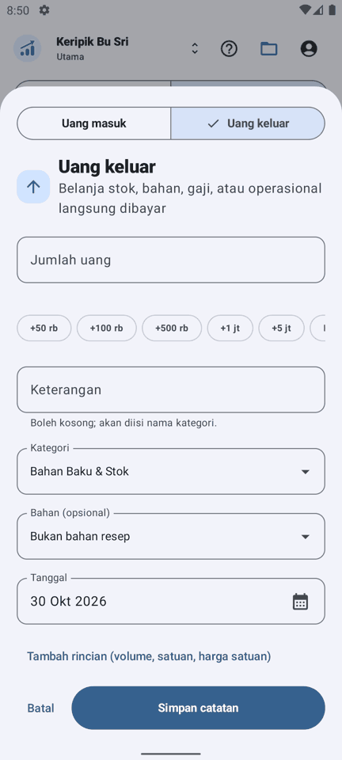 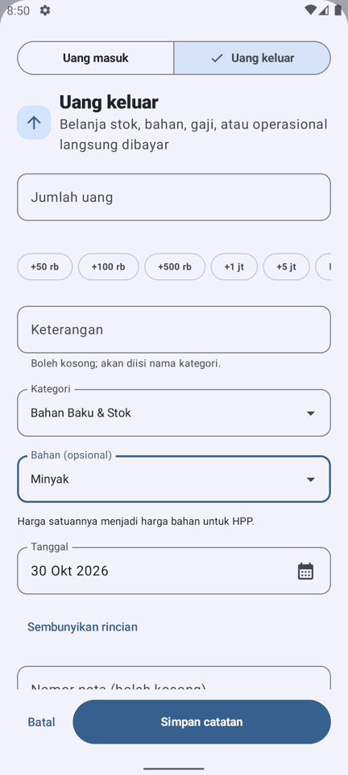 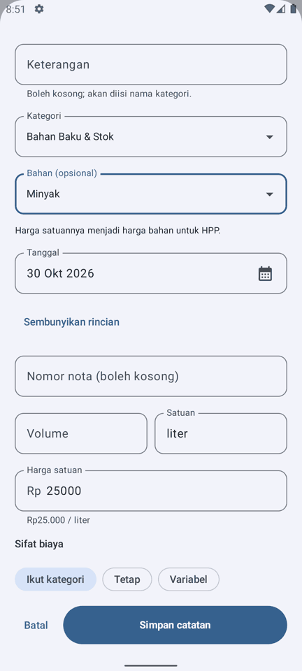 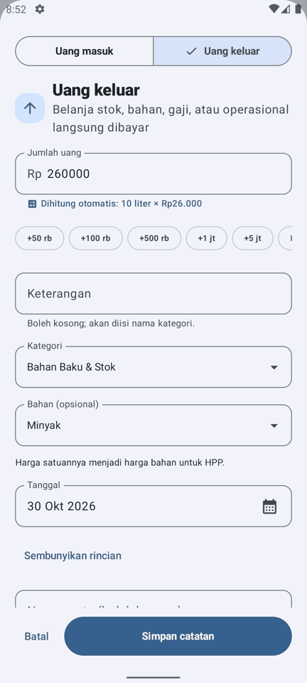 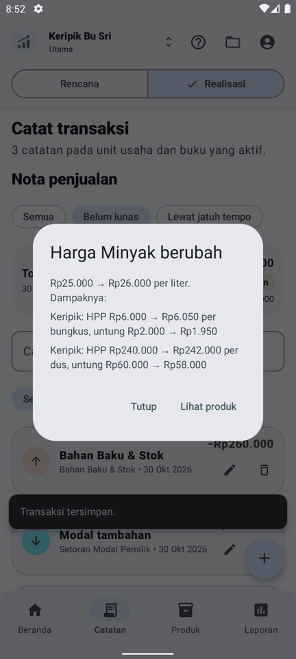

Untuk apa: tugas harian nomor dua — "beli minyak 10 liter Rp26.000/liter".

Isian setelah memilih bahan: Jumlah uang, chip, Keterangan, Kategori ▾, Bahan ▾, Tanggal, Nomor nota, Volume, Satuan,
Harga satuan, Sifat biaya (3 chip) = **9 kotak bergaris tepi + 2 deret chip**. Ketukan untuk belanja minyak:
+ → Uang keluar → Bahan ▾ → Minyak → gulir → Volume → 10 → Harga (hapus 25000) → 26000 → tutup keyboard →
gulir → Simpan = **±12 ketukan**, dan pengguna harus tahu bahwa jumlah uang akan terisi sendiri bila volume & harga diisi.

Yang sudah baik: memilih bahan mengisi satuan dan harga terakhir; jumlah dihitung otomatis ("10 liter × Rp26.000");
setelah simpan muncul dialog **"Harga Minyak berubah"** dengan dampak ke HPP dan untung per bungkus/per dus — sangat
berguna (#20) dan berbahasa pengusaha.

| Masalah | Tingkat | Usulan | Kapan |
|---|---|---|---|
| Urutan terbalik untuk belanja bahan (temuan 10-29 belum berubah): kotak pertama "Jumlah uang", sedangkan bahan, jumlah, dan harga satuan ada di bawah dan sebagian tersembunyi. | Berat | Form belanja dimulai dari "**Beli apa?**" (daftar bahan + "lainnya: gas, gaji, listrik…"). Bila bahan dipilih: Jumlah [10] liter × Harga [26.000] = **Rp260.000** (total besar, otomatis). Bila bukan bahan: langsung Jumlah uang. | sekarang |
| "**Sifat biaya: Ikut kategori / Tetap / Variabel**" masih tampil (temuan 10-29, belum berubah). Istilah kuliah; pemilik tidak tahu harus memilih apa. | Berat | Hapus dari form. Sifat biaya hanya di pengaturan kategori (bila perlu sama sekali; F2-8 sudah memakai tanda "sudah dihitung di HPP" per kategori). | sekarang |
| Kategori dan Bahan adalah dua dropdown terpisah yang saling tumpang tindih ("Bahan Baku & Stok" + "Minyak"). | Sedang | Memilih bahan otomatis menetapkan kategori; kategori hanya tampil untuk belanja non-bahan, sebagai chip (Gas, Kemasan, Gaji, Listrik, Transport, Lain-lain). | sekarang |
| Belum ada pilihan "**Belum dibayar / tempo ke pemasok**" (F2-5) — belanja tempo tidak bisa dicatat. Mungkin belum dikerjakan di F2. | Sedang | Segmen "Lunas / Belum dibayar / Sebagian" seperti nota, dengan pilihan pemasok. | sekarang (F2) |
| Baris hasil di daftar berjudul "**Bahan Baku & Stok**" (nama kategori) karena keterangan kosong, bukan "Minyak 10 liter". | Sedang | Judul otomatis dari bahan dan jumlah: "Minyak · 10 liter". | sekarang |
| Tidak jelas apakah stok Minyak ikut bertambah 10 liter (lihat L05: tidak ada pernyataan). | Sedang | Teks di form: "Stok Minyak +10 liter" dan snackbar setelah simpan. | sekarang |
| "Nomor nota (boleh kosong)" untuk belanja. | Ringan | Ganti dengan "Foto nota" (opsional) di "Lainnya", atau hapus. | nanti |

### L18. Daftar Catatan (berisi)

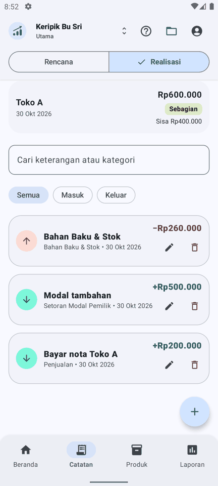

| Masalah | Tingkat | Usulan | Kapan |
|---|---|---|---|
| Tiga lapis kontrol sebelum isi: chip nota (Semua/Belum lunas/Lewat jatuh tempo), kotak cari, chip catatan (Semua/Masuk/Keluar). Dua set chip "Semua" di satu layar. | Sedang | Satu kotak cari (ikon di bilah atas) + satu baris chip: Semua · Penjualan · Belanja · Belum lunas. | sekarang |
| Setiap baris catatan adalah kartu bergaris tepi ±100 dp dengan ikon bulat berwarna, **ikon pensil dan tempat sampah merah** di setiap baris. 3 catatan sudah memenuhi layar; tempat sampah mudah tersentuh. | Sedang | Baris daftar padat 64 dp tanpa kartu: judul + kategori/tanggal kiri, jumlah kanan (hijau +/merah −). Ketuk → detail/ubah; hapus dari dalam detail atau geser + Urungkan. | sekarang |
| Tidak dikelompokkan per hari, tidak ada total harian ("Hari ini: masuk Rp700.000 · keluar Rp260.000"). Pengusaha menutup buku per hari. | Sedang | Judul grup per tanggal dengan total masuk/keluar. | sekarang |
| Pembayaran nota tampil sebagai catatan terpisah "Bayar nota Toko A" berkategori "Penjualan" — benar secara kas, tetapi pengguna bisa mengira penjualan tercatat dua kali (nota Rp600.000 + bayar Rp200.000). | Sedang | Baris pembayaran memakai ikon/teks berbeda: "Terima bayar dari Toko A (nota 30 Okt)" dan diketuk membuka nota. | sekarang |

### L19. Beranda setelah ada transaksi

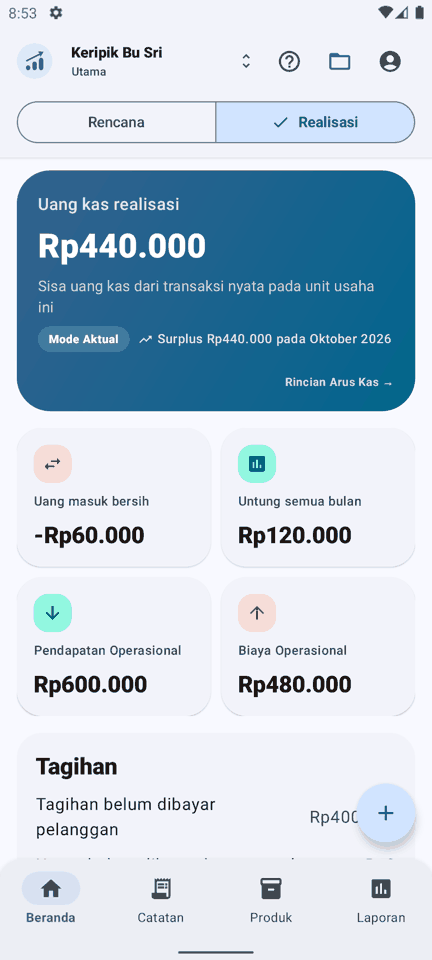 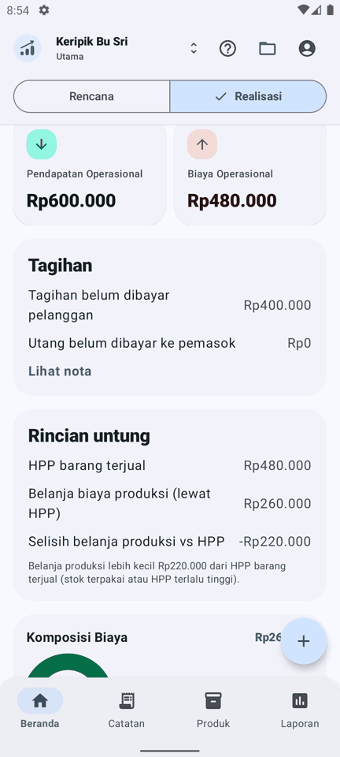 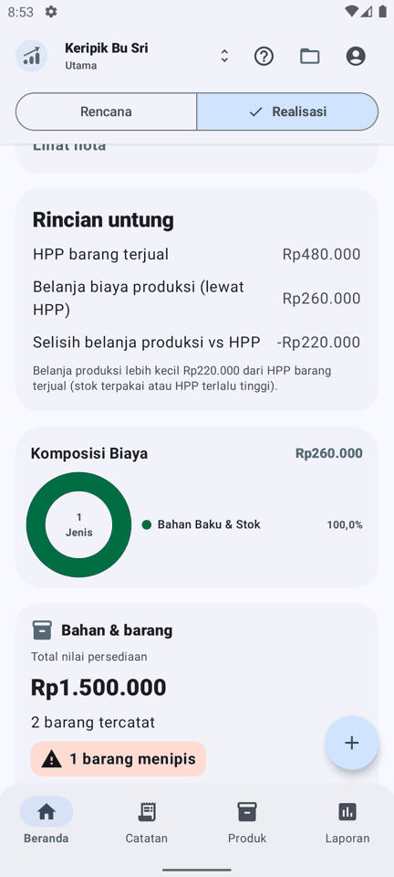

Data saat itu: modal masuk Rp500.000, nota Toko A Rp600.000 (dibayar Rp200.000), belanja minyak Rp260.000.

Angka yang tampil, dari atas: "Uang kas realisasi **Rp440.000**" (Surplus Rp440.000 pada Oktober 2026), "Uang masuk
bersih **−Rp60.000**", "Untung semua bulan **Rp120.000**", "Pendapatan Operasional **Rp600.000**", "Biaya Operasional
**Rp480.000**", Tagihan Rp400.000, Utang Rp0, "Rincian untung": HPP Rp480.000, Belanja biaya produksi Rp260.000,
**Selisih −Rp220.000**, "Komposisi Biaya" (donat 1 jenis 100%), "Bahan & barang" Rp1.500.000.

**Sebelas angka uang di satu layar, dengan tiga angka yang saling bertentangan bagi orang awam**: kas naik Rp440.000
("Surplus"), tetapi "Uang masuk bersih" minus Rp60.000; "Biaya Operasional" Rp480.000 padahal belanja yang dicatat
Rp260.000 (yang tampil ternyata HPP). Pemilik tidak bisa menjawab "bulan ini untung berapa?" tanpa menebak kartu mana
yang benar.

| Masalah | Tingkat | Usulan | Kapan |
|---|---|---|---|
| Angka bertentangan dan nama tumpang tindih (lihat di atas). "Uang masuk bersih −Rp60.000" (kas operasi tanpa modal) di samping "Surplus Rp440.000". "Biaya Operasional" = HPP, tidak sama dengan belanja. | Berat | Beranda maksimal **3 angka utama** dengan nama yang tidak bisa disalahpahami: **Uang di tangan** Rp440.000 · **Untung bulan ini** Rp120.000 (ketuk → rincian: penjualan − HPP − biaya lain) · **Belum dibayar pelanggan** Rp400.000. Semua angka lain pindah ke Laporan. | sekarang |
| Kartu "Tagihan" tidak menyebut **siapa** yang berutang ("Tagihan belum dibayar pelanggan Rp400.000" + "Lihat nota"). Pertanyaan pemilik adalah "siapa yang belum bayar?". | Berat | Daftar 3 pelanggan teratas: "Toko A · Rp400.000 · 0 hari" (ketuk → halaman pelanggan / kirim tagihan) + "Lihat semua". Jatuh tempo terdekat di atas. | sekarang |
| Kartu "**Rincian untung**" berisi "Belanja biaya produksi (lewat HPP)", "**Selisih belanja produksi vs HPP −Rp220.000**" + penjelasan "stok terpakai atau HPP terlalu tinggi". Ini rekonsiliasi akuntansi (F2-1) yang ditaruh di layar utama; pemilik akan membaca "−Rp220.000" sebagai rugi. | Berat | Pindahkan ke Laporan → Untung → "Kenapa untung beda dengan uang?" (lipat). Di Beranda tidak ada selisih. | sekarang (pindah), F4 (bentuk akhir) |
| "Komposisi Biaya" donat besar untuk 1 kategori (100%). Grafik tanpa makna, makan ±400 dp. | Sedang | Hapus dari Beranda; di Laporan tampil hanya bila ≥3 kategori, sebagai batang horizontal. | sekarang |
| Kartu "Bahan & barang" tetap "Rp1.500.000 · 1 barang menipis" setelah membeli 10 liter minyak: belanja bahan **tidak menambah stok bahan**, dan peringatan "menipis" tetap. (Bila disengaja, pengguna tidak diberi tahu.) | Berat | Belanja bahan = stok bahan bertambah (atau tanyakan dengan centang "Tambah ke stok Minyak", bawaan menyala). Lihat juga L07: gerak stok "Masuk" tidak mencatat uang. Satu kejadian beli = satu catatan yang mengubah uang dan stok. | sekarang |
| Tidak ada stok produk jadi ("Keripik: 8 dus tersisa") padahal produk adalah pusat (#9). | Sedang | Baris "Stok produk" ringkas dengan peringatan bila di bawah batas. | sekarang |
| Tidak ada aksi cepat di Beranda (Jual, Belanja, Produksi). Semua lewat FAB + menu. | Sedang | Tiga tombol besar di bawah angka utama: **Jual** · **Belanja** · **Produksi**. | F3 |
| Gradien besar + 4 kartu ikon + 4 kartu putih + donat: tidak ada satu titik fokus. Layar harus digulir ±3 kali. | Sedang | Beranda muat dalam 1–1,5 layar. Lihat aturan di "Pola lintas layar". | F3 |

### L20. Berkas dan Data (ikon folder di header)

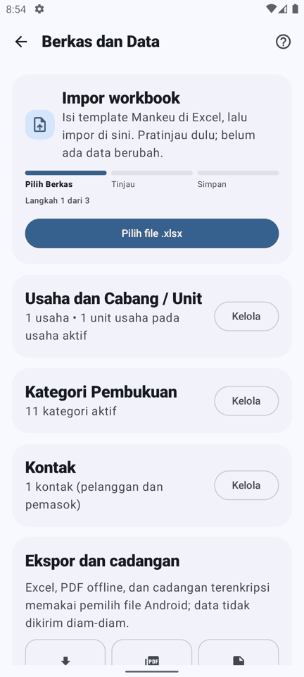 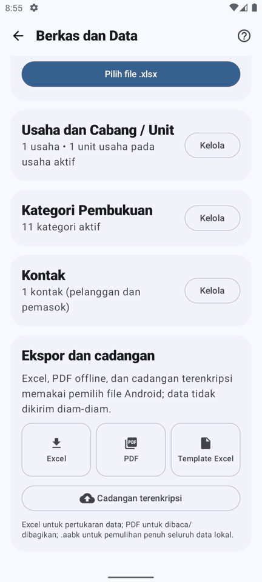

Untuk apa: impor/ekspor, cadangan — dan ternyata juga **Kontak**, Kategori, serta Usaha/Unit.

| Masalah | Tingkat | Usulan | Kapan |
|---|---|---|---|
| **Kontak** (pelanggan & pemasok, "siapa yang belum bayar") tersembunyi di balik ikon folder tanpa label, di layar bernama "Berkas dan Data", di bawah kartu Impor. Tidak ada jalan ke Kontak dari Beranda, Catatan, atau tab bawah. | Berat | Kontak dibuka dari kartu Tagihan di Beranda dan dari Catatan (chip "Pelanggan"). Di navigasi F3, Kontak masuk ke tab Catat atau menjadi bagian Beranda "Tagihan & pelanggan". | sekarang (tautan), F3 |
| Kartu teratas = **Impor workbook** dengan langkah 1-2-3 dan tombol utama besar. Impor dilakukan sekali seumur usaha; di sini menjadi hal paling menonjol. Kata "workbook". | Sedang | Urutan: Cadangan (paling penting untuk keamanan data) → Ekspor Excel/PDF → Impor dari Excel (baris biasa) → Pengaturan data (Kategori, Usaha). "Workbook" → "file Excel". | sekarang |
| "**Kategori Pembukuan**", "**Usaha dan Cabang / Unit** – 1 unit usaha pada usaha aktif" (kata pembukuan, unit). | Sedang | "Kategori uang masuk/keluar"; "Usaha" (unit disembunyikan, #15). | sekarang |
| Tiga tombol kotak sama besar Excel / PDF / Template Excel + tombol "Cadangan terenkripsi" + catatan kaki ".aabk". Pengguna tidak tahu bedanya. | Sedang | Baris daftar dengan penjelas tujuan: "Simpan salinan aman (bisa dipulihkan)", "Kirim laporan PDF", "Buka di Excel", "Unduh template kosong". Ekstensi `.aabk` tidak disebut. | sekarang |
| Setiap bagian = kartu besar + tombol "Kelola" bergaris tepi di kanan; pola yang sama dengan lembar Usaha (kartu besar untuk satu baris informasi). | Ringan | Daftar pengaturan biasa (baris 56–72 dp, chevron ›). | sekarang |

### L21. Kontak (daftar dan ubah)

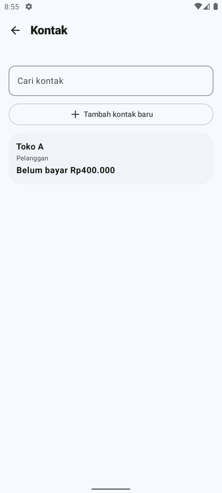 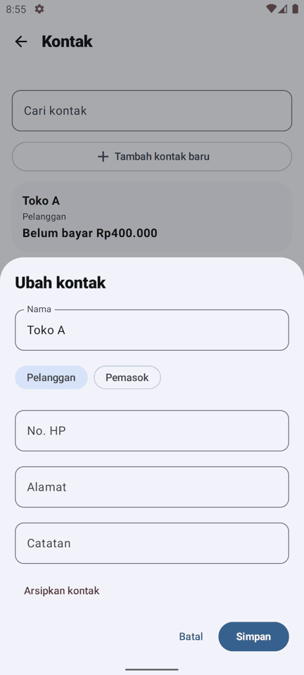

| Masalah | Tingkat | Usulan | Kapan |
|---|---|---|---|
| Daftar menampilkan "Toko A · Pelanggan · **Belum bayar Rp400.000**" — bagus. Tetapi mengetuk kontak hanya membuka **form ubah** (5 isian + Arsipkan). Tidak ada halaman pelanggan: daftar nota, total belanja, sisa tagihan, tombol "Terima bayar" / "Kirim tagihan" / telepon/WA. | Berat | Ketuk kontak → **halaman pelanggan**: sisa tagihan besar + tombol Terima bayar & Kirim tagihan; daftar nota (belum lunas di atas); total pembelian bulan ini. "Ubah" di menu ⋮. | sekarang |
| Daftar tidak diurutkan menurut tagihan; tidak ada total "Semua pelanggan belum bayar Rp400.000". | Sedang | Urut: yang berutang terbesar/terlama di atas; ringkasan total di atas daftar; chip Pelanggan/Pemasok. | sekarang |
| Kotak "Cari kontak" + tombol garis "Tambah kontak baru" lebar penuh di atas — dua kontrol bergaris tepi bertumpuk sebelum isi. | Ringan | Cari di bilah atas, tambah sebagai FAB. | sekarang |
| "Arsipkan kontak" teks merah kecil di form. | Ringan | Pindah ke menu ⋮ halaman pelanggan. | sekarang |

### L22. Kategori Pembukuan

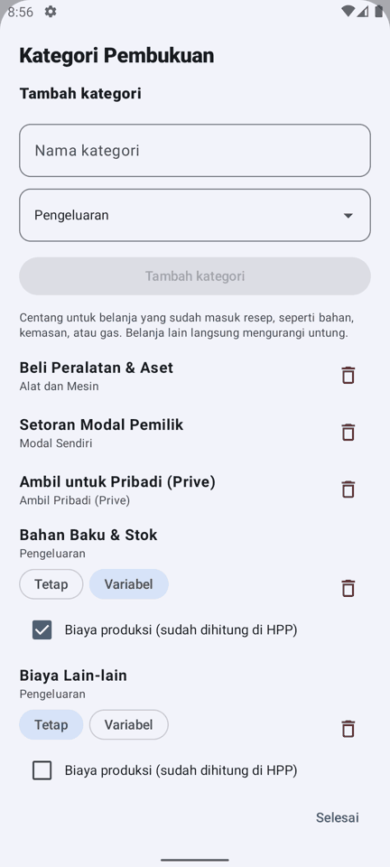

| Masalah | Tingkat | Usulan | Kapan |
|---|---|---|---|
| Penuh istilah akuntansi: "Beli Peralatan & **Aset**", "Setoran Modal Pemilik", "Ambil untuk Pribadi (**Prive**)", subjudul "Alat dan Mesin", "Modal Sendiri", chip **Tetap / Variabel**, centang "Biaya produksi (sudah dihitung di HPP)". | Berat | Nama kategori bawaan dalam bahasa sehari-hari ("Beli alat", "Modal dari saya", "Ambil untuk pribadi"). Chip Tetap/Variabel dihapus dari layar (biarkan nilai bawaan). Centang HPP diganti kalimat: "Belanja ini sudah termasuk resep (jangan kurangi untung dua kali)". | sekarang |
| Form tambah (2 kotak + tombol abu) menempel di atas daftar; setiap baris punya ikon tempat sampah merah, termasuk kategori sistem (Modal, Prive) yang mungkin tidak boleh dihapus. | Sedang | Daftar dikelompokkan "Uang masuk" / "Uang keluar"; tambah lewat FAB; hapus di dalam detail kategori; kategori sistem tanpa tombol hapus. | sekarang |
| Lembar setinggi layar dengan tombol "Selesai" teks kecil di kanan bawah (bukan "Simpan"; perubahan centang langsung tersimpan tanpa umpan balik). | Ringan | Halaman penuh dengan ←; snackbar saat centang berubah. | sekarang |

### L23. Cadangan terenkripsi

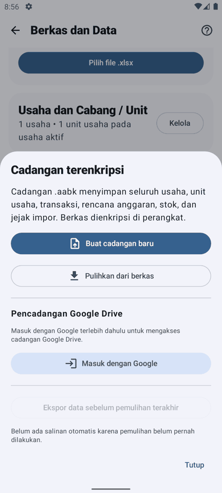

| Masalah | Tingkat | Usulan | Kapan |
|---|---|---|---|
| Teks: "Cadangan **.aabk** menyimpan seluruh usaha, **unit usaha**, transaksi, **rencana anggaran**, stok, dan **jejak impor**. Berkas **dienkripsi** di perangkat." Empat istilah teknis dalam satu kalimat pembuka. | Sedang | "Simpan salinan semua data ke file yang dikunci kata sandi. Pakai file ini untuk pindah HP atau kalau HP hilang." | sekarang |
| Tidak menampilkan **kapan terakhir dicadangkan** dan tidak ada pengingat. Bagi app offline, kehilangan HP = kehilangan seluruh buku. | Berat | Baris status di atas: "Terakhir dicadangkan: belum pernah" (merah) / "3 hari lalu"; pengingat mingguan di Beranda bila >7 hari. | sekarang |
| Tiga bagian dalam satu lembar (file, Google Drive, "Ekspor data sebelum pemulihan terakhir" abu-abu yang tidak bisa dipakai). Tombol mati tampil tanpa alasan yang jelas bagi pengguna. | Sedang | Sembunyikan tombol yang tidak berlaku; Drive menjadi satu baris "Sinkron ke Google Drive (mati)". Rencana F5 menggabungkannya. | F5 |

### L24. Pengaturan (ikon orang di header)

 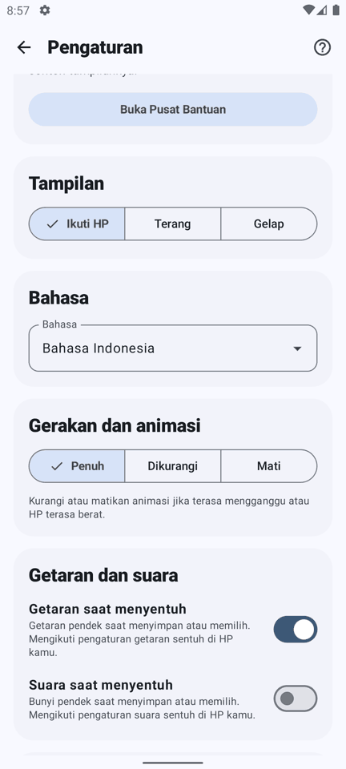

| Masalah | Tingkat | Usulan | Kapan |
|---|---|---|---|
| Ikon **orang** membuka "Pengaturan"; ikon folder membuka "Berkas dan Data"; ikon ? membuka bantuan. Tiga pintu tanpa label dengan isi yang saling silang (cadangan Drive ada di dua tempat; Pusat Bantuan juga ada di dalam Pengaturan). | Sedang | Satu pintu "Lainnya" (atau tab ke-5 / menu ☰) berisi daftar berlabel: Kontak, Cadangan & salinan, Excel & PDF, Kategori, Usaha, Tampilan, Bantuan, Tentang. | F3 |
| Layar dibuka dengan kartu Akun + kolom "Nama kamu" + tombol besar "Masuk dengan Google" + kotak info "offline-first" + kartu "**Sinkronisasi antar-HP**" dengan paragraf 5 baris "akun usaha, bukan akun pribadi kasir... kata sandi sync". Dua tombol biru besar "Masuk dengan Google" berturut-turut. | Sedang | Satu baris "Akun Google: belum masuk ›". Sinkron sebagai satu baris dengan status. Penjelasan panjang dipindah ke bantuan. Istilah "offline-first", "sync" diganti. | sekarang |
| "Gerakan dan animasi", "Getaran dan suara" — dua kartu untuk preferensi yang jarang diubah, setara bobotnya dengan Akun. | Ringan | Kelompok "Tampilan & suara" di bagian bawah, baris ringkas. | sekarang |
| "Hapus semua data" berada di tengah halaman di antara pengaturan biasa, dengan tombol bergaris tepi biasa. | Sedang | Pindah ke paling bawah, bagian "Zona bahaya", warna merah, konfirmasi ketik nama usaha. | sekarang |
| Kartu "Tentang Mankeu" menjanjikan "susun rencana usaha, hitung titik impas (**BEP**)" — istilah BEP, dan tidak menyebut nota, piutang, HPP. | Ringan | Perbarui deskripsi ke fitur nyata, bahasa awam. | F7 |
| Hubungi Kami meminta "sertakan nama **unit usaha**". | Ringan | "sertakan nama usaha". | sekarang |

### L25. Bantuan (lembar ?) dan Pusat Bantuan

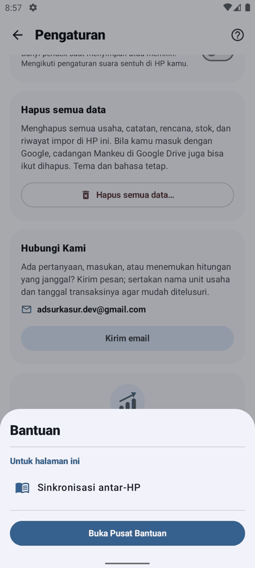  

| Masalah | Tingkat | Usulan | Kapan |
|---|---|---|---|
| Artikel "**Mencatat penjualan**" mengajarkan cara lama yang kini **salah**: "dicatat sebagai Pemasukan berkategori penjualan... Pastikan Realisasi dipilih... Pilih Catat Pemasukan". Nota penjualan tidak disebut. Pengguna yang membaca bantuan akan mencatat penjualan tanpa HPP dan tanpa potong stok. | Berat | Sebelum rilis berikutnya: tulis ulang minimal artikel "Mencatat penjualan" (pakai nota), "Tagihan/piutang", "Produk & HPP". Artikel yang menjelaskan alur yang sudah dihapus/akan dihapus diberi label "versi lama" atau disembunyikan. Penulisan lengkap tetap di F7. | sekarang (3 artikel), F7 |
| Daftar topik penuh istilah: "cabang/unit", "Rencana dan Realisasi", "sifat biaya", "Setoran modal, ambil pribadi", "aset", contoh pencarian "**BEP**". | Sedang | Topik berbentuk pertanyaan pengusaha: "Bagaimana mencatat penjualan ke toko?", "Siapa yang belum bayar?", "Berapa untung saya bulan ini?", "Bagaimana menghitung HPP?". | F7 |
| Gambar contoh di artikel memakai tampilan lama (saklar Rencana/Realisasi, "Kedai Kopi Senja"). | Ringan | Screenshot ulang setelah F3. | F7 |
| Setiap topik dibungkus kartu abu-abu tinggi (±60 dp) dengan ikon buku yang sama; 15+ kartu identik. | Ringan | Daftar polos dengan pemisah. | F7 |

### L26. Laporan – tab "Laba Rugi dan Arus Kas"

  

Untuk apa: menjawab "bulan ini untung berapa, uangnya ke mana".

| Masalah | Tingkat | Usulan | Kapan |
|---|---|---|---|
| Istilah laporan formal di layar utama (melanggar #19): "**Pendapatan Operasional**", "**Biaya Operasional**", "Untung / Rugi **semua bulan**", "**Arus Kas Operasi / Investasi / Pembiayaan**", "Saldo Kas Akhir", "Saldo Kas **Kumulatif**", "Arus Bersih", "penyusutan", subjudul "dari catatan transaksi dan **anggaran**". | Berat | Bahasa awam: "Penjualan", "Modal barang terjual (HPP)", "Biaya lain", "**Untung**"; arus kas: "Uang masuk dari jualan", "Uang keluar belanja", "Modal masuk/diambil", "Uang di tangan akhir bulan". Istilah formal hanya di PDF. | F4 |
| Tidak ada **pemilih bulan**; angka "semua bulan" dicampur dengan kartu per bulan. Pertanyaan pemilik selalu "bulan ini" atau "bulan lalu". | Berat | Pemilih bulan (‹ Oktober 2026 ›) di atas; semua angka mengikuti bulan terpilih; "Sepanjang waktu" sebagai pilihan. | F4 |
| Kartu laba rugi berisi juga HPP, "Selisih belanja produksi vs HPP −Rp220.000" + penjelasan, Tagihan & Utang, dan paragraf definisi kecil 4 baris. Satu kartu mencampur laba, rekonsiliasi, dan piutang. | Sedang | Laba rugi ringkas 4 baris (Penjualan − HPP − Biaya lain = Untung). Rekonsiliasi di bagian lipat "Kenapa uang di tangan beda dengan untung?". Piutang di kartu terpisah. | F4 |
| Grafik batang satu bulan (satu batang penuh) + kartu per bulan yang mengulang angka yang sama; temuan "24 kartu besar" 10-29 belum berubah. | Sedang | Grafik baru bermakna ≥2 bulan; kartu bulanan diganti tabel ringkas yang bisa dilipat. | F4 |
| Saklar Rencana/Realisasi tetap tampil; tiga tab dengan label dua baris yang terpotong ("Laba Rugi dan Arus Kas", "Kelayakan & BEP", "Realisasi vs Target"). | Berat | (F3) hapus saklar; (F4) tab: "Untung" · "Uang" · "Rencana vs nyata". | F3/F4 |

### L27. Laporan – tab "Kelayakan & BEP"

| Masalah | Tingkat | Usulan | Kapan |
|---|---|---|---|
| Lencana hijau "**Layak**" dengan "Biaya tetap dan penyusutan Rp0" dan "Sudah melewati titik impas bulan ini (Rp0)" — temuan 10-29 ("Layak terlalu dini") **belum diperbaiki**, padahal #14 menetapkan "Layak hanya bila biaya tetap terisi". | Berat | Bila biaya tetap belum ada: "Belum bisa dinilai — isi biaya tetap bulanan (sewa, gaji) dulu" + tombol ke Rencana. | sekarang |
| **Angka tidak cocok antar layar**: di sini "Belanja bahan/barang **Rp224.000** lebih kecil dari kebutuhan resep", di Beranda dan tab Laba Rugi "Selisih belanja produksi vs HPP **−Rp220.000**". Dugaan (inferred): tab ini memakai HPP terkini (Rp6.050 × 80 = Rp484.000) sedangkan yang lain memakai HPP snapshot nota (Rp480.000). Menurut aturan produk, selisih tak terjelaskan tidak boleh tampil. | Berat | Satu fungsi domain untuk selisih belanja-vs-HPP dipakai semua layar (HPP snapshot); tes golden yang membandingkan Beranda, Laba Rugi, dan Kelayakan. | sekarang |
| "**Rasio Penerimaan atas Biaya (R/C Ratio): 1,25**", "Status **BEP**", "Omzet", "**penyusutan**", "Pembiayaan Terpakai ... setoran modal dan **prive**" di layar biasa (melanggar #19). | Berat | R/C, B/C, BEP hanya di "Rincian analisis" + PDF. Di layar: "Untung bulan ini", "Perlu jual X dus/bulan supaya tidak rugi". | F3/F4 |
| "Total biaya Rp480.000" (= HPP saja) disebut "Total biaya". | Sedang | "Modal barang terjual Rp480.000"; biaya lain terpisah. | F4 |

### L28. Laporan – tab "Realisasi vs Target"

| Masalah | Tingkat | Usulan | Kapan |
|---|---|---|---|
| Angkanya **berbeda** dengan tab pertama untuk bulan yang sama: Pendapatan **Rp200.000** (di tab Laba Rugi Rp600.000), Biaya Operasional **Rp260.000** (di tab Laba Rugi Rp480.000), "Laba / Rugi kas **−Rp60.000**" (di tab Laba Rugi untung Rp120.000). Tab ini masih basis kas tanpa HPP, persis temuan 10-29 CP6. Pemilik melihat "untung Rp120.000" dan "rugi Rp60.000" untuk bulan yang sama. | Berat | Rencana vs nyata memakai definisi untung yang sama dengan Laba Rugi (penjualan − HPP − biaya). Bila ingin menampilkan kas, beri baris terpisah berlabel "Uang". | sekarang (definisi), F4 (tata letak) |
| Tanpa rencana (Rp0), "Selisih Rp200.000" hijau dan "Selisih Rp260.000" merah tetap tampil — perbandingan dengan nol tidak bermakna. | Sedang | Bila rencana kosong: kartu ajakan "Buat rencana sebulan normal untuk membandingkan". | F4 |
| Kalimat pembuka "Rata-rata per bulan: rencana 1 bulan, realisasi 1 bulan tercatat. Semua angka **basis kas, sebelum penyusutan**". | Sedang | Hapus; label kolom "Rencana" dan "Nyata" cukup. | F4 |

### L29. Mode Rencana (saklar) – Beranda dan Laporan

 

| Masalah | Tingkat | Usulan | Kapan |
|---|---|---|---|
| Menekan "Rencana" mengubah isi **semua tab**: Beranda menjadi "Uang kas rencana Rp0 · Mode Rencana" dengan empat kartu Rp0 yang bentuknya sama persis dengan mode nyata. Pengguna tidak bisa membedakan dua mode selain dari kata kecil di chip. Risiko salah catat dan salah baca sangat tinggi. Ini inti keluhan demo 10-28 dan **belum berubah sama sekali**. | Berat | Hapus saklar (#4). Rencana Usaha = satu halaman yang dibuka dari kartu di Beranda ("Rencana usaha: perlu jual 20 dus/bulan untuk tidak rugi ›"). | F3 (prioritas 1) |

### L30. Rencana Usaha (tab Catatan dalam mode Rencana) dan lembar-lembarnya

      

Untuk apa: "kalau saya jual sekian, sebulan untung berapa, perlu modal berapa, kapan balik modal".

| Masalah | Tingkat | Usulan | Kapan |
|---|---|---|---|
| Rencana masih tersembunyi di **tab Catatan** dan hanya muncul bila saklar di header dipindah (temuan 10-29 CP3, belum berubah). | Berat | Halaman sendiri dari Beranda (#4). | F3 |
| "**Periode rencana** Okt 2026 – Okt 2026 (1 bulan)" + lembar dengan dua kalender "Bulan mulai / Bulan selesai" yang memilih **tanggal** (1 Okt 2026) padahal yang dipakai bulan. #14 menghapus periode. | Berat | Hapus. Rencana = "sebulan normal" + "modal awal". | F3 |
| Kartu Kelayakan: "**BEP** Keripik **769,231 bungkus**" (pecahan bungkus, tidak dalam dus), "**R/C Ratio 0 · B/C Ratio −1**", sebelum biaya tetap: "R/C Ratio tidak terdefinisi · B/C Ratio tidak terdefinisi"; "Kebutuhan modal = **defisit kas terdalam** dari operasi dan pembelian aset...". | Berat | Kalimat jawaban: "Supaya tidak rugi, jual minimal **770 bungkus (±20 dus) sebulan**." "Untung sebulan pada target: Rp…", "Modal yang perlu disiapkan: Rp…", "Balik modal: N bulan". Rasio di "Rincian analisis". | F3 |
| "**Tidak Layak**" merah muncul hanya karena target penjualan belum diisi ("target -/bulan"), sehingga untung = −biaya tetap. Pengguna dihakimi sebelum selesai mengisi. Sebaliknya di Laporan (L27) muncul "Layak" dengan biaya tetap Rp0. | Berat | Status hanya bila target per produk **dan** biaya tetap terisi; sebelum itu daftar "yang belum diisi". | F3 |
| Target penjualan per bulan tidak bisa diisi dari Rencana: mengetuk "Keripik" membuka **editor produk lengkap** (19 kotak, L08) dan target ada di bagian lipat paling bawah. | Berat | Di Rencana, setiap produk satu baris dengan stepper/kolom "dus per bulan" langsung di tempat. | F3 |
| Lima bagian berkartu dengan teks penjelas 2–3 baris masing-masing: Produk, Biaya Tetap per Bulan, "Biaya dan Pendapatan Lain", "**Aset dan Penyusutan**", "Setoran Modal". | Sedang | Dua bagian saja (#14): "Sebulan normal" (penjualan per produk + biaya tetap) dan "Modal awal" (alat + persiapan). "Penyusutan" dihitung diam-diam dari umur pakai. | F3 |
| Lembar "Biaya Tetap per Bulan": kategori bawaan "Biaya Lain-lain" walau nama "Gaji karyawan" (temuan 10-29); label "**Nominal** per bulan". | Sedang | Chip kategori cepat (Gaji, Sewa, Listrik, Lain-lain), tebak dari nama. | F3 |
| Lembar "Biaya dan Pendapatan Lain": kategori bawaan "**Ambil untuk Pribadi (Prive)**" — bawaan yang keliru dan istilah asing; isian "Sekali / Setiap bulan" + "Bulan (opsional)". | Berat | Hapus bagian ini (lihat usulan dua bagian). Bila tetap ada, bawaan "Biaya lain". | F3 |
| Lembar "Aset dan Penyusutan": Nama, Kategori "Beli Peralatan & Aset", Nominal, "Umur pakai (bulan) 36", "Bulan (opsional)" — 5 kotak dengan istilah aset. | Sedang | "Alat yang dibeli (wajan, mesin, etalase)": Nama + Harga; umur pakai di "lainnya". | F3 |
| Deskripsi Produk di Rencana masih "resep biaya **per satuan**" (model lama; kini per batch). | Ringan | "resep per batch". | sekarang |

### L31. Ekspor PDF (file hasil)

Diperiksa isi PDF yang dihasilkan (`laporan-keuangan-utama-2026-10-30.pdf`, 3 halaman, tidak disimpan di repo).

| Masalah | Tingkat | Usulan | Kapan |
|---|---|---|---|
| Nama file memakai nama **unit** ("laporan-keuangan-**utama**-…"), bukan nama usaha. Lima usaha akan menghasilkan lima file "utama". | Sedang | `laporan-keripik-bu-sri-2026-10.pdf`. | sekarang |
| Halaman 1 dibuka dengan bagian "**Proyeksi**" (rencana) berisi "Kas −Rp1.500.000", "Beban", "Arus kas pendanaan", "Anggaran (1 item aktif)". Orang yang menerima PDF (bank, koperasi, keluarga) membaca "Kas minus 1,5 juta" di halaman pertama. Kalimat "posting **debit/kredit** aplikasi". | Berat | Halaman 1 = ringkasan nyata bulan ini (penjualan, untung, uang di tangan, piutang). Rencana di bagian akhir dengan judul jelas "Rencana (bukan data nyata)". | F4 |
| Tidak ada daftar nota/penjualan per produk atau daftar piutang per pelanggan — hanya 3 "transaksi" kas. Nota Rp600.000 ke Toko A tidak muncul sebagai penjualan. | Sedang | Bagian "Penjualan per produk" dan "Belum dibayar per pelanggan". | F4 |
| Istilah (wajar di PDF menurut #19, tetapi campur aduk): "Margin kontribusi (CM)", "Biaya variabel per unit (VC)", "BEP 769,231 bungkus". | Ringan | Tetap formal, tetapi konsisten dan dengan satuan bulat (770 bungkus ≈ 20 dus). | F4 |

### L32. Keadaan lain: mode gelap, filter kosong, konfirmasi hapus

  

| Masalah | Tingkat | Usulan | Kapan |
|---|---|---|---|
| Mode gelap terbaca baik. Tetapi warna angka **berganti makna antar mode**: di mode gelap "Pendapatan Operasional" hijau-toska dan "Biaya" krem, di mode terang keduanya hitam; ikon "Uang masuk bersih" merah-bata (padahal "masuk"). Warna bukan peran yang konsisten. | Ringan | Peran warna tetap (lihat aturan): hijau = uang masuk/untung, merah = uang keluar/rugi, netral = lainnya, sama di dua mode. | sekarang |
| Filter "Lewat jatuh tempo" kosong: "Tidak ada nota di sini." — wajar, tetapi form nota tidak pernah meminta jatuh tempo (L12), jadi filter ini selalu kosong. | Sedang | (lihat L12) | sekarang |
| Dialog hapus jelas (menyebut nama & jumlah, tombol merah, menyarankan "Ubah") — **bagus**. Judul memakai kata "Catatan Transaksi" dan kapital tiap kata. | Ringan | "Hapus catatan ini?" | sekarang |

## Yang sudah baik (jangan dibuang saat merombak)

- Editor produk menghitung HPP per bungkus dan per dus **langsung saat mengetik** (L08). Ini inti kegunaan app.
- Kartu produk menampilkan HPP, untung per satuan jual, dan stok "400 bungkus (10 dus + 0 bungkus)" (L09, L10).
- Nota menampilkan untung per baris dan per nota; pelanggan "Umum" boleh untuk nota lunas (L12).
- Detail nota + lembar Bayar: bersih, satu tujuan, jumlah terisi sisa tagihan (L15).
- Dialog "Harga Minyak berubah" dengan dampak ke HPP dan untung per satuan jual (L17).
- Lembar Produksi dan Hitung stok: 2 isian, hasil langsung terbaca (L10). Dialog hapus yang jelas (L32).
- Tanpa login, data lokal, mode gelap layak.

Pola yang benar sudah ada di app (lembar Produksi, detail nota, dialog harga). Masalahnya, pola itu belum dipakai di
layar lain, dan layar lama (Beranda, Laporan, Rencana, form uang) belum disentuh. Itulah sebabnya pemilik melihat
"tidak banyak berubah": perbaikan F1–F2 ada di layar yang baru terbuka setelah 3–4 ketukan, sedangkan layar pertama
yang dilihat masih sama dengan versi demo.

## Pola lintas layar

### P1. "Form berjejer" (penyebab utama kesan jelek)

Ditemukan di: Tambah Barang (5 kotak), Editor produk (19 kotak), Nota (8 kotak, 4 per baris produk), Uang masuk
(8 kotak), Uang keluar (9 kotak + 2 deret chip), Kontak (4 kotak), Aset (5 kotak), Biaya lain (4 kotak + chip),
Kategori (2 kotak + daftar).

Penyebabnya bukan banyaknya data, tetapi **satu komponen untuk semua hal**: kotak bergaris tepi (`OutlinedTextField`)
dipakai untuk mengetik teks, memilih dari daftar, memilih tanggal, memilih satuan, dan untuk setiap baris dalam daftar
berulang. Semua kotak sama tinggi (±56 dp), sama warna, sama jarak, sehingga mata tidak menemukan apa yang penting dan
layar terasa seperti formulir pajak.

### P2. Aturan desain form (usulan, berlaku untuk semua form baru dan yang dirombak)

1. **Maksimal 4 isian terlihat** saat form dibuka. Sisanya di balik satu baris "+ Tambah detail (diskon, catatan, …)".
2. **Setiap isian punya nilai bawaan** yang benar untuk sebagian besar kasus (tanggal hari ini, satuan terakhir, harga
   terakhir, pelanggan terakhir, kategori dari bahan). Isian yang hampir selalu bisa ditebak tidak tampil sebagai
   kotak, tetapi sebagai teks yang bisa diketuk ("Hari ini ▾").
3. **Pilih, jangan ketik**: paling banyak 6 pilihan → chip; 2–4 keadaan → tombol segmen; angka kecil (batch, dus) →
   stepper − n +; daftar panjang (produk, bahan, kontak) → halaman/lembar pilihan dengan pencarian dan
   "+ tambah baru '…'".
4. **Kotak bergaris tepi hanya untuk mengetik.** Pemilih dan nilai bawaan tampil sebagai **baris daftar** (label kiri,
   nilai kanan, tanda ›), seperti layar pengaturan HP.
5. **Item berulang = baris ringkas**, bukan kartu berisi kotak: "Singkong · 50 kg · Rp1.500.000", "2 dus Keripik ·
   Rp600.000". Ketuk untuk mengubah di lembar kecil (paling banyak 3 isian). Hapus dengan geser atau di lembar itu,
   dengan Urungkan.
6. **Angka uang**: keyboard angka, titik ribuan di dalam kotak saat mengetik, awalan "Rp", chip cepat yang sesuai
   konteks (sisa tagihan, harga terakhir), bukan deret +50rb…+5jt yang terpotong.
7. **Hasil hidup menempel** di atas tombol Simpan: "Total Rp600.000 · untung Rp120.000", "HPP Rp6.000/bungkus".
8. **Halaman penuh untuk form dengan lebih dari 3 isian** (#13): bilah atas ← + judul, Simpan lebar di bawah (label
   selalu "Simpan"). Lembar dari bawah hanya untuk paling banyak 3 isian, pilihan, dan konfirmasi. **Back sistem selalu
   menutup** lembar atau halaman teratas; bila ada isian, tanya "Buang perubahan?".
9. **Urutan mengikuti cara pikir pengusaha**: apa → berapa → ke/dari siapa → status bayar → (detail). Bukan jumlah
   uang dulu.
10. **Konsep tersembunyi tidak muncul di form**: unit/cabang (selama baru satu), sifat biaya, nomor nota, periode.

### P3. Skala ruang, huruf, dan warna

- **Ruang**: kelipatan 4 dp; tepi layar 16; jarak antar isian 12; antar bagian 24; baris daftar 56 (satu baris) /
  72 (dua baris). Target sentuh minimal 48 dp (ikon pensil/hapus di daftar catatan saat ini kecil dan berdempetan).
- **Huruf** (4 ukuran saja): judul layar 22 semibold; angka utama 28–32 tebal (paling banyak **satu** per kartu);
  isi 16; keterangan 13–14 abu. Sekarang hampir setiap kartu punya judul 22–26 tebal (Tagihan, Rincian untung, Laporan
  Laba Rugi, Kontak, Ekspor, …), sehingga semuanya berteriak.
- **Peran warna**: biru = aksi (tombol, tautan) saja; **hijau = uang masuk / untung**; **merah = uang keluar / rugi /
  hapus**; **kuning-oranye = perlu perhatian** (belum dibayar, stok rendah, jatuh tempo); permukaan netral. Satu gaya
  kartu (permukaan tonal tanpa garis tepi). Hapus gradien biru dan kartu ikon berwarna di Beranda. Warna yang sama di
  mode terang dan gelap.
- **Kartu vs daftar**: kartu untuk ringkasan (paling banyak 3 per layar); daftar polos dengan garis pemisah untuk item
  (catatan, nota, kontak, produk, topik bantuan, pengaturan).

### P4. Bahasa (#19): daftar ganti kata

| Di layar sekarang | Ganti dengan |
|---|---|
| Realisasi, Mode Aktual | (hapus; cukup "Catatan" / "nyata") |
| Rencana (saklar) | Rencana Usaha (halaman sendiri) |
| Unit, unit usaha, Utama, Cabang / Unit | (sembunyikan; "cabang" bila ada 2 atau lebih) |
| Uang kas realisasi | Uang di tangan |
| Pendapatan Operasional | Penjualan |
| Biaya Operasional | Biaya (atau "Modal barang terjual" bila isinya HPP) |
| Uang masuk bersih | (hapus) |
| Untung semua bulan | Untung bulan ini |
| Arus Kas Operasi / Investasi / Pembiayaan | Uang dari jualan / beli alat / modal (hanya di Laporan) |
| Saldo Kas Akhir / Kumulatif | Uang di tangan akhir bulan |
| Setoran Modal Pemilik | Modal dari saya |
| Ambil untuk Pribadi (Prive) | Ambil untuk pribadi |
| Beli Peralatan & Aset, Aset dan Penyusutan | Beli alat |
| Total nilai persediaan | Nilai bahan di gudang |
| Opname | Hitung ulang stok |
| Sifat biaya: Tetap / Variabel | (hapus dari layar) |
| Nominal | Jumlah |
| BEP, Titik Impas | "Supaya tidak rugi, jual minimal …" |
| R/C Ratio, B/C Ratio | (hanya di Rincian analisis / PDF) |
| Kategori Pembukuan | Kategori |
| Impor workbook, .aabk | Ambil dari Excel; file cadangan |
| batch | 1 kali masak (batch), dijelaskan sekali |
| barang (untuk bahan) | bahan |

### P5. Navigasi dan pintu masuk

- Tiga ikon tanpa label di header (?, folder, orang) menyembunyikan Kontak, Kategori, Cadangan, Pengaturan, dan
  Bantuan. Usul: satu menu "Lainnya" berlabel (F3).
- Fitur F2 yang paling berguna (Kontak, Tagihan, Bayar) tidak punya jalan dari Beranda selain teks "Lihat nota".
- Saklar Rencana/Realisasi mengubah isi semua tab (L03, L29).
- Back sistem diabaikan di beberapa layar (L04, L10).

### P6. Satu kejadian = satu catatan

Beli bahan (L07, L17, L19), jual produk (L11, L16), dan terima bayar (L18) masing-masing punya dua jalan dengan hasil
berbeda (stok tanpa uang, uang tanpa stok, penjualan tanpa HPP). Aturan: setiap kejadian usaha punya **satu** form
utama yang mengubah semua yang terdampak (uang, stok, HPP, piutang) dan mengatakannya di layar ("Stok Minyak +10
liter", "Sisa tagihan Toko A Rp400.000").

### P7. Satu angka, satu definisi

"Untung" punya tiga nilai untuk bulan yang sama (Rp120.000, −Rp60.000, dan label "Layak"), "biaya" punya dua
(Rp480.000 yang ternyata HPP, Rp260.000 belanja), selisih belanja-vs-HPP punya dua (Rp220.000, Rp224.000). Usul: satu
modul domain menghasilkan ringkasan bulanan (penjualan, HPP, biaya lain, untung, uang masuk/keluar, piutang); semua
layar dan PDF hanya menampilkan, tidak menghitung sendiri; tes golden membandingkan semua layar untuk data yang sama.

## Usefulness check: tugas harian

Diukur di build ini dengan data Keripik Bu Sri. "Ketukan" termasuk membuka menu, memilih, menutup keyboard, dan
menggulir; mengetik satu angka dihitung satu.

| Tugas harian | Sekarang | Masalah | Usulan | Target |
|---|---|---|---|---|
| **Catat penjualan** "2 dus ke Toko A, belum bayar" | ±14 ketukan, 8 kotak, 1 kali gulir; jatuh tempo tidak bisa diisi | urutan kotak, satuan bawaan bungkus, status di bawah lipatan | Beranda **Jual** → pelanggan (chip terakhir) → stepper dus +2 → "Belum dibayar" → chip "14 hari" → Simpan | **6–7 ketukan**, tanpa mengetik |
| **Catat belanja** "minyak 10 liter @Rp26.000" | ±12 ketukan, 9 kotak + 2 deret chip, 2 kali gulir; stok bahan **tidak** bertambah | uang dulu, bahan tersembunyi, sifat biaya | **Belanja** → Minyak (terakhir dipakai) → jumlah 10 → harga (terisi, ubah) → Simpan; stok +10 | **5 ketukan**, 2 angka |
| **Siapa yang belum bayar?** | Beranda gulir ke kartu Tagihan (hanya total) → "Lihat nota" → chip; atau ikon folder → Kontak = 3–4 ketukan | nama pelanggan tidak ada di Beranda | Kartu Tagihan di Beranda menampilkan nama + sisa + umur tagihan | **0 ketukan** (langsung terlihat) |
| **Terima bayar** dari Toko A | Catatan → nota → Bayar → hapus angka → ketik → Simpan = 6 | tidak ada jalan dari pelanggan | Beranda Tagihan → Toko A → **Terima bayar** → chip jumlah → Simpan | **4 ketukan** |
| **Untung bulan ini?** | Tidak bisa dijawab dengan yakin: Beranda "Untung semua bulan Rp120.000" + "Uang masuk bersih −Rp60.000"; Laporan tanpa pemilih bulan; tab ketiga "−Rp60.000" | definisi bertentangan, tanpa bulan | Beranda "**Untung bulan ini** Rp120.000 ▲ dibanding bulan lalu"; ketuk → rincian 4 baris | **0 ketukan**, satu angka |
| **Cek stok** | Tab Produk = 1 ketukan; stok produk benar; stok bahan salah setelah belanja; peringatan "menipis" palsu | P6, L05 | Sama, dengan stok bahan benar dan peringatan nyata; peringatan juga di Beranda | **1 ketukan** |
| **Produksi 1 batch** | Produk → Produksi → Simpan = 3 | sudah baik | Tambah tombol Produksi di Beranda | **2–3 ketukan** |
| **Tagih / kirim nota ke WA** | tidak bisa | fitur belum ada | Nota → **Kirim** (share sheet Android) | **2 ketukan** |

## Urutan kerja yang diusulkan

**Sekarang (sebelum atau sejalan dengan sisa F2):**
1. Satukan definisi untung/biaya/selisih di semua layar (P7, L19, L27, L28). Angka yang saling bertentangan paling
   merusak kepercayaan.
2. Beli bahan = stok bertambah; tambah stok = tawarkan catat uang (P6, L07, L17).
3. Beranda: 3 angka utama + kartu Tagihan bernama + langkah awal saat data kosong; pindahkan Rincian untung dan donat
   dari Beranda (L03, L19).
4. Pola baris ringkas untuk resep, satuan jual, dan baris nota; stepper; titik ribuan (P1, P2, L08, L12).
5. Jatuh tempo + Kirim nota/tagihan + halaman pelanggan (L12, L15, L21).
6. Satu daftar Catatan (nota + uang); "Uang masuk lain", bukan "Penjualan", untuk usaha berproduk (L14, L16, L18).
7. Hapus "Sifat biaya" dari form; ganti kata di P4 untuk layar non-laporan.
8. Perbaiki Back sistem (L04, L10); tulis ulang 3 artikel bantuan yang kini salah (L25); "Layak" hanya bila biaya
   tetap terisi (L27).

**F3:** hapus saklar Rencana/Realisasi, Rencana Usaha jadi halaman sendiri tanpa periode, form uang jadi halaman
penuh, unit/cabang tersembunyi, menu "Lainnya", aksi cepat Jual/Belanja/Produksi di Beranda.

**F4:** laporan dengan pemilih bulan, bahasa awam, rekonsiliasi di dalam lipatan, tabel bulanan, PDF dibuka dengan
data nyata.
