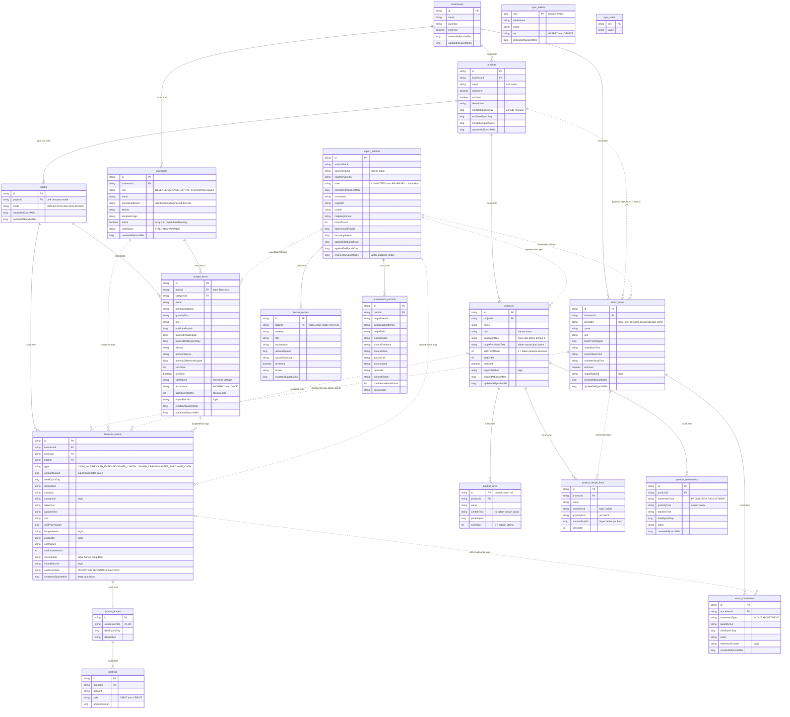

# Entity Relationship Diagram - Basis Data Mankeu

Skema Room SQLite **versi 11** (`com.mankeu.data`), diselaraskan dengan `Entities.kt`, `domain/StockManagement.kt`, `sync/SyncEntities.kt`, dan `app/schemas/com.mankeu.data.AppDatabase/11.json`.

> Garis **tegas** adalah foreign key sungguhan (dengan aturan `CASCADE` atau `RESTRICT`). Garis **putus-putus** adalah referensi logis: kolomnya diindeks, tetapi tidak dijaga foreign key, sehingga integritasnya ditegakkan oleh `FinanceRepository`.

`sync_outbox` dan `sync_meta` tidak memiliki relasi: outbox diisi trigger SQLite pada setiap tabel `DATA_TABLES` (DEC-013, DEC-015), dan `sync_meta` menyimpan flag seperti `applying_remote` dan `requires_full_snapshot`.

## Aturan integritas

1. **Dua buku per unit.** Indeks unik `(projectId, mode)` dan `ensureBookPair` menjamin tepat satu buku `PROJECTION` dan satu `REALIZATION`.
2. **Jurnal selalu seimbang.** Setiap event memiliki tepat satu `journal_entries` (unik pada `sourceEventId`). Debit dan kredit diperiksa di `insertEventAndJournal` sebelum baris ditulis, di dalam transaksi yang sama.
3. **Kas murni (DEC-011).** Hanya lima jenis event kas: uang yang benar-benar berpindah.
4. **Ubah dan Hapus (DEC-019).** `updateEvent` mengganti event di tempat: id, `importBatchId`, dan `createdAtEpochMillis` dipertahankan, jurnal dan posting dibangun ulang. `deleteEvent` menghapus event, dan jurnal serta posting ikut terhapus lewat `CASCADE`. Tidak ada lagi status atau kolom pembalikan.
5. **Rencana usaha (DEC-014, DEC-017).** Produk dan komponen biaya per unit milik unit (`projects`). Biaya tetap, biaya sekali, aset, dan modal rencana adalah `budget_items` di buku Rencana.
6. **Stok per unit (DEC-017).** `stock_items.projectId` NULL berarti dipakai bersama semua unit. Nama unik di antara barang yang terlihat oleh satu unit.
7. **Impor dan pembatalannya.** Duplikat boleh diimpor ulang dengan peringatan (`hasImported` hanya menghitung batch `COMMITTED`). `undoImportBatch` menghapus event batch, mengarsipkan RAB-nya, menghapus produk dan stoknya, lalu menandai batch `REVERSED` sebagai riwayat.
8. **Migrasi.** `MIGRATION_10_11` menjalankan `ReversalCleanup` (menghapus setiap pasangan pembalikan beserta jurnalnya, meninggalkan satu notice SYSTEM), lalu membangun ulang `financial_events` dan `journal_entries` tanpa kolom pembalikan dan membuat ulang trigger sinkronisasi. Tidak ada migrasi destruktif.
