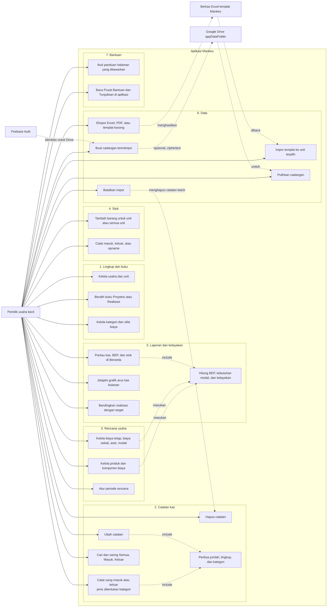

# Use Case Diagram - Mankeu

Mankeu adalah aplikasi satu pengguna tanpa peran atau hak akses bertingkat: satu pemilik usaha mengelola seluruh buku di perangkatnya. Aktor lain adalah sistem eksternal. Diselaraskan dengan kode pada Room **schema 11** (DEC-011 sampai DEC-019).

| Use case | Tujuan bagi pemilik usaha |
| --- | --- |
| Catat uang masuk atau keluar | Mengganti buku kas tulis dengan beberapa ketukan. Kategori menentukan jenisnya (pemasukan, pengeluaran, setoran modal, ambil pribadi, beli aset), tanpa istilah debit dan kredit. |
| Ubah dan Hapus | Membetulkan catatan yang salah langsung di tempat, atau menghapusnya, tanpa baris pembalik tambahan (DEC-019). |
| Rencana usaha | Menjawab "berapa modal yang harus disiapkan" dan "berapa unit harus terjual agar tidak rugi" dari produk, resep biaya, dan biaya tetap. |
| Stok | Mengetahui sisa barang per unit dan kapan harus belanja lagi. |
| Impor templat | Memasukkan banyak catatan sekaligus ke unit terpilih. Batalkan impor menghapus catatan batch itu, dan berkas yang sama boleh diimpor ulang. |
| Cadangan terenkripsi | Memindahkan atau menyelamatkan data tanpa pihak mana pun dapat membaca isinya. |

Sinkronisasi multi-perangkat (DEC-013) sudah ada sebagai kerangka di `sync/`, tetapi belum dapat dijalankan pemilik dari UI, sehingga tidak muncul sebagai use case.
