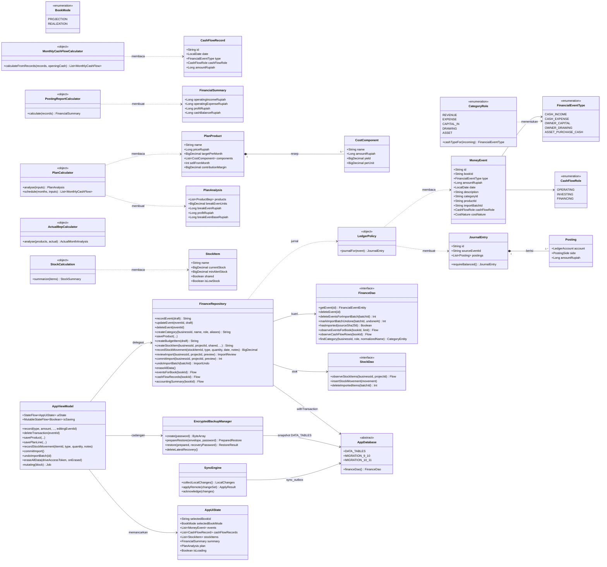

# Class Diagram - Domain, Data, dan Presentasi Mankeu

Nama kelas, properti, dan metode di bawah ini sama dengan kode sumber pada Room **schema 12**. Hanya anggota yang relevan bagi alur bisnis yang ditampilkan.

## Catatan desain

1. **Keseimbangan dua lapis.** `LedgerPolicy.journalFor` memanggil `JournalEntry.requireBalanced()`, lalu `FinanceRepository.insertEventAndJournal` memeriksa ulang debit sama dengan kredit tepat sebelum baris ditulis.
2. **Satu jalur untuk catat dan ubah.** `AppViewModel.record` memanggil `updateEvent` bila `editingEventId` terisi dan `recordEvent` bila tidak. Keduanya memakai `requireValid` dan `LedgerPolicy.journalFor` yang sama.
3. **Kategori menentukan jenis.** Formulir hanya punya Masuk dan Keluar. `CategoryRole.cashTypeFor` mengubahnya menjadi salah satu dari lima jenis kas (DEC-011 K-2).
4. **Proyeksi sempit.** `CashFlowRecord` hanya membawa kolom yang dibutuhkan jadwal kas, sehingga buku berisi ribuan transaksi tidak memuat seluruh deskripsi ke memori.
