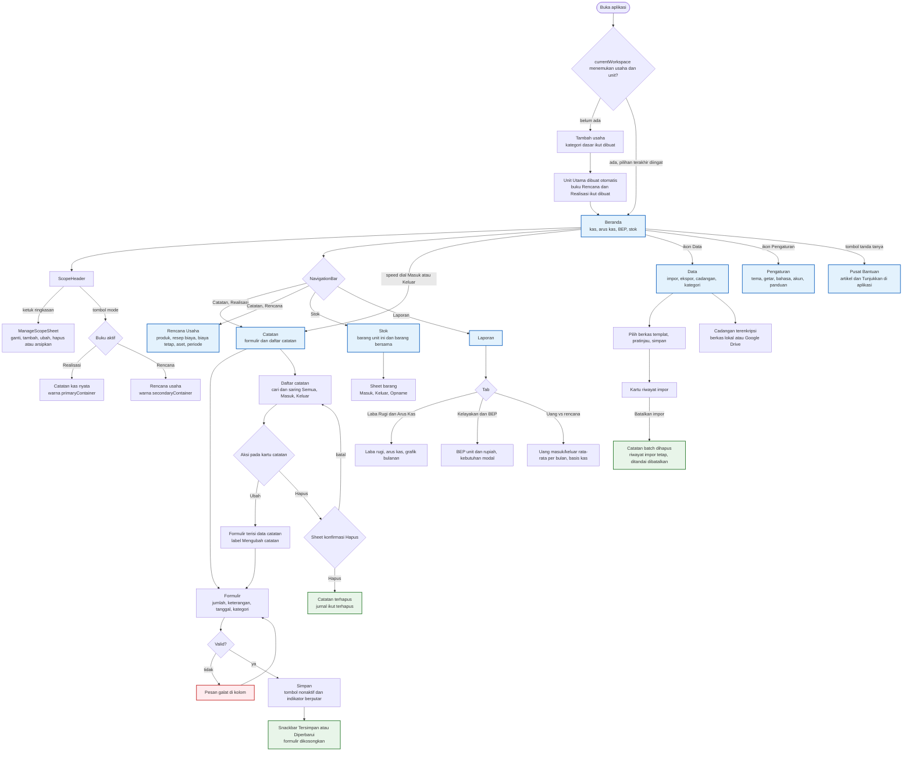

# User Flow Diagram - Mankeu

Alur navigasi sesuai `MankeuApp` pada Room **schema 12**: empat destinasi di `NavigationBar` (atau `AppRail` pada layar lebar), tiga overlay yang dibuka dari bar atas, dan satu bottom sheet lingkup.

## Catatan kegunaan

1. **Ubah di tempat (DEC-019).** Catatan yang salah dibetulkan di formulir yang sama dengan saat mencatat, tanpa baris tambahan atau tanda khusus pada kartu.
2. **Hapus selalu dikonfirmasi.** Sheet konfirmasi menampilkan keterangan dan jumlah catatan dengan warna galat sebelum penghapusan.
3. **Warna buku berbeda** agar catatan kas nyata tidak tercatat ke buku rencana, dan Catatan berganti menjadi Rencana Usaha di mode Rencana.
