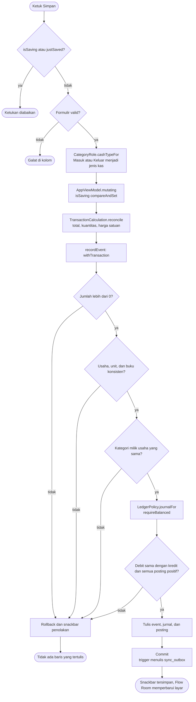
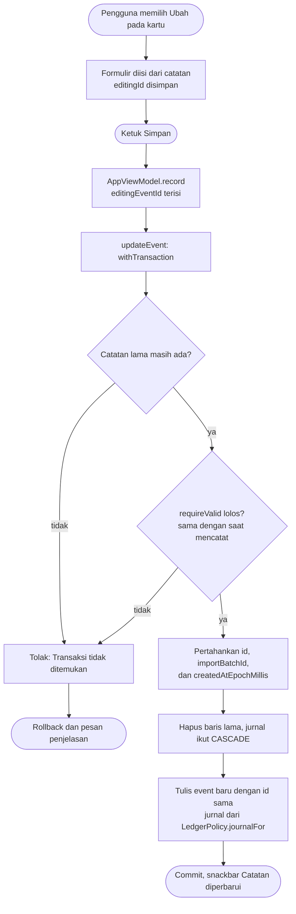
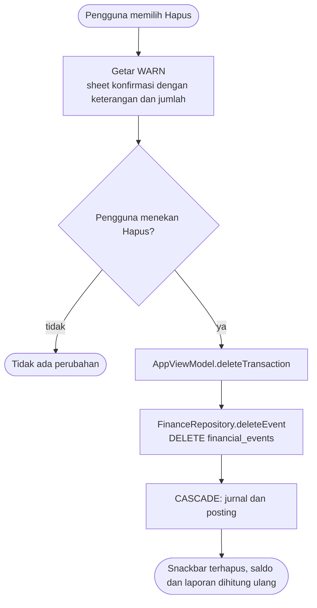
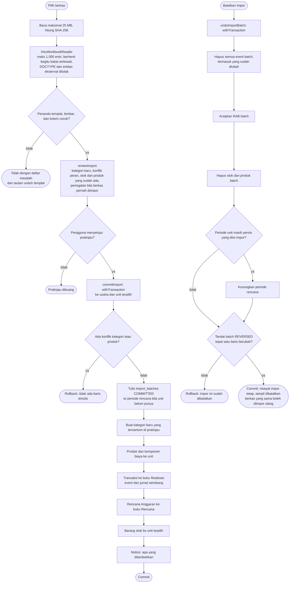
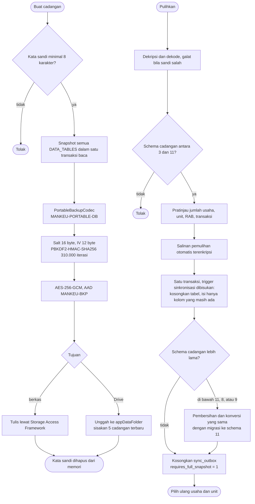

# Activity Diagrams - Alur Bisnis Kritis Mankeu

Lima alur yang menulis, mengubah, atau menghapus uang pada Room **schema 12**. Semua pemeriksaan di bawah ini berada di `FinanceRepository`, di dalam `withTransaction`: satu penolakan membatalkan seluruh penulisan.

## 1. Mencatat transaksi

## 2. Mengubah catatan (Ubah)

## 3. Menghapus catatan (Hapus)

## 4. Impor templat dan Batalkan impor

## 5. Cadangan dan pemulihan terenkripsi

