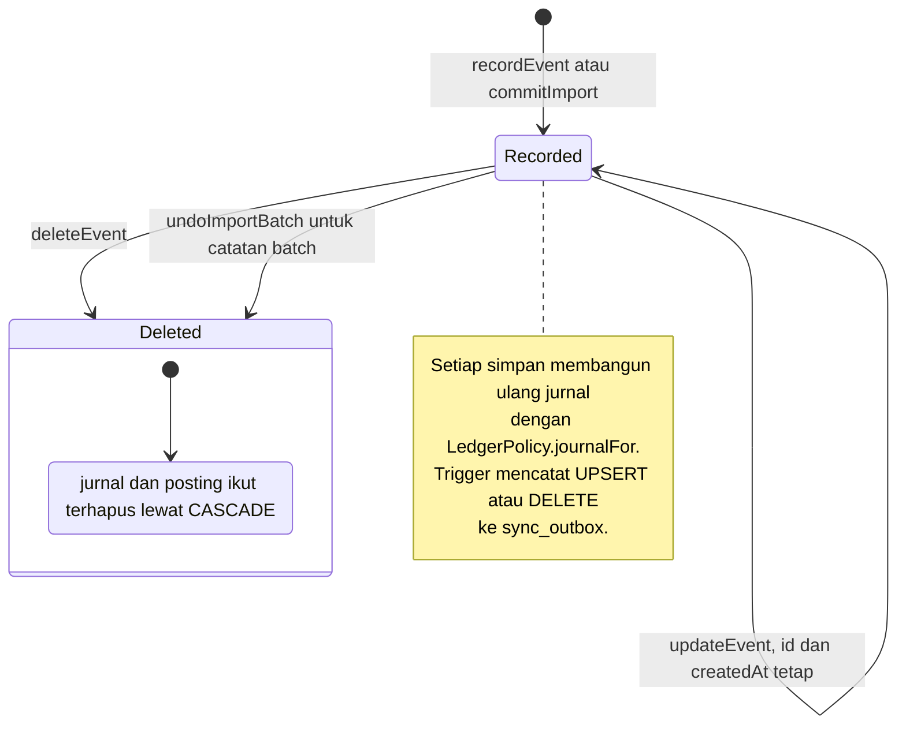
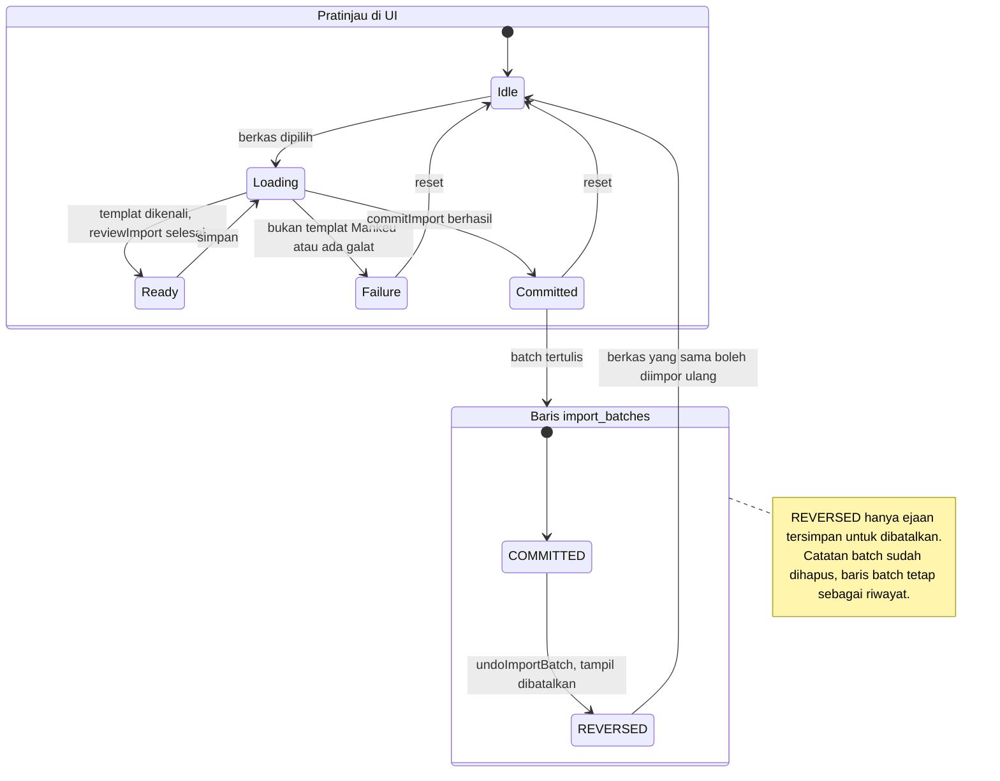
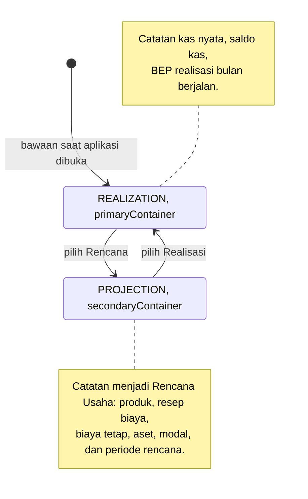
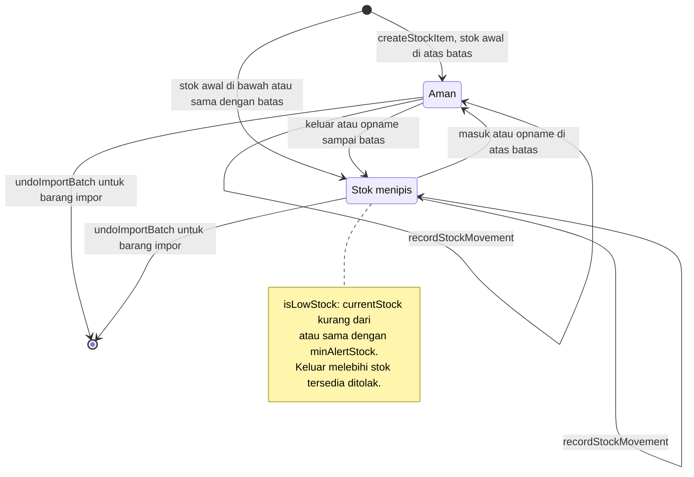

# State Diagrams - Siklus Hidup Mankeu

Diselaraskan dengan Room **schema 12**. Sejak DEC-019 catatan kas tidak punya kolom status: catatan ada, diubah di tempat, atau dihapus.

## 1. Catatan kas (`financial_events`)

Tidak ada status draf di basis data: formulir yang belum disimpan hanya ada di UI.

## 2. Batch impor dan pratinjau (`ImportUiState`)

## 3. Buku aktif (`BookMode`)

## 4. Barang stok (`stock_items`)

