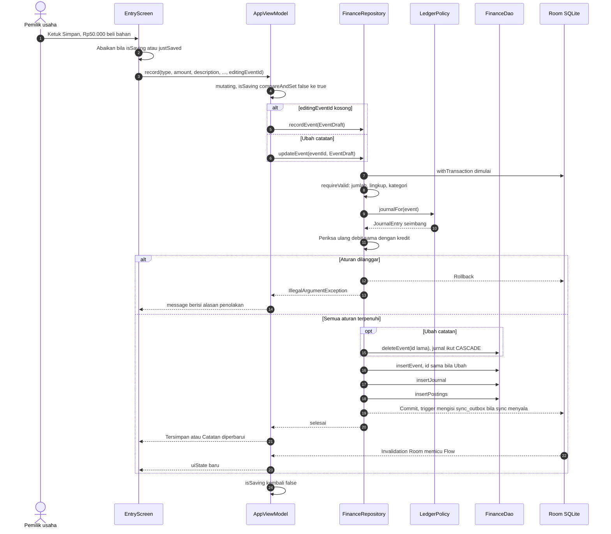
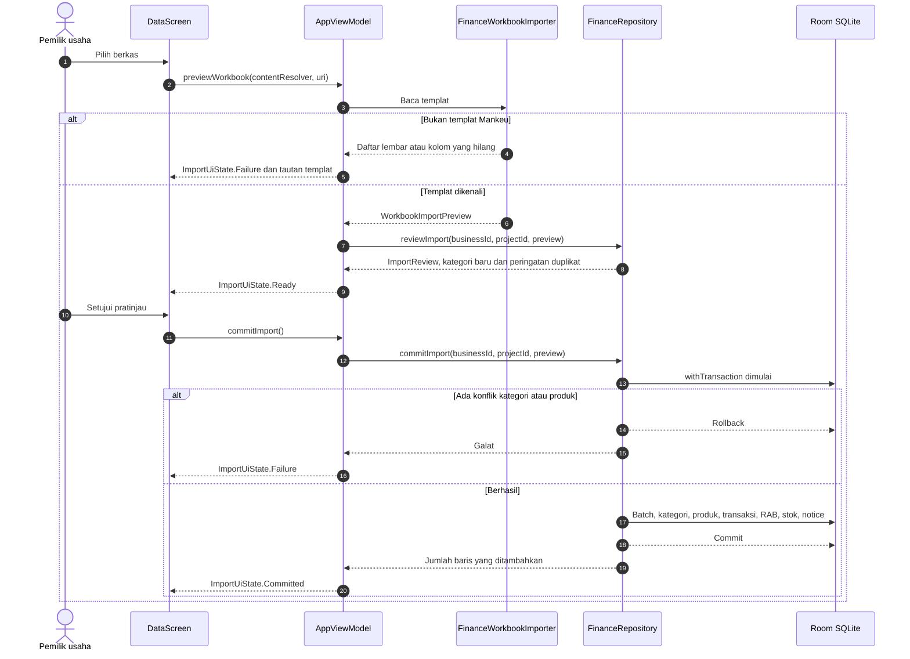
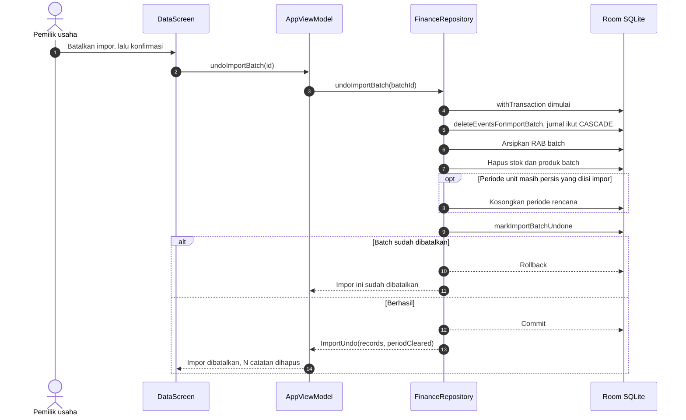

# Sequence Diagrams - Mankeu

Diselaraskan dengan Room **schema 12** (DEC-012, DEC-019).

## 1. Mencatat atau mengubah catatan kas

## 2. Impor templat ke unit terpilih

## 3. Batalkan impor

## Jaminan

1. **Atomik.** Semua penulisan dan pemeriksaan satu aksi berada dalam satu transaksi SQLite. Penolakan tidak meninggalkan baris setengah jadi. Ubah adalah satu pertukaran atomik: tidak pernah ada saat catatan lama sudah hilang dan yang baru belum tertulis.
2. **Tidak ada ketukan ganda.** `compareAndSet` di `mutating` menolak aksi kedua yang tiba sebelum aksi pertama selesai, termasuk ketukan dalam satu frame (D-072).
3. **Reaktif.** Setelah commit, invalidation Room memancarkan ulang Flow, dan `uiState` memperbarui layar tanpa pemanggilan manual.
