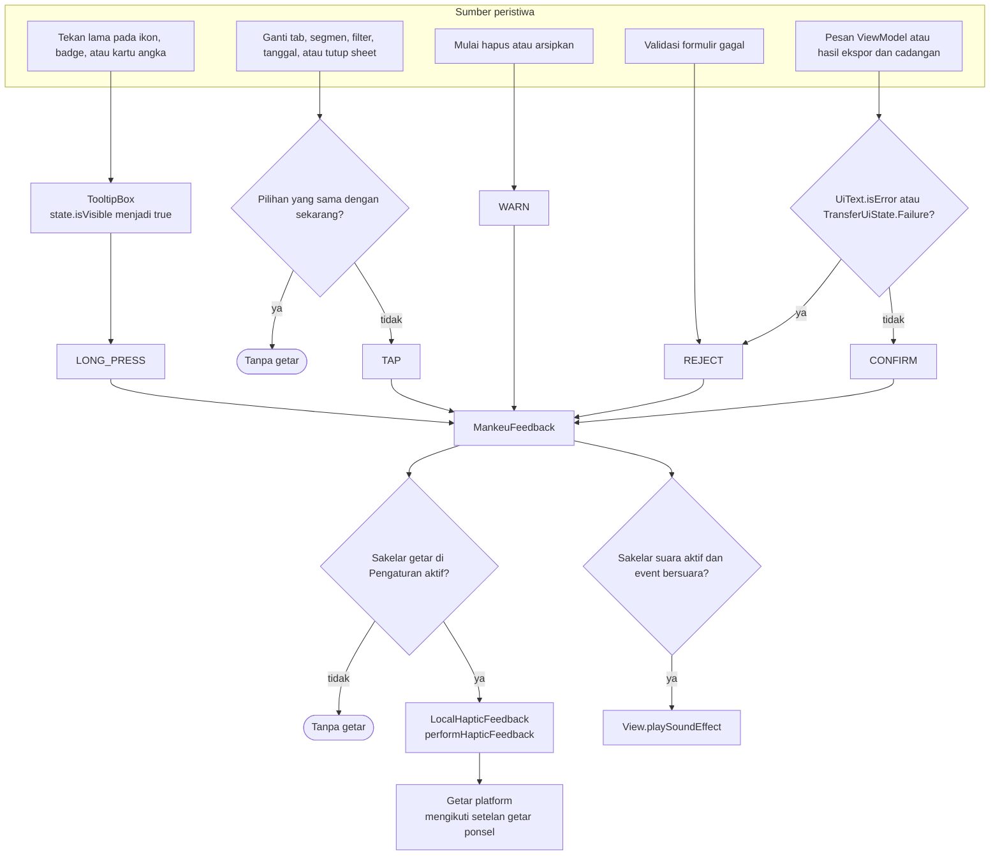
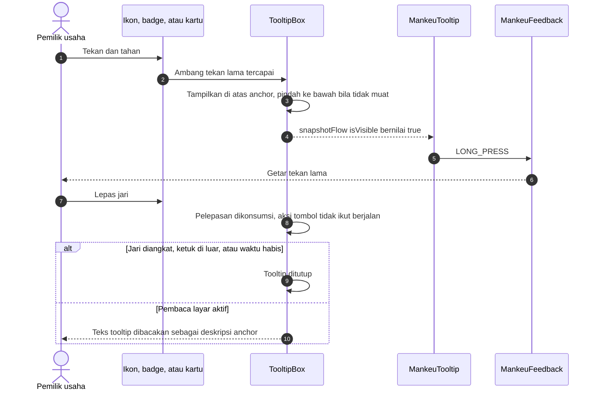
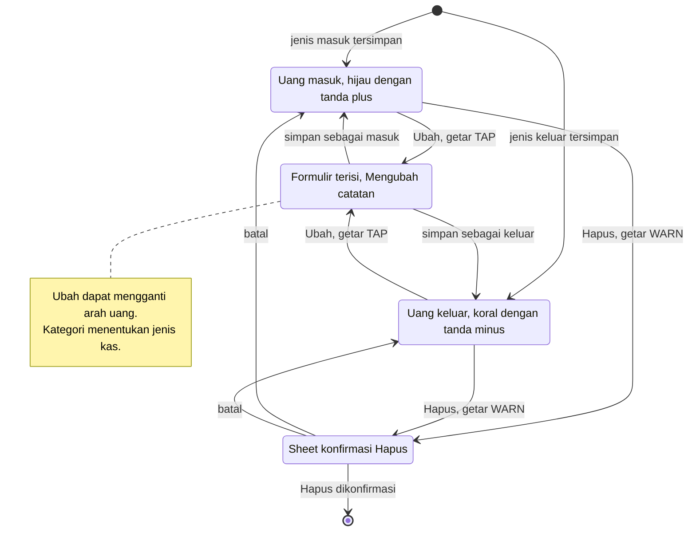

# Interaction Feedback - Tooltip dan Haptic

Cara Mankeu memberi tahu pengguna bahwa sentuhannya diterima: tooltip tekan lama dari Material 3 dan lima jenis getar. Aturannya ada di `docs/UX_AND_ACCESSIBILITY.md` ("Touch targets, tooltips and haptics") dan keputusan D-084 sampai D-087, diselaraskan dengan Room **schema 11** (DEC-019).

## 1. Dari peristiwa ke getar

| Event | `HapticFeedbackType` | Contoh |
| --- | --- | --- |
| TAP | SegmentTick | Tab Laporan, Proyeksi atau Realisasi, filter Catatan, tombol Ubah, tanggal di kalender |
| LONG_PRESS | LongPress | Tooltip ikon Data, tombol Ubah catatan, kartu Uang masuk bersih |
| WARN | GestureThresholdActivate | Ketuk ikon Hapus pada catatan |
| CONFIRM | Confirm | Catatan tersimpan atau diperbarui, impor disimpan, cadangan dibuat |
| REJECT | Reject | Jumlah kosong, stok keluar melebihi stok tersedia |

## 2. Siklus tooltip

## 3. Tampilan kartu catatan (`EventCard`)

Sejak DEC-019 kartu tidak punya status pembalikan: warnanya hanya mengikuti arah uang, dan setiap kartu di Catatan memiliki Ubah dan Hapus (target sentuh 48dp).

