# Panduan Penggunaan Aplikasi Mankeu untuk Pelaku UMKM

**Mencatat keuangan, menyusun rencana usaha, dan membaca kelayakan usaha dari HP**

Versi panduan: 1.0 (Oktober 2026). Berlaku untuk Mankeu dengan Rencana Usaha, Stok per unit, dan
Pusat Bantuan.

---

## Cara Memakai Panduan Ini

Panduan ini menjelaskan cara memakai setiap bagian aplikasi Mankeu. Semua gambar layar memakai satu
contoh usaha, **Kedai Kopi Senja**, sehingga angka di satu bagian bisa dicocokkan dengan bagian lain.
Data contoh ini fiktif.

Urutan bagian mengikuti urutan membuka usaha: menyiapkan aplikasi, merencanakan, menjalankan dan mencatat,
memantau lewat laporan, lalu mengamankan data. Setiap bagian hanya memakai hal yang sudah dijelaskan di bagian
sebelumnya, sehingga panduan bisa dibaca lurus dari awal sampai akhir. Contoh untuk usaha tani musiman dan usaha
dengan beberapa cabang ada di lampiran.

Pilih jalur yang sesuai kebutuhan Anda:

| Jalur | Untuk siapa | Bagian yang dibaca |
|---|---|---|
| **Jalur cepat** | Anda yang ingin langsung mencatat uang masuk dan keluar setiap hari | [1](#1-memasang-mankeu), [2](#2-mengenal-mankeu), [3](#3-memulai-usaha-dan-unit), [6](#6-mencatat-uang-masuk-dan-keluar), [8.1](#81-beranda), [9.4](#94-cadangan-terenkripsi) |
| **Jalur lengkap** | Anda yang juga ingin menyusun rencana usaha, menghitung titik impas, mengelola stok, dan memakai Excel | Semua bagian, berurutan dari 1 sampai 14 |

Tanda yang dipakai:

> **Tips**: cara yang lebih cepat atau lebih aman.

> **Perhatian**: kesalahan yang sering terjadi.

> **Untuk yang ingin tahu**: penjelasan hitungan di balik angka aplikasi. Boleh dilewati.

---

## Daftar Isi

1. [Memasang Mankeu](#1-memasang-mankeu)
2. [Mengenal Mankeu](#2-mengenal-mankeu)
3. [Memulai: Usaha dan Unit](#3-memulai-usaha-dan-unit)
4. [Menyusun Rencana Usaha](#4-menyusun-rencana-usaha)
5. [Membaca Kelayakan, BEP, dan Kebutuhan Modal](#5-membaca-kelayakan-bep-dan-kebutuhan-modal)
6. [Mencatat Uang Masuk dan Keluar](#6-mencatat-uang-masuk-dan-keluar)
7. [Mengelola Stok Barang](#7-mengelola-stok-barang)
8. [Membaca Laporan](#8-membaca-laporan)
9. [Berkas dan Data: Impor, Ekspor, Cadangan](#9-berkas-dan-data-impor-ekspor-cadangan)
10. [Bantuan di Dalam Aplikasi](#10-bantuan-di-dalam-aplikasi)
11. [Contoh Pemakaian Satu Bulan](#11-contoh-pemakaian-satu-bulan)
12. [Pemecahan Masalah](#12-pemecahan-masalah)
13. [Lembar Periksa Rutin](#13-lembar-periksa-rutin)
14. [Daftar Istilah](#14-daftar-istilah)
- [Lampiran A. Usaha Tani Musiman](#lampiran-a-usaha-tani-musiman)
- [Lampiran B. Usaha dengan Beberapa Cabang](#lampiran-b-usaha-dengan-beberapa-cabang)

---

## 1. Memasang Mankeu

Saat panduan ini ditulis, Mankeu masih dibagikan lewat **jalur uji internal Google Play**. Aplikasi
belum bisa ditemukan dengan pencarian biasa di Play Store.

1. Hubungi pengelola Mankeu dan sampaikan alamat email akun Google yang dipakai di HP Anda.
2. Setelah alamat Anda didaftarkan sebagai penguji, buka tautan undangan dari pengelola di HP.
3. Ketuk **Terima undangan**, lalu **Unduh di Google Play**, dan pasang seperti aplikasi lain.

Yang dibutuhkan:

- HP Android 8.0 atau yang lebih baru.
- Akun Google yang sama dengan yang didaftarkan sebagai penguji.

Mankeu bekerja **tanpa internet dan tanpa akun**. Semua data tersimpan di HP Anda. Internet hanya
dipakai bila Anda memilih mencadangkan ke Google Drive.

---

## 2. Mengenal Mankeu

### Empat istilah utama

| Istilah | Artinya | Contoh |
|---|---|---|
| **Usaha** | Bisnis Anda. Setiap usaha punya daftar kategori sendiri. | Kedai Kopi Senja |
| **Unit** | Cabang, gerai, kebun, atau musim tanam di dalam usaha. Semua catatan, rencana, dan stok milik satu unit. | Utama |
| **Rencana** | Buku rencana: apa yang akan dijual, berapa biayanya, berapa modal yang dibutuhkan. | Rencana 12 bulan kedai |
| **Realisasi** | Buku kenyataan: uang yang benar-benar masuk dan keluar. | Penjualan kopi hari ini |

### Mankeu mencatat uang tunai

Mankeu mencatat uang yang **benar-benar berpindah tangan**. Tidak ada catatan utang, piutang,
pinjaman, atau cicilan. Bila pembeli belum membayar, catat penjualannya saat uangnya diterima.

### Bagian-bagian layar

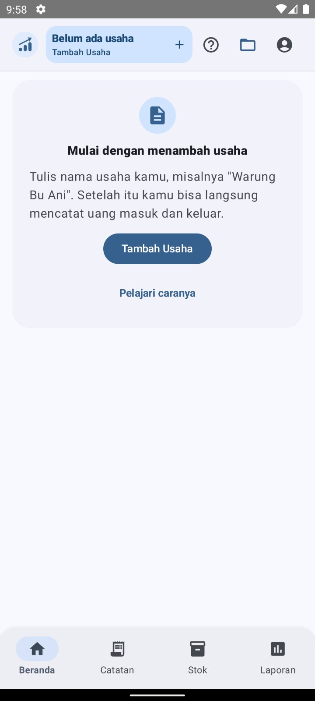

1. **Nama usaha dan unit** di kiri atas. Ketuk untuk memilih atau menambah usaha dan unit.
2. **Tombol ?** membuka bantuan untuk halaman yang sedang dibuka.
3. **Ikon map** membuka Berkas dan Data: impor, ekspor, dan cadangan.
4. **Ikon orang** membuka Pengaturan.
5. **Rencana / Realisasi** untuk berpindah buku. Tombol ini baru muncul setelah usaha dibuat.
6. **Bilah bawah**: Beranda, Catatan, Stok, Laporan.

---

## 3. Memulai: Usaha dan Unit

Saat pertama dibuka, aplikasi masih kosong dan menyapa dengan kartu **Selamat datang**. Pilih
**Lihat** untuk panduan singkat, atau **Tutup**. Kapan pun butuh bantuan, ketuk tombol **?** di
kanan atas.

### 3.1 Membuat usaha

1. Ketuk tulisan **Belum ada usaha** di kiri atas, atau tombol **Tambah Usaha** di tengah layar.
   Formulir **Tambah usaha** langsung terbuka.
2. Tulis nama usaha Anda, lalu ketuk **Simpan**. Kategori pembukuan awal dibuat otomatis dan bisa
   diubah nanti lewat Berkas dan Data.

   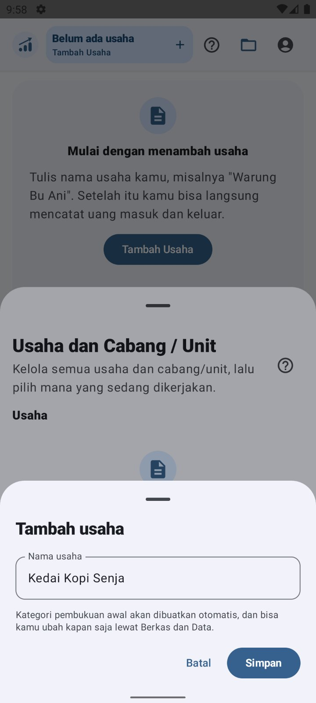

3. Usaha baru langsung punya satu unit bernama **Utama**, dan Beranda siap dipakai dengan semua angka
   masih Rp0. Anda bisa langsung mencatat.

   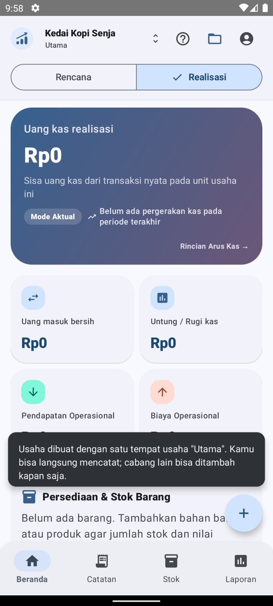

### 3.2 Menambah cabang atau unit lain

Usaha dengan satu tempat cukup memakai unit **Utama**. Bila Anda punya cabang, kebun, atau musim
tanam yang ingin dipisah:

1. Ketuk nama usaha di kiri atas. Lembar *Usaha dan Cabang / Unit* terbuka.
2. Ketuk **Tambah Unit Usaha**, tulis namanya, misalnya *Cabang Pasar*, lalu ketuk **Simpan**.
3. Untuk mengganti nama unit **Utama**, ketuk **Ubah** pada kartunya.
4. Geser lembar ke bawah untuk menutupnya.

### 3.3 Berpindah unit

Ketuk nama usaha di kiri atas, lalu ketuk **Pakai ini** pada unit yang ingin dibuka. Aplikasi
mengingat unit terakhir yang dipakai, sehingga saat dibuka lagi Anda langsung berada di unit yang
sama.

> **Tips.** Buat unit terpisah untuk setiap cabang atau setiap musim tanam. Angka setiap unit tidak
> tercampur, sehingga Anda tahu cabang mana yang untung.

---

## 4. Menyusun Rencana Usaha

Rencana Usaha menjawab pertanyaan *berapa yang harus terjual agar tidak rugi, dan berapa modal yang
dibutuhkan*. Rencana disusun di buku **Rencana**.

1. Pilih **Rencana** di bagian atas.
2. Buka **Catatan** di bilah bawah. Halaman **Rencana Usaha** terbuka.

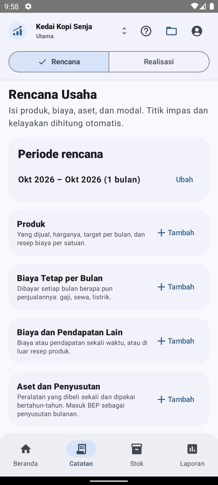

Rencana terdiri atas enam bagian: periode, produk, biaya tetap per bulan, biaya dan pendapatan
lain, aset, serta setoran modal.

### 4.1 Periode rencana

Periode adalah lamanya rencana berjalan, misalnya 12 bulan. Biaya sekali bayar, seperti izin usaha,
dibagi rata ke bulan-bulan ini.

1. Ketuk **Ubah** di kartu *Periode rencana*.
2. Pilih bulan mulai dan bulan selesai, lalu ketuk **Simpan**.

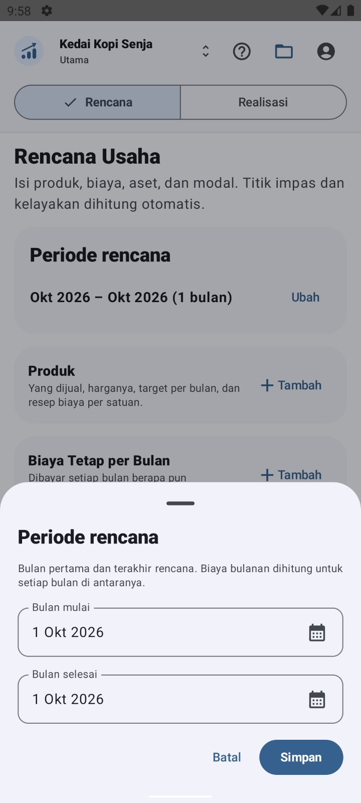

### 4.2 Produk dan resep biaya

Resep adalah **biaya bahan untuk satu satuan produk**. Untuk bahan yang dibeli per kemasan, cukup
tulis harga kemasan dan berapa satuan yang dihasilkan.

1. Ketuk **Tambah** di bagian **Produk**.
2. Isi **Nama produk**, **Satuan**, **Target per bulan**, dan **Harga jual per satuan**.
3. Isi **Mulai dijual bulan ke-**. Biarkan `1` bila produk dijual sejak bulan pertama. Untuk hasil
   panen yang baru dijual beberapa bulan kemudian, isi bulan panen pertama, misalnya `4`. Bulan
   sebelumnya dihitung tanpa penjualan.
4. Isi resep. Untuk kopi susu:
   - Susu: biaya Rp18.000 **untuk 6 cup**, jadi Rp3.000 per cup;
   - Kopi dan cup: biaya Rp2.000 untuk 1 cup.

   Ketuk **Tambah komponen** untuk baris berikutnya.
5. Perhatikan tulisan di bawah resep: biaya variabel Rp5.000 per cup dan margin Rp5.000. Bila
   tulisannya merah, harga jual masih di bawah biaya bahan.
6. Ketuk **Simpan**.

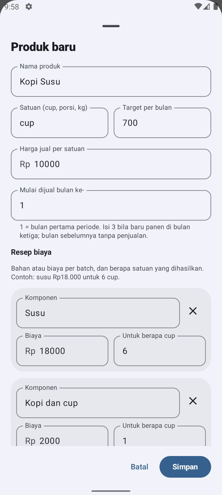

### 4.3 Biaya tetap per bulan

1. Ketuk **Tambah** di bagian **Biaya Tetap per Bulan**.
2. Isi nama (misalnya *Sewa lapak*), pilih kategori (*Sewa Tempat*), lalu isi nominal per bulan.
3. Ketuk **Simpan**. Ulangi untuk gaji, listrik, dan biaya bulanan lainnya.

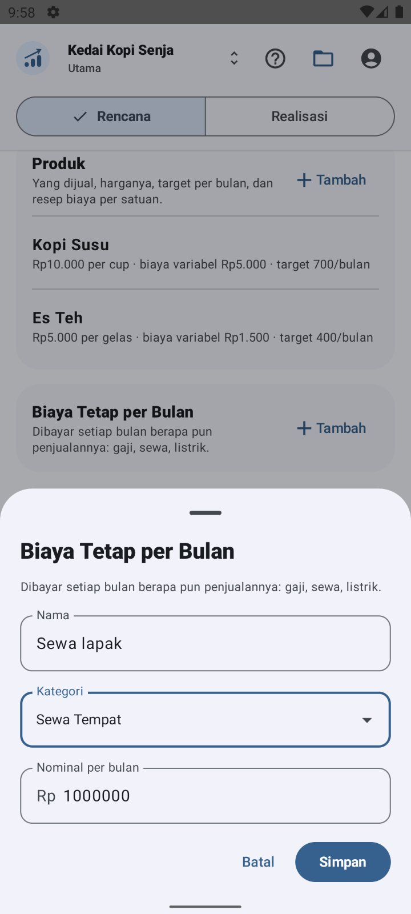

### 4.4 Biaya dan pendapatan lain

Gunakan bagian ini untuk biaya atau pendapatan **sekali waktu**, misalnya izin usaha atau renovasi,
atau untuk biaya variabel di luar resep, misalnya bibit dan pupuk. Pilih **Sekali** atau **Bulanan**,
lalu isi bulannya bila perlu.

### 4.5 Aset dan penyusutan

1. Ketuk **Tambah** di bagian **Aset dan Penyusutan**.
2. Isi nama alat, kategori **Beli Peralatan & Aset**, nominal, dan **Umur pakai (bulan)**.
3. Di bawah isian umur pakai muncul penyusutan per bulan: Rp7.200.000 ÷ 36 = Rp200.000.
4. Ketuk **Simpan**.

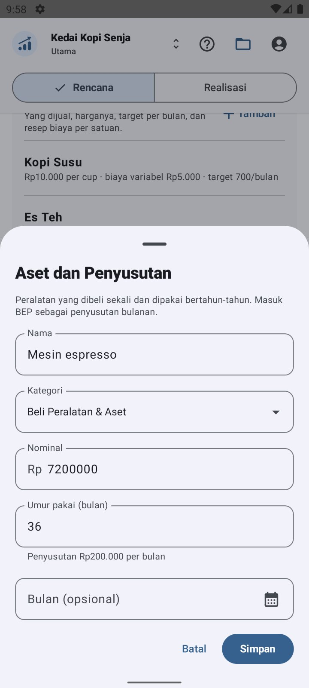

### 4.6 Setoran modal

Di bagian **Setoran Modal**, tambahkan uang yang akan Anda masukkan ke usaha beserta bulannya.
Setoran modal **tidak mengubah laba**, tetapi menutup kebutuhan modal.

Setelah semua bagian terisi, daftar rencana tampak seperti ini:

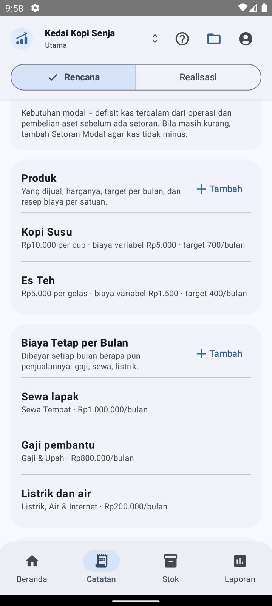

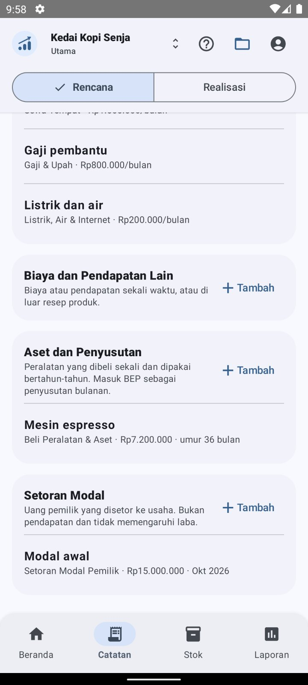

### Rencana Kedai Kopi Senja

| Bagian | Isi |
|---|---|
| Periode | 12 bulan |
| Kopi Susu | Rp10.000 per cup, target 700 cup per bulan, biaya variabel Rp5.000 |
| Es Teh | Rp5.000 per gelas, target 400 gelas per bulan, biaya variabel Rp1.500 |
| Biaya tetap | Sewa Rp1.000.000, gaji Rp800.000, listrik dan air Rp200.000 per bulan |
| Aset | Mesin espresso Rp7.200.000, umur pakai 36 bulan |
| Setoran modal | Rp15.000.000 di bulan pertama |

---

## 5. Membaca Kelayakan, BEP, dan Kebutuhan Modal

Kartu **Kelayakan & Titik Impas (BEP)** di atas Rencana Usaha dihitung otomatis setiap kali isian
rencana berubah.

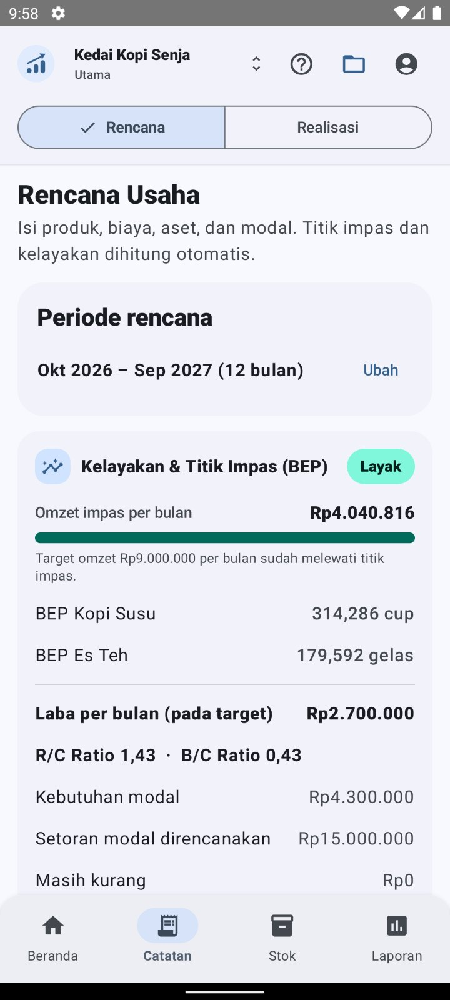

| Baris | Arti | Kedai Kopi Senja |
|---|---|---|
| **Layak / Waspada / Tidak Layak** | Kesimpulan cepat dari R/C | Layak |
| **Omzet impas per bulan** | Penjualan minimum per bulan agar tidak rugi | Rp4.040.816 |
| **BEP per produk** | Jumlah yang harus terjual per bulan, sesuai porsi penjualan | 314,286 cup kopi dan 179,592 gelas teh |
| **Laba per bulan (pada target)** | Hasil bila target tercapai, setelah penyusutan | Rp2.700.000 |
| **R/C Ratio** | Penerimaan dibagi biaya. Di atas 1 berarti untung. | 1,43 |
| **B/C Ratio** | Laba dibagi biaya | 0,43 |
| **Kebutuhan modal** | Kekurangan kas terdalam sebelum ada setoran modal | Rp4.300.000 |
| **Setoran modal direncanakan / Masih kurang** | Apakah modal yang direncanakan sudah cukup | Rp15.000.000 / Rp0 |

> **Perhatian.** BEP adalah batas bawah, bukan target. Target penjualan yang sehat jauh di atas
> BEP, seperti pada contoh ini: omzet target Rp9.000.000 dibanding omzet impas Rp4.040.816.

> **Untuk yang ingin tahu: dari mana angkanya**
>
> 1. **Biaya tetap per bulan** = sewa + gaji + listrik + penyusutan
>    = 1.000.000 + 800.000 + 200.000 + 200.000 = **Rp2.200.000**.
> 2. **Margin** (harga − biaya variabel): kopi Rp5.000 per cup, teh Rp3.500 per gelas.
>    Margin total pada target = 700 × 5.000 + 400 × 3.500 = **Rp4.900.000** per bulan.
> 3. **Laba per bulan** = 4.900.000 − 2.200.000 = **Rp2.700.000**.
> 4. **Omzet impas** = biaya tetap × omzet target ÷ margin total
>    = 2.200.000 × 9.000.000 ÷ 4.900.000 = **Rp4.040.816**.
> 5. **Kebutuhan modal**: di bulan pertama masuk Rp9.000.000 dari jualan, keluar Rp4.100.000 untuk
>    bahan, Rp2.000.000 untuk biaya tunai, dan Rp7.200.000 untuk mesin. Hasilnya **−Rp4.300.000**.
>    Itulah uang yang harus disiapkan sebelum usaha berjalan. Penyusutan tidak dihitung karena bukan
>    uang keluar.

---

## 6. Mencatat Uang Masuk dan Keluar

Setelah rencana siap, usaha mulai berjalan dan uang mulai bergerak. Semua transaksi harian dicatat di
buku **Realisasi**. Ketuk **Realisasi** di bagian atas sebelum mencatat.

### 6.1 Tombol Catat

Ketuk tombol **+** di kanan bawah. Muncul dua pilihan: **Catat Pemasukan** dan **Catat
Pengeluaran**.

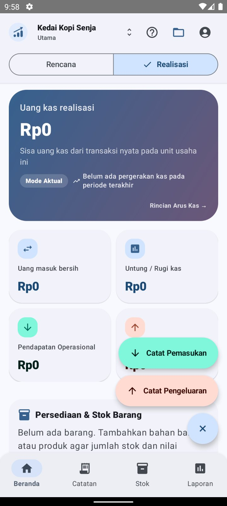

### 6.2 Mencatat modal awal

Aplikasi hanya mengetahui uang yang Anda catat. Karena itu, catat dulu uang yang Anda siapkan untuk
usaha. Bila Anda sudah menyusun rencana, setoran modal yang direncanakan di bagian 4.6 baru masuk
ke kas setelah dicatat di sini, saat uangnya benar-benar disetor.

1. Ketuk **+**, lalu **Catat Pemasukan**.
2. Isi **Jumlah uang** tanpa titik, misalnya `15000000`. Di bawahnya muncul ejaan rupiahnya untuk
   dicek: Rp15.000.000.
3. Isi **Keterangan**, misalnya *Modal awal*. Keterangan boleh dikosongkan; aplikasi memakai nama
   kategorinya.
4. Pilih **Kategori**: **Setoran Modal Pemilik**.
5. Periksa **Tanggal**, lalu ketuk **Simpan catatan**.

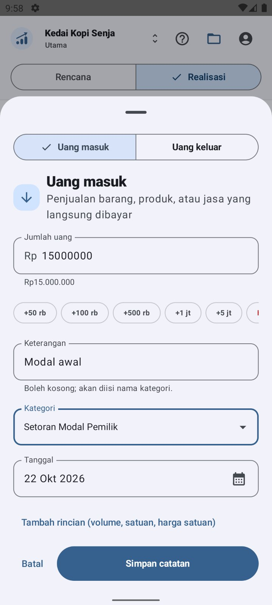

> **Perhatian.** Setoran modal menambah **uang kas**, tetapi **bukan pendapatan**. Laba tidak
> berubah.

> **Tips.** Lupa mencatat uang awal? Bila uang kas di Beranda minus, muncul kartu **Uang kas
> minus?** dengan tombol **Catat uang awal**. Tombol itu membuka formulir ini dengan kategori
> Setoran Modal Pemilik sudah terpilih.

### 6.3 Mencatat penjualan

1. Ketuk **+**, lalu **Catat Pemasukan**.
2. Pilih **Kategori**: **Penjualan & Jasa**.
3. Bila produk Anda sudah dibuat di Rencana Usaha ([bagian 4](#4-menyusun-rencana-usaha)), pilih
   **Produk (opsional)**, misalnya *Kopi Susu*, lalu isi **Volume** (jumlah terjual), misalnya
   `460`. Jumlah uang terisi otomatis sebesar volume × harga: 460 × Rp10.000 = Rp4.600.000.
4. Isi keterangan bila perlu, lalu ketuk **Simpan catatan**. Kategori yang terakhir Anda pakai
   terpilih otomatis untuk catatan berikutnya.

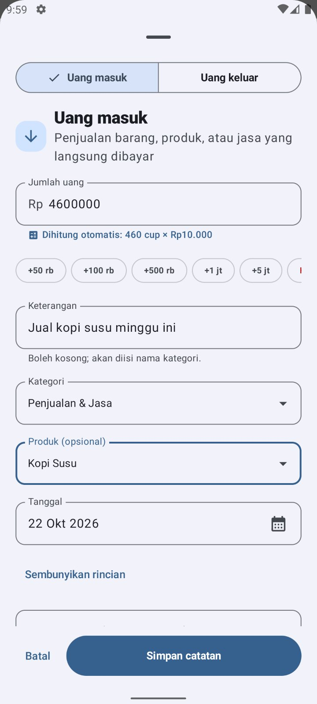

> **Tips.** Memilih produk saat mencatat penjualan membuat aplikasi bisa menghitung jumlah terjual
> per produk dan apakah penjualan bulan ini sudah melewati titik impas. Tanpa produk pun penjualan
> tetap tercatat.

### 6.4 Mencatat pengeluaran

1. Ketuk **+**, lalu **Catat Pengeluaran**.
2. Isi jumlah, keterangan, dan kategori, misalnya **Bahan Baku & Stok**.
3. Setiap kategori biaya punya **sifat biaya**:
   - **Tetap**: dibayar berapa pun penjualannya, misalnya sewa, gaji, dan listrik;
   - **Variabel**: naik turun mengikuti penjualan, misalnya bahan baku dan kemasan.

   Bila satu pengeluaran berbeda dari biasanya, ubah sifatnya di form ini.
4. Ketuk **Simpan catatan**.

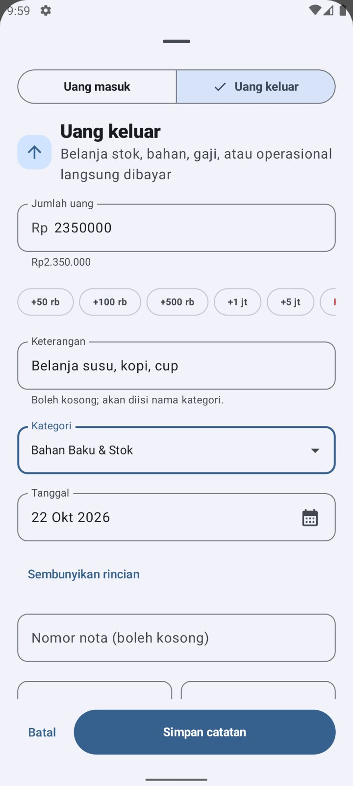

### 6.5 Membeli alat atau aset

Alat yang dipakai bertahun-tahun, seperti mesin, etalase, atau pompa, **bukan biaya bulan ini**.

1. Ketuk **+**, lalu **Catat Pengeluaran**.
2. Pilih kategori **Beli Peralatan & Aset**.
3. Isi **Umur pakai (bulan)**, misalnya `36` untuk tiga tahun. Aplikasi membagi harga alat menjadi
   **penyusutan bulanan**: Rp7.200.000 ÷ 36 = Rp200.000 per bulan.
4. Ketuk **Simpan catatan**.

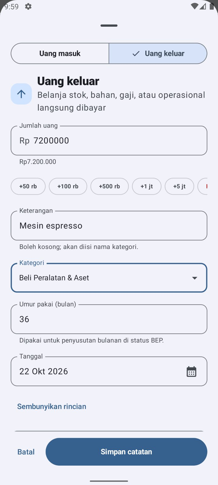

### 6.6 Ringkasan kategori

| Kejadian | Jenis | Kategori | Pengaruh |
|---|---|---|---|
| Menjual barang/jasa | Pemasukan | Penjualan & Jasa | Kas dan laba naik |
| Belanja bahan, gaji, sewa, listrik | Pengeluaran | Kategori biaya | Kas dan laba turun |
| Uang pribadi dimasukkan ke usaha | Pemasukan | Setoran Modal Pemilik | Kas naik, laba tetap |
| Uang usaha dipakai untuk keperluan rumah | Pengeluaran | Ambil untuk Pribadi (Prive) | Kas turun, laba tetap |
| Membeli alat tahan lama | Pengeluaran | Beli Peralatan & Aset | Kas turun, laba berkurang lewat penyusutan |

### 6.7 Melihat dan memperbaiki catatan

Buka **Catatan** di bilah bawah. Semua catatan tampil, yang terbaru di atas. Gunakan kolom cari dan
saringan **Semua / Masuk / Keluar**.

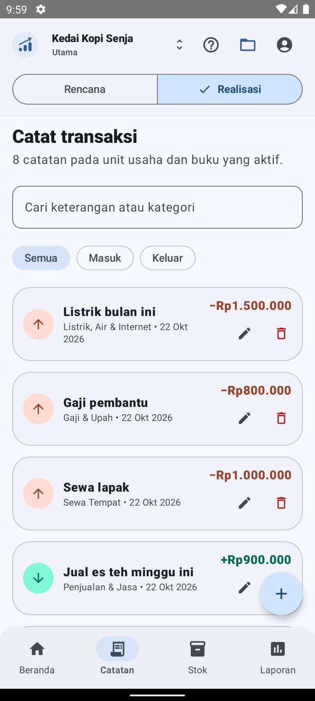

Setiap kartu catatan punya dua tombol: **Ubah** (ikon pensil) dan **Hapus** (ikon tempat sampah).

Bila ada catatan yang salah isi, misalnya listrik Rp150.000 yang terketik Rp1.500.000:

1. Ketuk ikon **Ubah** (pensil) di kartu catatan itu. Formulir catat terbuka dengan isi catatan
   tersebut, bertanda *Mengubah catatan*.
2. Perbaiki nominal, tanggal, kategori, atau keterangannya.
3. Ketuk **Simpan catatan**. Catatan lama diganti dengan yang benar; kas dan laporan ikut menyesuaikan.

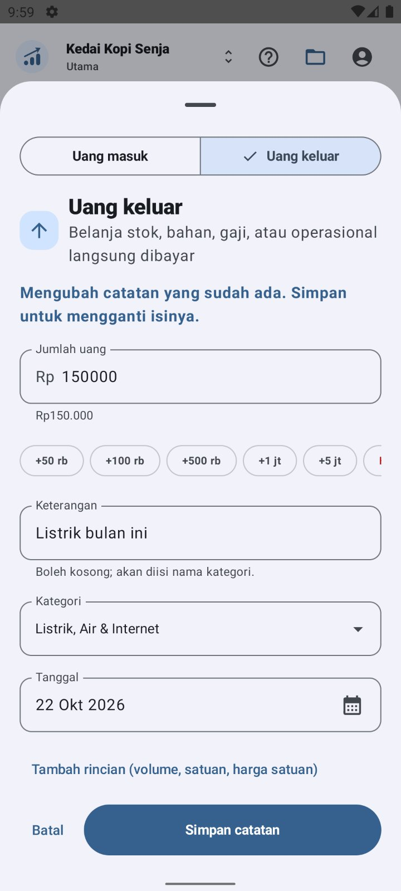

Catatan yang sama sekali tidak perlu, misalnya tercatat dua kali, dihapus dengan ikon **Hapus**.

> **Perhatian.** Hapus bersifat permanen dan tidak bisa dibatalkan. Bila hanya isinya yang salah,
> pakai **Ubah**.

---

## 7. Mengelola Stok Barang

Buka **Stok** di bilah bawah. Stok mencatat barang yang disimpan beserta nilainya.

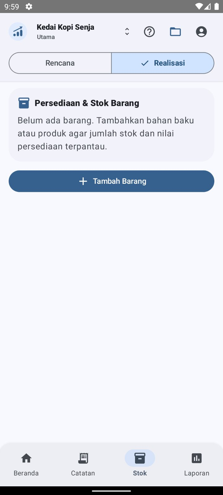

### 7.1 Menambah barang

1. Ketuk **Tambah Barang**.
2. Isi nama, satuan, harga beli per satuan, stok awal, dan batas stok minimum.
3. Di **Barang ini milik**, pilih:
   - **Unit [nama unit]**: barang hanya milik unit ini dan tidak tampil di cabang lain;
   - **Semua unit**: barang dipakai bersama, misalnya isi gudang pusat.
4. Ketuk **Simpan**.

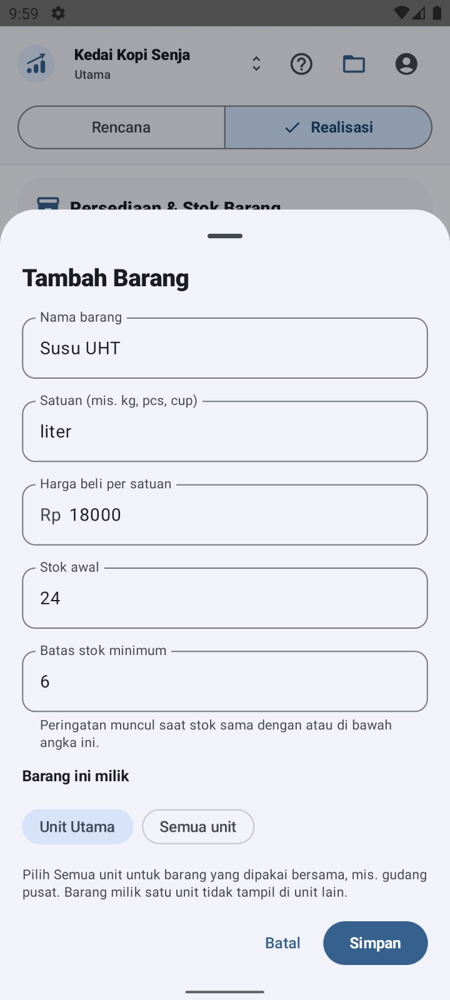

Daftar stok menampilkan jumlah dan nilai setiap barang. Barang bersama diberi keterangan *dipakai
semua unit*, dan barang di bawah batas minimum diberi tanda peringatan.

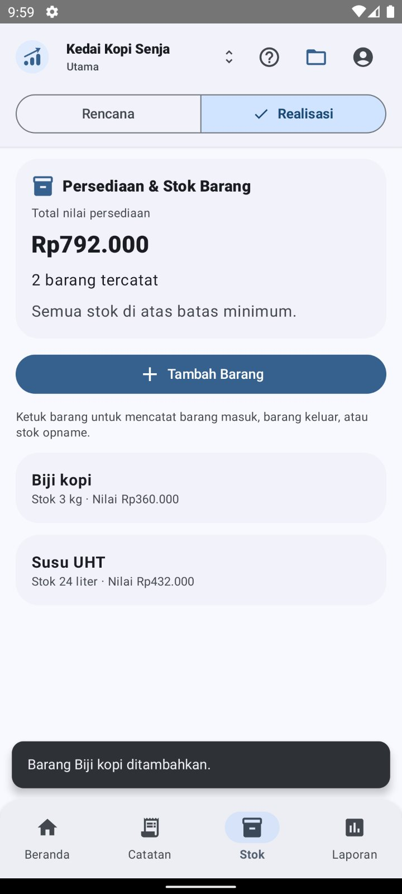

### 7.2 Barang masuk, keluar, dan opname

1. Ketuk barang di daftar.
2. Pilih **Masuk** (beli atau terima), **Keluar** (terpakai atau terjual), atau **Opname** (hasil
   hitung ulang di rak).
3. Isi jumlah dan catatan, lalu ketuk **Simpan**.

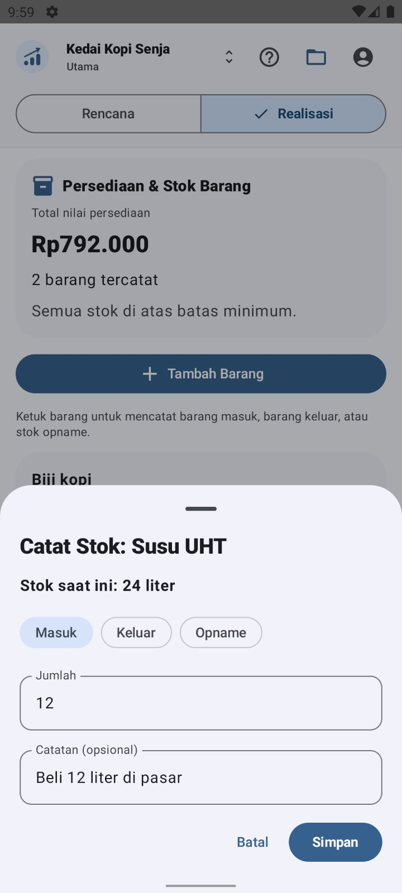

> **Perhatian.** Mutasi stok tidak mencatat uang. Belanja barang tetap dicatat sebagai
> **Pengeluaran** ([bagian 6.4](#64-mencatat-pengeluaran)).

---

## 8. Membaca Laporan

### 8.1 Beranda

Saat Realisasi terpilih, Beranda merangkum unit yang dipilih: **uang kas**, **untung atau rugi
kas**, **pendapatan**, dan **biaya operasional**.

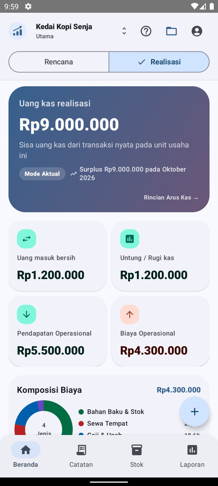

| Angka | Kedai Kopi Senja | Dari mana |
|---|---|---|
| Uang kas | Rp9.000.000 | Semua uang masuk dikurangi semua uang keluar, termasuk modal dan mesin |
| Pendapatan operasional | Rp5.500.000 | Kopi Rp4.600.000 + teh Rp900.000 |
| Biaya operasional | Rp4.300.000 | Bahan, sewa, gaji, listrik (tanpa mesin dan tanpa modal) |
| Untung/rugi kas | Rp1.200.000 | Pendapatan dikurangi biaya operasional |

### 8.2 Status BEP bulan ini

Gulir ke bawah di Beranda, atau buka **Laporan → Kelayakan & BEP**. Saat Realisasi terpilih, kartu
ini membandingkan penjualan bulan ini dengan titik impasnya.

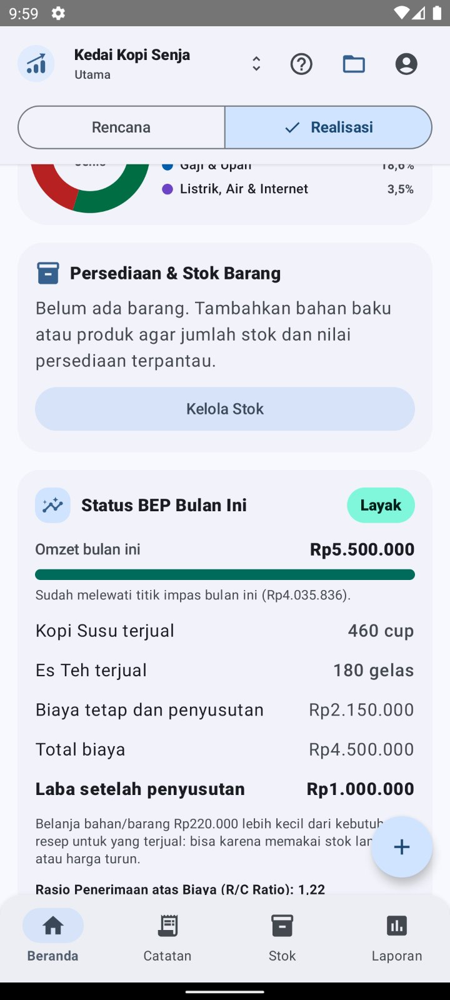

- **Omzet bulan ini** Rp5.500.000 sudah melewati titik impas bulan ini (Rp4.035.836).
- **Terjual per produk**: 460 cup kopi susu dan 180 gelas es teh.
- **Biaya tetap dan penyusutan** Rp2.150.000, **laba setelah penyusutan** Rp1.000.000.
- **Selisih resep**: belanja bahan Rp220.000 lebih kecil dari kebutuhan resep. Penyebabnya bisa
  karena memakai stok lama atau harga turun. Bila belanja lebih besar dari resep, periksa harga
  bahan, pemborosan, atau bahan yang masih tersisa sebagai stok.
- Bila belum ada penjualan bulan ini, statusnya **Belum Dapat Dinilai**.

### 8.3 Laba rugi dan arus kas

Buka **Laporan**, tab **Laba Rugi dan Arus Kas**.

- **Laporan Laba Rugi**: pendapatan operasional dikurangi biaya operasional.
- **Laporan Arus Kas** membagi uang menjadi tiga kelompok:
  - **Operasi**: jual beli harian (Rp1.200.000);
  - **Investasi**: beli alat (−Rp7.200.000);
  - **Pembiayaan**: setoran modal dan ambil pribadi (Rp15.000.000).
- **Saldo kas akhir** adalah jumlah ketiganya: Rp9.000.000.

Di bawahnya, **Pergerakan Kas Bulanan** menampilkan grafik kas per bulan.

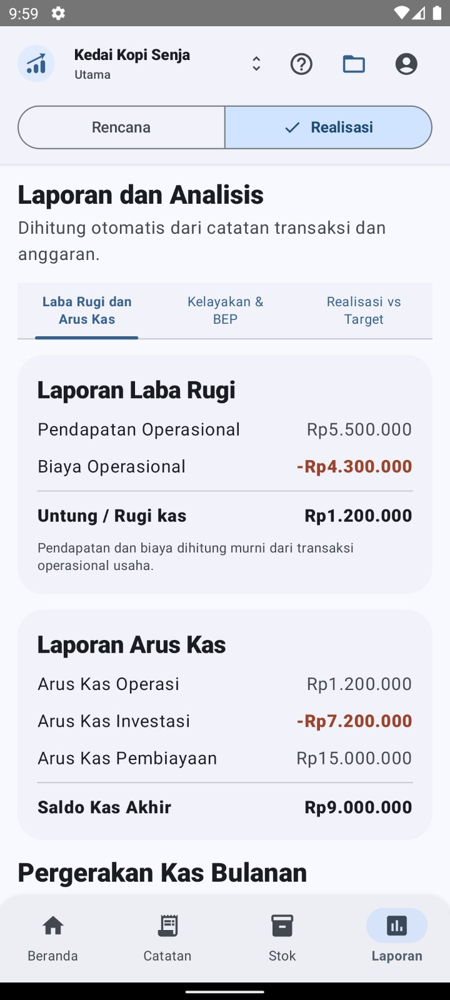

### 8.4 Kelayakan dan BEP

Tab **Kelayakan & BEP** menampilkan Status BEP bulan ini (di Realisasi) atau kelayakan rencana (di
Rencana), beserta rinciannya.

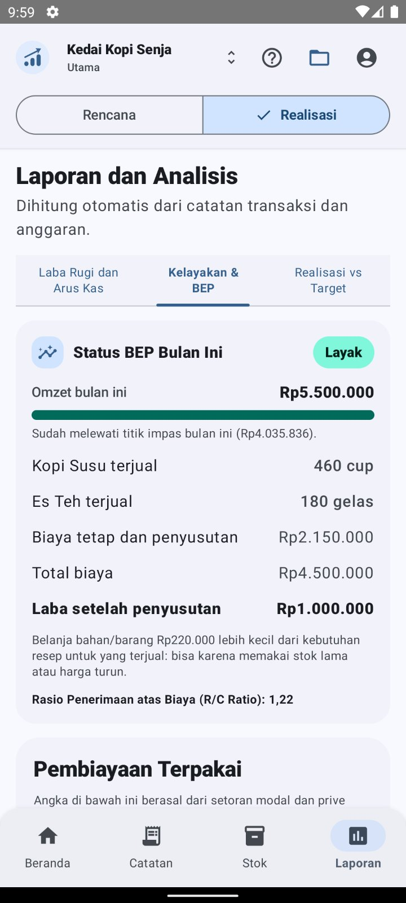

### 8.5 Realisasi vs Target

Tab ini membandingkan **rata-rata per bulan** dari rencana dengan rata-rata per bulan dari catatan
nyata.

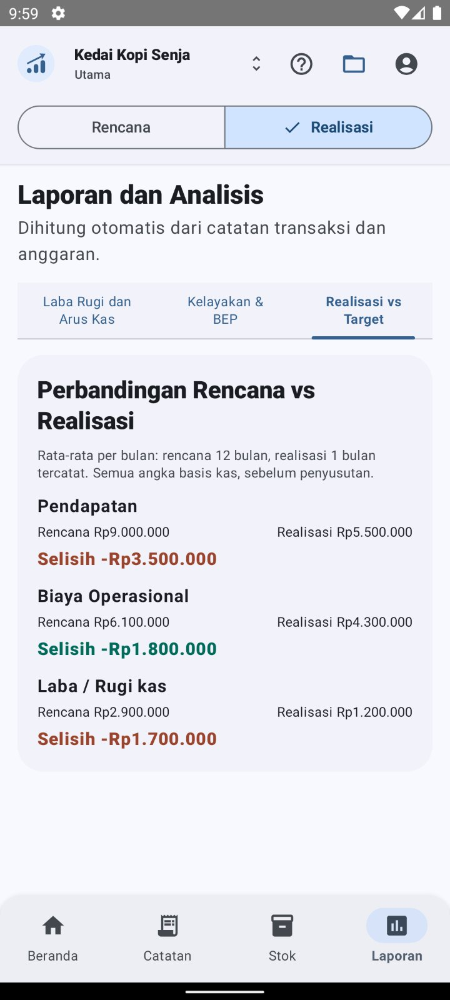

Pada contoh ini pendapatan baru Rp5.500.000 dari target Rp9.000.000 (selisih −Rp3.500.000). Biaya
operasional Rp1.800.000 di bawah rencana, sehingga ditandai hijau. Gunakan tab ini setiap akhir bulan
untuk melihat pos mana yang meleset.

---

## 9. Berkas dan Data: Impor, Ekspor, Cadangan

Ketuk **ikon map** di bagian atas untuk membuka **Berkas dan Data**.

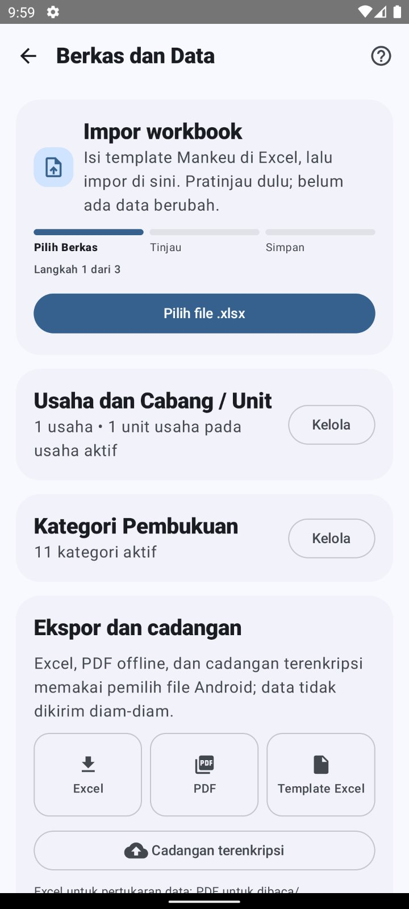

### 9.1 Ekspor Excel, PDF, dan template

Di **Ekspor dan cadangan**:

- **Excel**: seluruh data unit ini dalam format template Mankeu. Berkas ini bisa diimpor lagi tanpa
  kehilangan data, misalnya untuk dipindah ke unit atau HP lain.
- **PDF**: laporan yang siap dibaca, dibagikan, atau dicetak.
- **Template Excel**: berkas kosong berformat Mankeu, untuk diisi di Excel lalu diimpor ke
  aplikasi.

Nama berkas memuat nama unit dan tanggal, misalnya `mankeu-gerai-utama-2026-10-21.xlsx`.

### 9.2 Impor dari Excel

Impor berguna bila Anda sudah punya catatan di Excel, atau ingin mengetik banyak transaksi di
komputer.

1. Unduh **Template Excel** seperti pada bagian 9.1.
2. Isi template di Excel. Jangan ubah nama lembar atau judul kolom. Tulis tanggal dengan format
   `YYYY-MM-DD`, misalnya `2026-10-21`.
3. Kembali ke Berkas dan Data, pastikan unit tujuan sudah terpilih, lalu ketuk **Pilih file .xlsx**.
4. Periksa **pratinjau**: jumlah transaksi, item rencana, produk, barang, periode rencana, total uang
   masuk dan keluar, kategori baru, serta barang yang dilewati karena namanya sudah ada. Baris
   **Masuk ke** menyebut usaha dan unit tujuan; bila salah, tutup pratinjau dan pilih unit lain dulu.
5. Ketuk **Setujui dan impor**. Berkas besar (ribuan baris) butuh beberapa detik; biarkan aplikasi
   terbuka sampai muncul **Impor selesai**. Semua baris tersimpan sekaligus, atau tidak sama sekali.

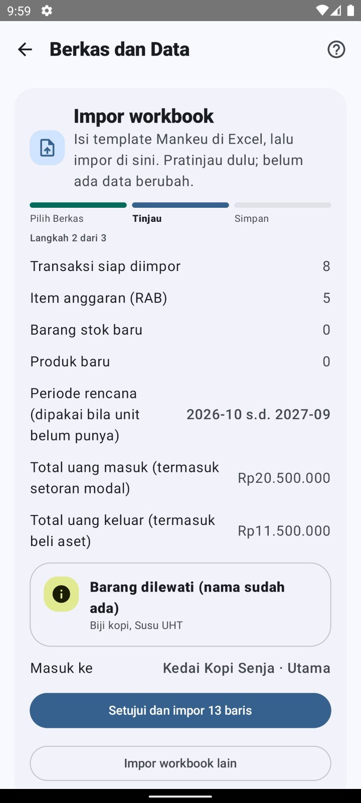

> **Perhatian.** Bila berkas yang sama diimpor dua kali, pratinjau memberi peringatan karena
> transaksi bisa tercatat dobel. Bila berkas ditolak, pesannya menyebut lembar dan sel yang salah,
> misalnya `Transaksi!A3`.

### 9.3 Membatalkan impor

Setiap impor tercatat di **Riwayat pengambilan**. Ketuk **Batalkan impor** pada berkas yang salah,
lalu konfirmasi. Semua transaksi yang ditambahkan impor itu dihapus, baris rencananya diarsipkan,
produk dan stok yang ditambahkan dihapus, dan periode rencana yang diisinya dikosongkan kembali.
Impor itu tetap tercantum di riwayat dengan status *dibatalkan*.

### 9.4 Cadangan terenkripsi

Cadangan menyimpan **seluruh** data di HP dalam satu berkas yang dikunci kata sandi.

1. Buka Berkas dan Data, lalu ketuk **Cadangan terenkripsi**.
2. Ketuk **Buat cadangan baru**, buat kata sandi minimal 8 karakter, lalu pilih tempat menyimpan.
3. Untuk menyimpan di Google Drive, masuk dulu dengan akun Google di Pengaturan, lalu pilih
   pencadangan Google Drive.

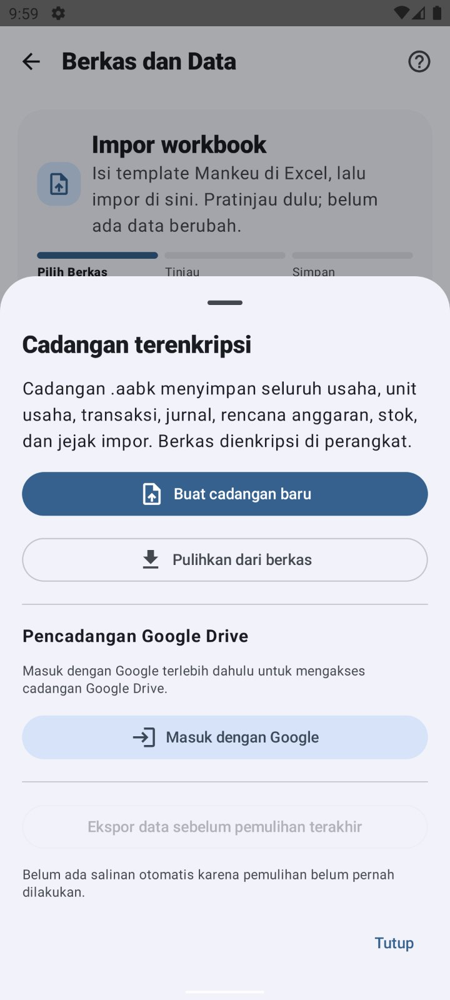

> **Perhatian.** Kata sandi cadangan **tidak disimpan** aplikasi dan **tidak bisa dipulihkan**.
> Catat di tempat yang aman, terpisah dari HP.

### 9.5 Pindah HP atau memulihkan data

1. Di HP lama, buat cadangan, lalu simpan berkasnya di Google Drive atau salin ke HP baru.
2. Di HP baru, buka **Berkas dan Data → Cadangan terenkripsi → Pulihkan dari berkas**.
3. Pilih berkas, masukkan kata sandi, periksa pratinjau, lalu konfirmasi.

Sebelum memulihkan, aplikasi otomatis menyalin data yang ada sekarang. Bila ternyata salah berkas,
data lama bisa dikembalikan lewat **Ekspor data sebelum pemulihan terakhir**.

### 9.6 Menghapus semua data

Untuk menyerahkan HP ke orang lain atau berhenti memakai Mankeu:

1. Buat cadangan dulu bila datanya masih ingin disimpan (bagian 9.4).
2. Buka **Pengaturan → Hapus semua data**, lalu ketuk **Hapus semua data…**.
3. Bila Anda masuk dengan Google, biarkan **Hapus juga semua cadangan Mankeu di Google Drive** tercentang
   agar cadangan di Drive dan akun masuk Mankeu ikut terhapus. Berkas lain di Drive Anda tidak tersentuh.
4. Ketik **HAPUS** dengan huruf besar, lalu ketuk **Hapus semua**.

Semua usaha, unit, catatan, rencana, stok, riwayat impor, dan salinan pemulihan otomatis hilang dan
tidak bisa dikembalikan, kecuali dari cadangan yang Anda buat sendiri. Tema dan bahasa tetap.

---

## 10. Bantuan di Dalam Aplikasi

### 10.1 Tombol ? di setiap halaman

Ketuk **?** di bagian atas. Lembar Bantuan berisi **Putar panduan halaman ini**, topik bantuan
untuk halaman tersebut, dan **Buka Pusat Bantuan**.

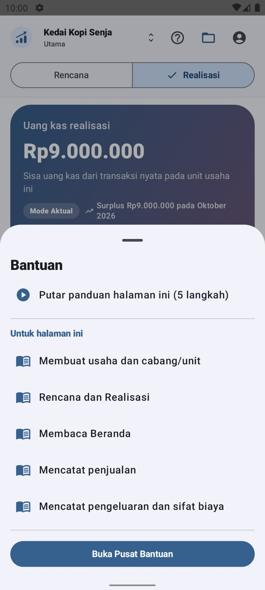

### 10.2 Pusat Bantuan

Pusat Bantuan berisi artikel *Cara …* dan *Kenapa …?*, dikelompokkan menurut tugas, dengan kolom
pencarian.

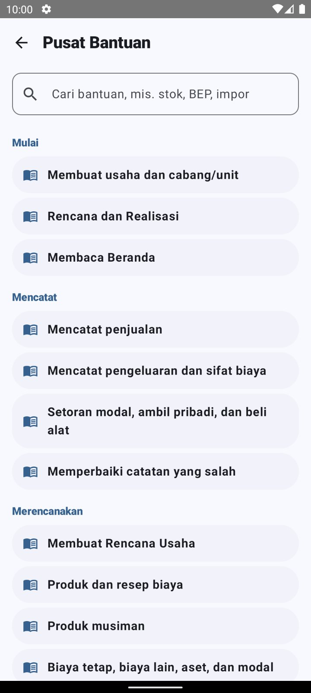

Setiap artikel berisi langkah bernomor, gambar layar, dan tombol **Tunjukkan di aplikasi**.

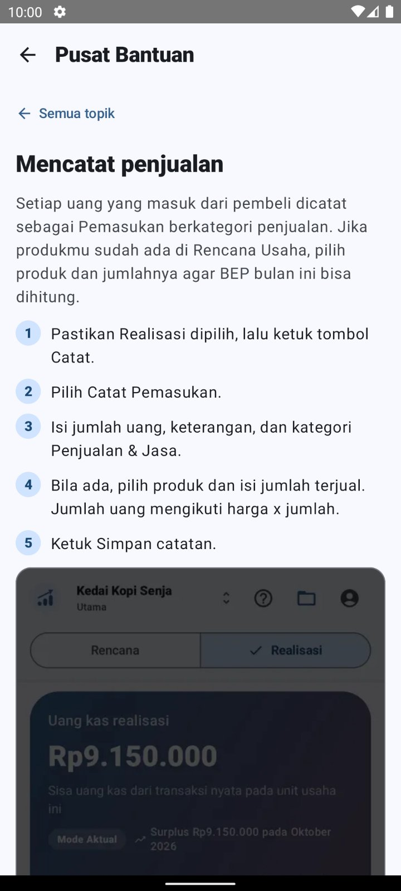

**Tunjukkan di aplikasi** membuka halaman yang dimaksud dan menyorot bagian yang perlu disentuh.
Ketuk **Mengerti** untuk menutup sorotan.

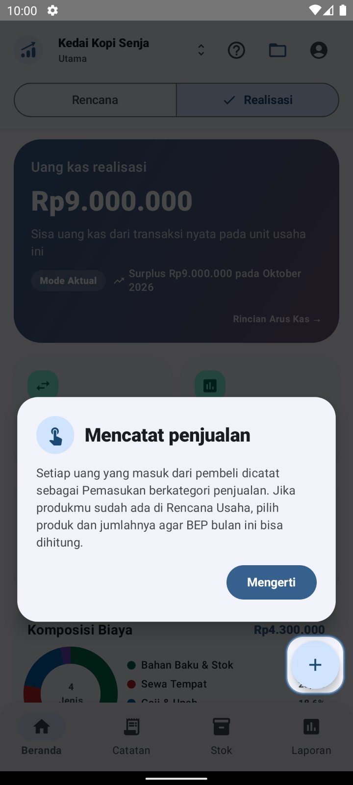

### 10.3 Panduan halaman

Saat aplikasi pertama dibuka, Beranda menampilkan kartu **Selamat datang**. Pilih **Lihat** untuk
mengikuti panduan langkah demi langkah, atau **Tutup**. Halaman lain tidak menampilkan tawaran;
panduan setiap halaman selalu ada lewat tombol **?** → **Putar panduan halaman ini**.

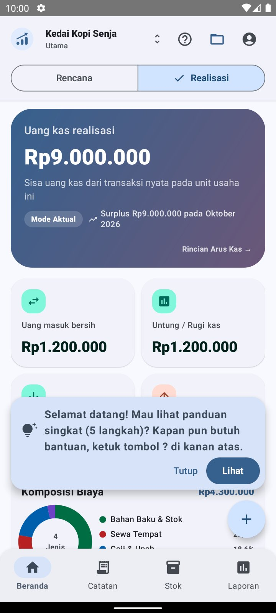

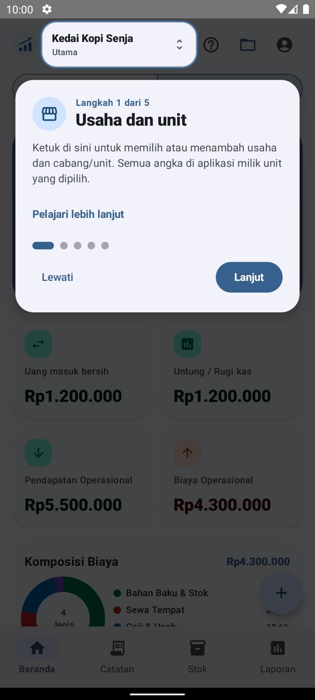

Di **Pengaturan → Panduan Aplikasi**, Anda bisa membuka Pusat Bantuan, menyalakan atau mematikan
sapaan panduan di Beranda, dan mengulang semua panduan dari awal.

---

## 11. Contoh Pemakaian Satu Bulan

Bu Sari membuka kedai kopi kecil di dekat kampus dengan modal Rp15.000.000. Berikut urutan kerjanya
dengan Mankeu di bulan pertama.

| Urutan | Yang dilakukan | Bagian |
|---|---|---|
| 1 | Membuat usaha *Kedai Kopi Senja* dan unit *Utama* | [3](#3-memulai-usaha-dan-unit) |
| 2 | Menyusun rencana 12 bulan: dua produk, tiga biaya tetap, mesin espresso, modal | [4](#4-menyusun-rencana-usaha) |
| 3 | Membaca kelayakan: layak, omzet impas Rp4.040.816, kebutuhan modal Rp4.300.000 sudah tertutup | [5](#5-membaca-kelayakan-bep-dan-kebutuhan-modal) |
| 4 | Mencatat modal awal Rp15.000.000 | [6.2](#62-mencatat-modal-awal) |
| 5 | Mencatat transaksi harian: jualan, bahan, mesin, sewa, gaji, listrik | [6](#6-mencatat-uang-masuk-dan-keluar) |
| 6 | Memperbaiki catatan listrik yang salah ketik dengan **Ubah** | [6.7](#67-melihat-dan-memperbaiki-catatan) |
| 7 | Mencatat stok susu dan biji kopi | [7](#7-mengelola-stok-barang) |
| 8 | Di akhir bulan, membaca Status BEP bulan ini dan Realisasi vs Target | [8](#8-membaca-laporan) |
| 9 | Membuat cadangan terenkripsi | [9.4](#94-cadangan-terenkripsi) |

**Catatan transaksi bulan ini:**

| Keterangan | Kategori | Masuk | Keluar |
|---|---|---:|---:|
| Modal awal | Setoran Modal Pemilik | 15.000.000 | |
| Jual kopi susu (460 cup) | Penjualan & Jasa | 4.600.000 | |
| Jual es teh (180 gelas) | Penjualan & Jasa | 900.000 | |
| Belanja susu, kopi, cup | Bahan Baku & Stok | | 2.350.000 |
| Mesin espresso (umur 36 bulan) | Beli Peralatan & Aset | | 7.200.000 |
| Sewa lapak | Sewa Tempat | | 1.000.000 |
| Gaji pembantu | Gaji & Upah | | 800.000 |
| Listrik bulan ini | Listrik, Air & Internet | | 150.000 |

**Hasil di aplikasi:**

- **Uang kas** Rp9.000.000 = 15.000.000 + 4.600.000 + 900.000 − 2.350.000 − 7.200.000 − 1.000.000 −
  800.000 − 150.000.
- **Untung/rugi kas** Rp1.200.000 = pendapatan Rp5.500.000 − biaya operasional Rp4.300.000.
- **Laba setelah penyusutan** Rp1.000.000. Mesin espresso tidak dihitung sebagai biaya bulan ini.
  Bebannya masuk sedikit demi sedikit sebagai penyusutan Rp200.000 per bulan.
- **Status BEP bulan ini**: sudah melewati titik impas.
- Catatan listrik sempat terketik Rp1.500.000. Bu Sari memperbaikinya lewat **Ubah** menjadi
  Rp150.000, sehingga semua angka di atas sudah memakai jumlah yang benar.

---

## 12. Pemecahan Masalah

| Masalah | Penyebab yang paling mungkin | Yang dilakukan |
|---|---|---|
| Uang kas minus padahal uangnya ada | Modal awal belum dicatat | Catat Pemasukan berkategori *Setoran Modal Pemilik* dengan tanggal sebelum transaksi pertama |
| BEP tidak muncul | Ada produk tanpa target per bulan, atau belum ada produk | Isi target per bulan di setiap produk |
| Tulisan margin di form produk merah | Harga jual di bawah biaya bahan | Naikkan harga, atau periksa resep termasuk isian "untuk berapa satuan" |
| Laba berbeda dengan uang kas | Modal, ambil pribadi, beli alat, dan penyusutan | Lihat Laporan → Arus Kas: selisihnya ada di Investasi dan Pembiayaan |
| Barang tidak tampil di cabang lain | Barang dibuat sebagai milik satu unit | Buka unit pembuatnya, atau tambahkan sebagai *Semua unit* |
| Berkas impor ditolak | Bukan template Mankeu, judul kolom diubah, atau format tanggal salah | Baca pesan sel yang salah dan perbaiki di Excel, atau ekspor template baru |
| Transaksi tercatat dobel setelah impor | Berkas yang sama diimpor dua kali | **Batalkan impor** pada impor kedua |
| Ada catatan yang salah jumlah atau tanggal | Salah ketik saat mencatat | **Ubah** di kartu catatannya ([bagian 6.7](#67-melihat-dan-memperbaiki-catatan)) |
| Status BEP bulan ini "Belum Dapat Dinilai" | Belum ada penjualan bulan ini | Catat penjualan bulan ini |
| Lupa kata sandi cadangan | Kata sandi tidak disimpan aplikasi | Cadangan itu tidak bisa dibuka. Buat cadangan baru dan catat kata sandinya |
| Aplikasi tidak ditemukan di Play Store | Mankeu masih di jalur uji internal | Minta undangan penguji kepada pengelola ([bagian 1](#1-memasang-mankeu)) |

Bila masih bingung, ketuk **?** di halaman tersebut, atau cari di **Pusat Bantuan**.

---

## 13. Lembar Periksa Rutin

### Setiap hari (5 menit)

- [ ] Catat semua penjualan hari ini, sebaiknya dengan produk dan volume.
- [ ] Catat semua pengeluaran hari ini.
- [ ] Pastikan buku yang terpilih adalah **Realisasi**.

### Setiap minggu (15 menit)

- [ ] Cocokkan uang kas di Beranda dengan uang di laci atau rekening.
- [ ] Perbaiki catatan yang salah dengan **Ubah**, hapus yang dobel.
- [ ] Catat barang masuk dan keluar di Stok, atau lakukan opname.

### Setiap akhir bulan (30 menit)

- [ ] Baca **Status BEP bulan ini**: sudah melewati titik impas atau belum?
- [ ] Baca **Realisasi vs Target**: pos mana yang meleset dari rencana?
- [ ] Perbarui Rencana Usaha bila harga bahan atau target berubah.
- [ ] Ekspor **PDF** untuk arsip.
- [ ] Buat **cadangan terenkripsi** dan simpan di tempat lain.

---

## 14. Daftar Istilah

| Istilah | Arti |
|---|---|
| **Aset** | Barang yang dipakai bertahun-tahun, misalnya mesin, etalase, dan pompa |
| **Arus kas** | Catatan uang yang benar-benar masuk dan keluar |
| **B/C Ratio** | Laba dibagi biaya. Di atas 0 berarti untung. |
| **BEP (titik impas)** | Penjualan minimum agar tidak rugi dan tidak untung |
| **Biaya tetap** | Biaya yang dibayar berapa pun penjualannya: sewa, gaji, listrik |
| **Biaya variabel** | Biaya yang mengikuti jumlah terjual: bahan baku, kemasan |
| **Kebutuhan modal** | Kekurangan kas terdalam sebelum ada setoran modal |
| **Margin kontribusi** | Harga jual dikurangi biaya variabel per satuan |
| **Opname** | Menghitung ulang barang di rak dan menyesuaikan catatan |
| **Penyusutan** | Harga aset dibagi umur pakainya, dihitung sebagai beban bulanan |
| **Prive** | Uang usaha yang diambil untuk keperluan pribadi |
| **Rencana** | Buku rencana usaha |
| **R/C Ratio** | Penerimaan dibagi biaya. Di atas 1 berarti untung. |
| **Realisasi** | Buku catatan kenyataan |
| **Resep biaya** | Biaya bahan untuk membuat satu satuan produk |
| **Setoran modal** | Uang pribadi yang dimasukkan ke usaha |
| **Unit** | Cabang, gerai, kebun, atau musim tanam di dalam satu usaha |

---

## Lampiran A. Usaha Tani Musiman

Contoh: **Tani Cabai Makmur**, unit **Kebun 1**. Cabai ditanam di bulan pertama dan baru dipanen
mulai bulan keempat. Selama tiga bulan pertama tidak ada penjualan, tetapi upah, pupuk, dan sewa
lahan tetap harus dibayar.

### Mengisi produk musiman

1. Di Rencana Usaha (Rencana → Catatan), ketuk **Tambah** di bagian **Produk**.
2. Isi *Cabai merah*, satuan *kg*, target *400* kg per bulan, harga *Rp35.000*.
3. Isi **Mulai dijual bulan ke-** dengan **4**.
4. Isi resep, misalnya *Panen dan angkut* Rp3.000 per kg, lalu ketuk **Simpan**.

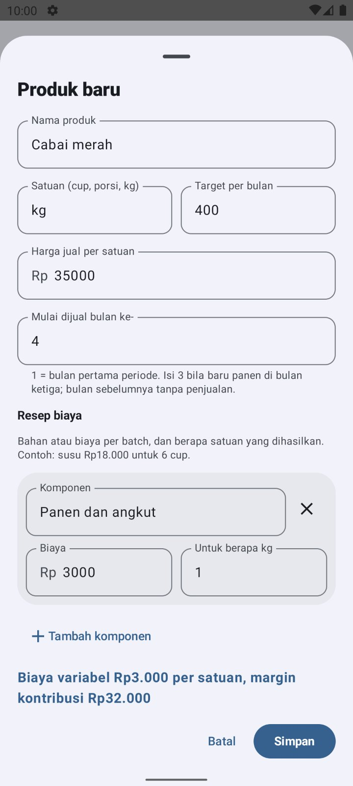

Di daftar produk, cabai ditandai **mulai bulan ke-4**.

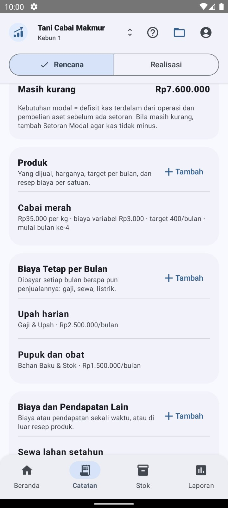

Biaya rencana kebun ini: upah harian Rp2.500.000 per bulan, pupuk dan obat Rp1.500.000 per bulan
(sifat Variabel), sewa lahan setahun Rp12.000.000 di bulan pertama, pompa dan sprayer Rp3.600.000
(umur 24 bulan), serta setoran modal Rp20.000.000.

> **Catatan.** Biaya yang berulang setiap bulan selalu tampil di bagian **Biaya Tetap per Bulan**,
> termasuk pupuk yang bersifat Variabel. Sifat Variabel-nya tetap dipakai dalam hitungan BEP.

### Membaca kelayakan usaha musiman

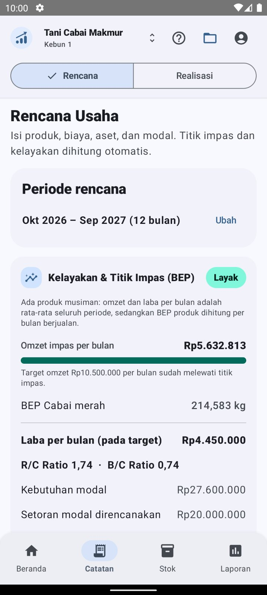

Bila ada produk musiman, kartu kelayakan memberi keterangan bahwa **omzet dan laba per bulan adalah
rata-rata seluruh periode**, sedangkan **BEP produk dihitung per bulan berjualan**.

| Baris | Tani Cabai Makmur | Artinya |
|---|---|---|
| BEP Cabai merah | 214,583 kg | Yang harus terjual di **setiap bulan panen** agar setahun tidak rugi |
| Omzet impas per bulan | Rp5.632.813 | Rata-rata per bulan selama 12 bulan |
| Laba per bulan (pada target) | Rp4.450.000 | Rata-rata per bulan selama 12 bulan |
| R/C Ratio | 1,74 | Layak |
| Kebutuhan modal | Rp27.600.000 | Termasuk tiga bulan menunggu panen |
| Masih kurang | Rp7.600.000 | Setoran Rp20.000.000 belum cukup |

> **Untuk yang ingin tahu.** Bila cabai diisi "mulai dijual bulan ke-1", kebutuhan modal hanya
> Rp6.800.000. Selisihnya, Rp20.800.000, adalah uang yang habis selama menunggu panen:
> bulan 1 kas turun Rp19.600.000 (upah, pupuk, sewa lahan setahun, pompa), lalu bulan 2 dan 3
> masing-masing Rp4.000.000 (upah dan pupuk), sebelum panen pertama di bulan 4.

---

## Lampiran B. Usaha dengan Beberapa Cabang

Contoh: **Toko Sembako Berkah** dengan dua unit, **Pusat** dan **Cabang 2**. Setiap cabang menyimpan
gula sendiri, sedangkan kantong plastik diambil dari gudang yang sama.

### Mengatur unit dan stok

1. Buat usaha *Toko Sembako Berkah* dengan unit *Pusat*, lalu tambahkan unit *Cabang 2*
   ([bagian 3](#3-memulai-usaha-dan-unit)).
2. Pilih unit **Pusat**. Di **Stok**, tambahkan *Gula* dengan pilihan **Unit Pusat**.
3. Tambahkan *Kantong plastik* dengan pilihan **Semua unit**.

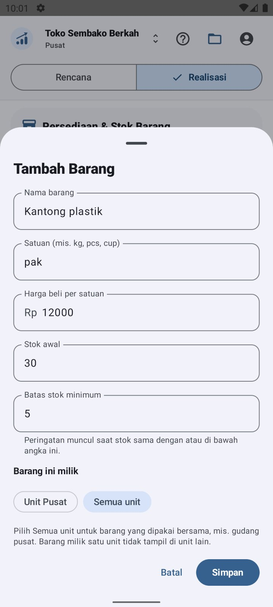

Di unit Pusat tampil kedua barang. Kantong plastik diberi keterangan *dipakai semua unit*.

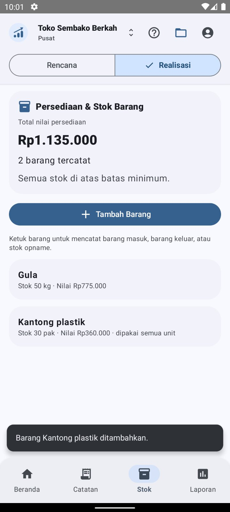

Di unit Cabang 2 hanya tampil kantong plastik. Gula milik Pusat tidak ikut tampil, sehingga stok
setiap cabang tidak tercampur.

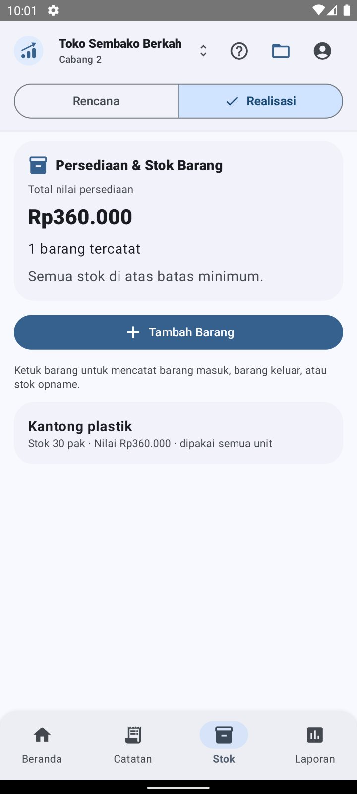

> **Tips.** Cabang 2 bisa menambahkan *Gula* miliknya sendiri dengan nama yang sama. Barang bersama
> tidak boleh bernama sama dengan barang milik unit, agar tidak tertukar.

> **Tips.** Saat mengimpor dari Excel, barang di lembar *Stok Barang* masuk sebagai barang milik
> unit yang sedang dipilih.

---

*Gambar layar dalam panduan ini diambil otomatis dari aplikasi dengan data contoh fiktif. Untuk
memperbaruinya setelah tampilan aplikasi berubah, jalankan `scripts/capture_module_screenshots.ps1`
dengan emulator Android menyala. Setelah mengubah naskah, jalankan
`python scripts/check_guide_flow.py docs/panduan/PANDUAN_PENGGUNAAN_MANKEU.md` untuk memastikan tidak
ada rujukan ke bagian yang belum dibaca, dan semua gambar serta tautan masih lengkap.*
